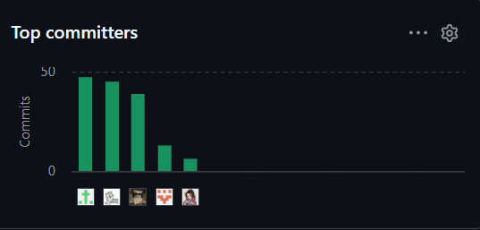
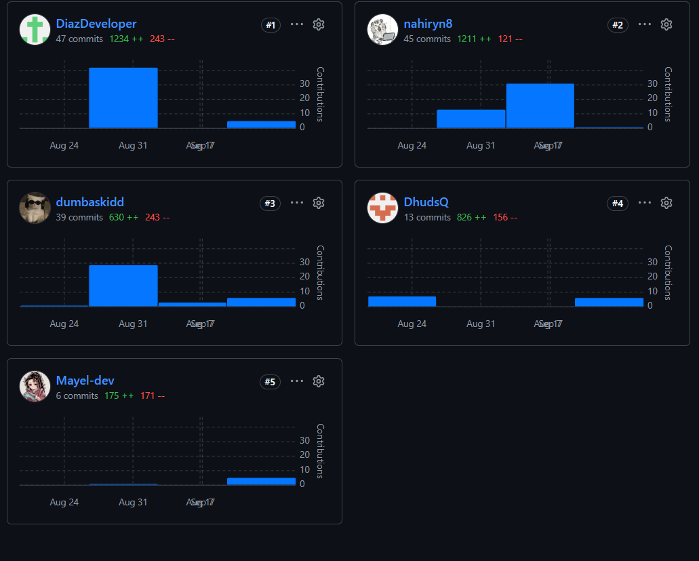
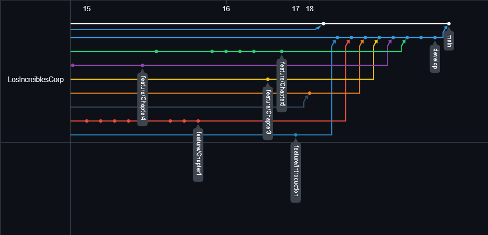
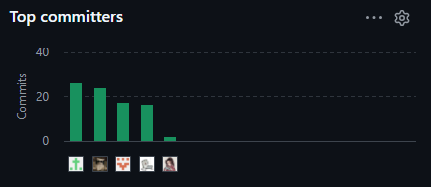

# Project Report Collaboration Insights

Link de los repositorios de la organización: https://github.com/LosIncreiblesCorp

Link del repositorio-Informe: https://github.com/LosIncreiblesCorp/losIncreibles-project-report

## Reporte de colaboración de la entrega del AV1

Durante la primera fase de elaboración del informe, el equipo LosIncreibles centró sus esfuerzos en la construcción de los fundamentos conceptuales, de investigación, especificación y diseño inicial de InstAlert. Cada integrante asumió un rol activo en la redacción, modelado y documentación de los capítulos del reporte, manteniendo una organización basada en ramas de trabajo y revisiones antes de integrar los cambios.

A partir del historial de commits del repositorio, se observa la participación de los cinco integrantes en las distintas etapas del informe. Las responsabilidades principales de la entrega AV1 fueron las siguientes:

* **Jose Asto:** creó la estructura inicial del Project Report, organizó la gestión de archivos y ramas, participó en la configuración del flujo GitFlow, integró las ramas de los capítulos en `develop` y desarrolló los diagramas de clases y de base de datos.

* **Víctor Díaz:** desarrolló gran parte de la configuración del entorno de desarrollo y del Source Code Management, documentó herramientas y servicios, organizó la planificación y las evidencias del Sprint 1, y realizó revisiones y actualizaciones del Capítulo V.

* **Yngrid Ruiz:** trabajó en Requirements Elicitation y Product Design, incluyendo competidores, entrevistas, Needfinding, User Personas, User Journey Mapping, Empathy Mapping, Style Guidelines, UX/UI, wireframes, prototipos, EventStorming y arquitectura C4.

* **Jean Noriega:** desarrolló el Startup Profile y partes principales del Capítulo I, incluyendo antecedentes, problemática, Lean UX y segmentos objetivo. También elaboró y reorganizó las User Stories, el Impact Mapping y el Product Backlog del Capítulo III.

* **Ismael Simon:** colaboró en el registro y análisis de entrevistas, actualizó la configuración de despliegue y los repositorios del proyecto, participó en la revisión de la documentación y completó el Student Outcome correspondiente a la entrega AV1.

Estas responsabilidades representan la distribución principal observada en el historial de commits; no excluyen las revisiones, apoyos y aportes colaborativos realizados por los demás integrantes durante la consolidación del informe.

Finalmente, estas capturas representan la cantidad de commits realizados por cada miembro en el repositorio del Project Report. En la vista de GitHub se identifican Víctor Díaz (`DiazDeveloper`) con 47 commits, Yngrid Ruiz (`nahiryn8`) con 45, Jean Noriega (`dumbaskidd`) con 39, Jose Asto (`DhudsQ`) con 13 e Ismael Simon (`Mayel-dev`) con 6. Cada barra representa a un integrante del equipo y su altura indica el número de commits registrados durante la elaboración del informe.

### Gráficos de colaboración de AV1

*Figura: Principales colaboradores y cantidad de commits registrados por GitHub durante AV1.*

*Figura: Detalle de commits, adiciones y eliminaciones por integrante durante AV1.*

## Ramificación del proyecto usando GitFlow

Durante la elaboración del informe se trabajó con una rama principal de integración y ramas `feature` asociadas a cada capítulo. Se utilizaron `feature/Introduction`, `feature/Chapter1`, `feature/Chapter2`, `feature/Chapter3`, `feature/Chapter4` y `feature/Chapter5` para desarrollar los contenidos de forma independiente. Posteriormente, estas ramas fueron integradas en `develop`, donde se consolidó la versión correspondiente al avance AV1.

El registro de versiones del informe representa esta evolución desde `0.0.1`, correspondiente a la inicialización del repositorio, hasta `1.0.0`, propuesta como versión consolidada de AV1. La versión `1.0.0` quedará formalmente publicada cuando el contenido final sea enviado a `main`.

Este gráfico muestra la evolución de las ramas, los puntos de integración y la relación entre los avances documentales y las versiones del Project Report. Durante AV1 se trabajó en ramas independientes por capítulo y posteriormente se integraron los cambios en `develop`, antes de consolidar el contenido en `main`.

### Ramificación GitFlow de AV1

*Figura: Ramificación del proyecto usando GitFlow durante la elaboración del Project Report de AV1.*

## Reporte de colaboración de la entrega del TB1

Durante la elaboración del informe para TB1, el equipo actualizó los capítulos y consolidó la documentación de la Web Application y del Sprint 2. De acuerdo con el historial de commits, los principales aportes documentales de esta etapa fueron los siguientes:

- **Jose Asto:** revisó y amplió contenidos de Lean UX, segmentos objetivo, lenguaje ubicuo, User Stories y Product Backlog. También actualizó los diagramas de arquitectura y clases del Capítulo IV, organizó rutas de imágenes y consolidó la planificación y las evidencias del Sprint 2.
- **Víctor Díaz:** incorporó evidencia de ejecución para la revisión del Sprint 2 y optimizó el tamaño de imágenes incluidas en el Capítulo V.
- **Yngrid Ruiz:** actualizó los registros de entrevistas y el análisis cualitativo de segmentos, además de revisar los diagramas de User Flow y Wireflow.
- **Jean Noriega:** alineó la estructura de los capítulos con la rúbrica, revisó la terminología en español y amplió los resúmenes de entrevistas con información sobre dispositivos y sistemas utilizados.
- **Ismael Simon:** actualizó los anexos con los enlaces de despliegue y de repositorios correspondientes a TB1.

Estas tareas resumen los cambios identificables en el historial del repositorio; no excluyen la colaboración y revisión compartida durante la integración del informe. La captura de GitHub Insights muestra la distribución relativa de los commits registrados por los cinco integrantes durante esta entrega.

### Gráfico de colaboración de TB1

*Figura: Principales colaboradores y cantidad relativa de commits registrados por GitHub durante TB1.*

