# Capítulo V: Product Implementation, Validation & Deployment

## 5.1. Software Configuration Management.

La Gestión de Configuración de Software (SCM) es una disciplina del desarrollo de software que permite identificar, controlar y realizar un seguimiento de los diferentes componentes de un sistema durante todo su ciclo de vida. Su aplicación facilita la organización y administración de los cambios realizados en el código, documentos y demás elementos del proyecto, contribuyendo a un proceso de desarrollo más ordenado y eficiente. De esta manera, busca optimizar el trabajo del equipo y reducir la posibilidad de errores (Martin, 2023).

### 5.1.1. Software Development Environment Configuration.

A continuación se listan los productos de software utilizados por el equipo, organizados por tipo de actividad del ciclo de vida. Para cada herramienta se indica su propósito y la ruta de referencia o descarga.

**1. Gestión de Proyectos**

_Descripción:_

La gestión de proyectos es un aspecto esencial en el desarrollo de software, ya que permite organizar y estructurar las actividades necesarias para alcanzar los objetivos de un proyecto. Las herramientas de gestión facilitan la planificación, asignación y seguimiento de tareas, además de favorecer la comunicación y colaboración entre los integrantes del equipo.

Jira (SaaS):

Jira es una plataforma de gestión de proyectos utilizada principalmente en el desarrollo de software y en equipos que trabajan con metodologías ágiles como Scrum y Kanban. La herramienta permite organizar Sprints, supervisar el progreso de las tareas y generar informes sobre el rendimiento del equipo, contribuyendo a una mejor planificación y gestión del trabajo.

https://www.atlassian.com/es/software/jira

<p align="center">
  
</p>

Discord:

Discord es una plataforma de comunicación que permite mantener reuniones y conversaciones en tiempo real mediante canales de texto y voz. En el desarrollo del proyecto, puede utilizarse como medio de comunicación sincrónica para coordinar actividades, realizar reuniones diarias y mantener una comunicación constante entre los integrantes del equipo.

https://discord.com/

<p align="center">
  
</p>

Google Meet:

Google Meet es una herramienta de videoconferencias que permite realizar reuniones virtuales mediante llamadas de audio y video. En el proyecto, se utiliza para llevar a cabo reuniones formales con el equipo, como revisiones de Sprint, coordinaciones y otras actividades que requieren comunicación directa.

https://meet.google.com/

<p align="center">
  
</p>

**2. Gestión de Requisitos**

UXPressia:

UXPressia es una plataforma utilizada para representar y organizar información relacionada con los usuarios y sus experiencias. En el proyecto se empleará para elaborar Personas Usuarias, Mapas de Empatía, Mapas de Viaje del Cliente y Mapas de Impacto, facilitando la identificación de necesidades y comportamientos de los usuarios.

https://uxpressia.com/

<p align="center">
  
</p>

Miro:

Miro es una plataforma colaborativa utilizada para organizar y representar visualmente diferentes elementos del proyecto. En este caso, será utilizada para la elaboración de diagramas de Event Storming y para facilitar el trabajo colaborativo del equipo.

https://miro.com/

<p align="center">
  
</p>

**3. Diseño UX/UI del Producto**

Figma:

Figma es una herramienta de diseño colaborativo en la nube que permite crear interfaces, prototipos y diseños interactivos. Su funcionamiento en línea facilita que los integrantes de un equipo puedan editar, revisar y comentar los diseños en tiempo real, incluso trabajando desde diferentes lugares. Además, resulta especialmente útil en metodologías ágiles, donde las actividades de diseño y desarrollo se realizan de manera paralela.

https://www.figma.com/es-la/

<p align="center">
  
</p>

Lucidchart:

Lucidchart es una plataforma de diagramación utilizada para elaborar Flujos Visuales y Flujos de Usuario, además de diagramas UML y Diseño de Base de Datos, permitiendo representar visualmente diferentes aspectos del diseño y estructura del sistema.

https://www.lucidchart.com/

<p align="center">
  
</p>

**4. Desarrollo de Software**

Visual Studio Code:

Visual Studio Code es un editor de código utilizado como herramienta principal para el desarrollo de la Página de Aterrizaje y de la Aplicación Web. Permite trabajar con tecnologías como HTML5, CSS3, JavaScript y Vue.js.

https://code.visualstudio.com/

<p align="center">
  
</p>

Vue.js:

Vue.js es un framework de JavaScript utilizado para el desarrollo del frontend de la Aplicación Web. Permite construir interfaces de usuario dinámicas y componentes reutilizables.

https://vuejs.org/

<p align="center">
  
</p>

PrimeVue:

PrimeVue es una biblioteca de componentes de interfaz de usuario para Vue.js. Será utilizada para implementar componentes visuales y funcionales en la Aplicación Web.

https://primevue.org/

<p align="center">
  
</p>

HTML5 / CSS3 / JavaScript:

HTML5, CSS3 y JavaScript serán utilizados como tecnologías principales para el desarrollo de la Página de Aterrizaje. Asimismo, HTML5 y CSS3 se emplearán en la construcción de plantillas de la Aplicación Web, mientras que JavaScript será utilizado como lenguaje de programación del frontend.

<p align="center">
  
</p>

ASP.NET Core:

ASP.NET Core es el framework utilizado para el desarrollo de los Servicios Web bajo el estilo arquitectónico RESTful API. Permitirá implementar la lógica del backend y los servicios necesarios para la comunicación con el frontend.

https://dotnet.microsoft.com/apps/aspnet

<p align="center">
  
</p>

Entity Framework Core:

Entity Framework Core es un ORM para .NET utilizado para facilitar la interacción entre los Servicios Web desarrollados con ASP.NET Core y la base de datos relacional.

https://learn.microsoft.com/ef/core/

<p align="center">
  
</p>

C#:

C# es el lenguaje de programación utilizado para el desarrollo de los Servicios Web mediante ASP.NET Core y Entity Framework Core.

https://dotnet.microsoft.com/languages/csharp

<p align="center">
  
</p>

MySQL Server:

MySQL Server será utilizado como sistema de gestión de bases de datos relacional (RDBMS), permitiendo almacenar y administrar la información utilizada por la aplicación.

https://www.mysql.com/

<p align="center">
  
</p>

Structurizr:

Structurizr será utilizado para la elaboración de los diagramas de Arquitectura de Software mediante el modelo C4, permitiendo representar la estructura y arquitectura del sistema.

https://structurizr.com/

<p align="center">
  
</p>

Lucidchart:

Lucidchart será utilizado para la elaboración de diagramas UML y para el Diseño de Base de Datos, permitiendo representar la estructura, relaciones y componentes de la solución.

https://www.lucidchart.com/

<p align="center">
  
</p>

Git:

Git es un sistema de control de versiones distribuido utilizado para gestionar los cambios realizados en el código fuente de manera local. Permite crear ramas, registrar modificaciones y mantener un historial de versiones del proyecto.

https://git-scm.com/

<p align="center">
  
</p>

GitHub:

GitHub es una plataforma de desarrollo colaborativo basada en Git que permite alojar repositorios, gestionar versiones del código y facilitar el trabajo colaborativo entre los integrantes del equipo mediante ramas, confirmaciones y solicitudes de extracción.

https://github.com/

<p align="center">
  
</p>

**5. Despliegue de Software**

GitHub Pages:

GitHub Pages será utilizado como servicio de hosting para realizar el despliegue de la Página de Aterrizaje estática y de la Aplicación Web (frontend).

https://pages.github.com/

<p align="center">
  
</p>

Proveedor de hosting en la nube para ASP.NET Core:

Se utilizará un proveedor de hosting en la nube para realizar el despliegue de los Servicios Web desarrollados con ASP.NET Core. El proveedor definitivo será determinado de acuerdo con las necesidades del proyecto.

<p align="center">
  
</p>

**6. Documentación de Software**

Swagger / OpenAPI:

Swagger será utilizado para documentar los Servicios Web mediante la especificación OpenAPI, permitiendo visualizar e interactuar con los puntos de enlace disponibles en la RESTful API.

https://swagger.io/

<p align="center">
  
</p>

Markdown + Visual Studio Code:

Markdown será utilizado para la elaboración y estructuración de la documentación del proyecto dentro del repositorio. Visual Studio Code permitirá editar los archivos Markdown y utilizar extensiones para facilitar su visualización y generación en diferentes formatos.

<p align="center">
  
</p>

### 5.1.2. Source Code Management.

La administración del código fuente es un pilar esencial para el trabajo colaborativo en el desarrollo de InstAlert. En este apartado se define el modelo de organización y control de versiones utilizado por el equipo mediante GitHub y el flujo de trabajo GitFlow. Esta configuración permite mantener el código fuente y la documentación estructurados, trazables y organizados durante el ciclo de vida del proyecto.

Asimismo, se establecen las convenciones utilizadas para la creación de ramas, la escritura de mensajes de confirmación y la gestión de versiones mediante Semantic Versioning.

**1. Establecimiento de repositorios en GitHub**

Para organizar los distintos componentes de la solución, el proyecto InstAlert se encuentra distribuido en cuatro repositorios públicos dentro de la organización LosIncreiblesCorp. Cada repositorio posee una responsabilidad específica dentro de la solución.

_Página de Aterrizaje:_
Repositorio destinado al sitio web promocional e informativo de InstAlert. Contiene la estructura HTML, hojas de estilo CSS, scripts JavaScript y recursos multimedia utilizados para presentar la propuesta de valor, funcionalidades, planes y equipo del producto.

_Frontend Aplicación Web:_
Repositorio destinado a la aplicación web del lado del cliente. Contiene la estructura, componentes, vistas y lógica de interacción de la Aplicación Web, además del consumo de los servicios proporcionados por la RESTful API.

_Servicios Web:_
Repositorio destinado al Backend de InstAlert. Contiene la lógica de negocio, acceso a datos y servicios RESTful desarrollados con ASP.NET Core y Entity Framework Core. Asimismo, incluye los recursos necesarios para las pruebas automatizadas y la documentación de los puntos de enlace mediante OpenAPI/Swagger.

_Informe del Proyecto:_
Repositorio destinado a la documentación académica y técnica del proyecto. Contiene el informe desarrollado colaborativamente en Markdown, junto con los recursos gráficos, diagramas y evidencias correspondientes a cada capítulo.

**Enlaces a los repositorios:**

- Repositorio de Página de Aterrizaje: https://github.com/LosIncreiblesCorp/InstAlert-LandingPage
- Repositorio de Frontend Aplicación Web: https://github.com/LosIncreiblesCorp/Instalert-FrontEnd
- Repositorio de Servicios Web: https://github.com/LosIncreiblesCorp/Instalert-BackEnd
- Repositorio del Informe del Proyecto: https://github.com/LosIncreiblesCorp/losIncreibles-project-report

**2. Flujo de trabajo de control de versiones (GitFlow)**

Para gestionar la integración de nuevas características y coordinar el trabajo colaborativo, el equipo utiliza GitFlow. Este flujo de trabajo permite desarrollar funcionalidades de manera aislada mediante ramas específicas y posteriormente integrarlas de forma controlada a las ramas principales del proyecto.

_Estructura de ramas principales y de soporte:_

| Nombre de la rama                           | Descripción                                                                                                                                                                                                                                 |
| ------------------------------------------- | ------------------------------------------------------------------------------------------------------------------------------------------------------------------------------------------------------------------------------------------- |
| **Rama Principal** (`main`)                 | Representa el estado estable y listo para producción del proyecto. Recibe únicamente cambios previamente integrados, revisados y validados.                                                                                                 |
| **Rama de Desarrollo** (`develop`)          | Funciona como la rama principal de integración. Las nuevas funcionalidades se incorporan aquí antes de preparar una nueva versión del producto.                                                                                             |
| **Ramas de Características** (`feature/*`)  | Ramas temporales creadas a partir de `develop` para implementar funcionalidades o tareas específicas de manera independiente. <br> **Convención:** `feature/nombre-de-la-tarea`                                                             |
| **Ramas de Lanzamiento** (`release/*`)      | Ramas utilizadas para preparar una nueva versión del producto. Permiten realizar validaciones finales y correcciones menores antes de integrar los cambios en `main`. <br> **Convención:** `release/vX.Y.Z`                                 |
| **Ramas de Corrección Rápida** (`hotfix/*`) | Ramas creadas a partir de `main` para resolver errores críticos detectados en una versión publicada. Posteriormente, los cambios deben incorporarse tanto en `main` como en `develop`. <br> **Convención:** `hotfix/descripcion-del-parche` |

**3. Versionado Semántico (Semantic Versioning 2.0.0)**

Para identificar y rastrear las versiones publicadas de InstAlert, el equipo utiliza Semantic Versioning (SemVer). Este estándar emplea el formato `MAJOR.MINOR.PATCH`.

- **MAJOR:** Se incrementa cuando se introducen cambios incompatibles con versiones anteriores.
- **MINOR:** Se incrementa cuando se incorporan nuevas funcionalidades compatibles con la versión actual.
- **PATCH:** Se incrementa cuando se realizan correcciones de errores o mejoras menores que no modifican la compatibilidad del producto.

Ejemplos:

- `v1.0.0`: Primera versión estable del producto.
- `v1.1.0`: Incorporación de nuevas funcionalidades manteniendo compatibilidad.
- `v1.1.1`: Corrección de errores de una versión existente.

**4. Convenciones de Mensajes de Confirmación (Conventional Commits)**

Los mensajes de confirmación siguen la especificación Conventional Commits con el objetivo de mantener un historial de cambios consistente, comprensible y fácilmente auditable.

La estructura utilizada es:

`type(scope): description`

Los principales tipos utilizados por el equipo son:

- `feat`: Incorporación de una nueva funcionalidad.
  Ejemplo: `feat(alerts): add panic alert creation`

- `fix`: Corrección de un error o comportamiento inesperado.
  Ejemplo: `fix(auth): resolve login validation issue`

- `docs`: Cambios realizados exclusivamente en documentación.
  Ejemplo: `docs(chapter5): update source code management`

- `style`: Cambios de formato o presentación que no modifican la lógica del sistema.
  Ejemplo: `style(landing): improve responsive team layout`

- `refactor`: Reestructuración de código existente sin modificar su comportamiento externo.
  Ejemplo: `refactor(alerts): simplify alert processing logic`

- `test`: Incorporación o modificación de pruebas automatizadas.
  Ejemplo: `test(auth): add authentication unit tests`

- `chore`: Cambios de configuración, mantenimiento o tareas auxiliares que no afectan directamente una funcionalidad del producto.
  Ejemplo: `chore(repo): update project configuration`

### 5.1.3. Source Code Style Guide & Conventions.

En esta sección, el equipo define las normativas y directrices de codificación que se aplicarán a lo largo del desarrollo de la solución. El objetivo principal es estandarizar la escritura del código en HTML, CSS, JavaScript y C#, asegurando que sea legible, mantenible y escalable.

Como regla transversal, **toda la nomenclatura (variables, métodos, clases, comentarios, etc.) se redactará exclusivamente en inglés**. Para establecer estas bases, nos alinearemos con las siguientes guías de la industria:

- Guía de Estilo y Convenciones de Codificación de HTML
- Guía de Estilo HTML/CSS de Google
- Guía de Estilo de JavaScript de Google
- Directrices de JavaScript de MDN
- Guía de Estilo de JavaScript de W3C
- Convenciones de Codificación de C#
- Directrices de Codificación de ASP.NET Core de Microsoft

La estructuración e implementación del sistema, desde la Página de Aterrizaje hasta los Servicios Web y el Frontend de la aplicación, seguirán reglas estrictas para cada tecnología involucrada.

**Principios Transversales**

- **Idioma:** Todo el nombrado de elementos técnicos y documentación interna debe estar en inglés.
- **DRY (Don't Repeat Yourself):** Evitar la duplicidad de código mediante la creación de componentes y métodos reutilizables.
- **KISS (Keep It Simple, Stupid):** Priorizar la simplicidad y claridad en la lógica de programación.
- **Indentación:** Mantener una indentación estricta y coherente según el lenguaje utilizado.

---

**HTML**

Se utilizará HTML5 para definir la estructura semántica de las interfaces (Página de Aterrizaje y vistas de la aplicación web).

_Convenciones de Formato y Estructura:_

- **Indentación:** 2 espacios por nivel. No utilizar tabulaciones.
- **Etiquetas y atributos:** Escribir siempre en minúsculas (ej. `<section>`, `<article>`).
- **Comillas:** Usar comillas dobles para los valores de los atributos (ej. `class="container"`).
- **Cierre de etiquetas:** Todas las etiquetas deben cerrarse adecuadamente. Las etiquetas vacías no requieren barra diagonal en HTML5 (ej. usar `<br>` en lugar de `<br />`).
- **Semántica:** Priorizar etiquetas semánticas (`<header>`, `<nav>`, `<main>`, `<footer>`) sobre el uso excesivo de `<div>`.
- **Accesibilidad:** Incluir siempre el atributo `alt` en las imágenes y usar atributos ARIA cuando sea necesario para tecnologías de asistencia.
- **Documento base:** Declarar siempre `<!DOCTYPE html>` en la primera línea y especificar el idioma principal `<html lang="en">`.

<p align="center">
  
</p>

---

**CSS**

Se utilizará para controlar la presentación visual, priorizando un diseño modular y responsivo (Mobile-First).

_Convenciones de Formato y Arquitectura:_

- **Indentación:** 2 espacios por nivel.
- **Sintaxis:** Dejar un espacio antes de la llave de apertura `{` y colocar la llave de cierre `}` en una nueva línea. Escribir cada declaración en su propia línea, terminando con punto y coma `;`.
- **Nomenclatura:** Adoptar la metodología BEM (Block, Element, Modifier) para las clases, utilizando guiones bajos dobles para elementos y guiones medios dobles para modificadores (ej. `.card`, `.card__title`, `.card--highlighted`).
- **Orden de propiedades:** Agrupar propiedades lógicamente: Posicionamiento, Modelo de caja (Box model), Tipografía, Aspecto visual (Colores, fondos) y Animaciones.
- **Especificidad y Anidamiento:** Evitar anidar selectores más de 3 niveles de profundidad. Restringir estrictamente el uso de `!important`.
- **Variables:** Utilizar Custom Properties (variables CSS) en la raíz (`:root`) para colores de la marca, tipografías y espaciados estandarizados.

<p align="center">
  
</p>

---

**JavaScript**

Se aplicará para la interactividad del lado del cliente y el consumo de APIs, priorizando los estándares modernos de ECMAScript (ES6+).

_Convenciones de Formato y Nomenclatura:_

- **Indentación:** 2 espacios.
- **Sintaxis:** Requerir el uso de punto y coma `;` al final de cada instrucción para evitar problemas de ASI (Automatic Semicolon Insertion). Usar comillas simples para strings (`'texto'`).
- **Nomenclatura:**
  - Variables y funciones: `camelCase` (ej. `fetchUserData`).
  - Clases y Componentes: `PascalCase` (ej. `UserProfile`).
  - Constantes globales: `UPPER_SNAKE_CASE` (ej. `API_BASE_URL`).
- **Declaración de variables:** Usar `const` por defecto. Utilizar `let` únicamente cuando la variable vaya a ser reasignada. Prohibir el uso de `var`.

_Buenas Prácticas Añadidas:_

- **Igualdad Estricta:** Utilizar siempre `===` y `!==` en lugar de `==` y `!=`.
- **Asincronismo:** Preferir `async/await` sobre cadenas extensas de `.then()` para el manejo de promesas, y siempre envolver el bloque lógico en `try/catch` para el manejo de errores.
- **Funciones:** Utilizar arrow functions `() => {}` para callbacks y métodos anónimos para preservar el contexto de `this`.
- **Documentación:** Usar JSDoc para documentar funciones complejas, describiendo parámetros y valores de retorno.

<p align="center">
  
</p>

---

**C# (.NET Core)**

Se aplicará en el desarrollo de los Servicios Web y la lógica del lado del servidor, siguiendo las convenciones oficiales de Microsoft.

_Convenciones de Formato y Nomenclatura:_

- **Indentación:** 4 espacios (configuración por defecto en Visual Studio).
- **Llaves:** Utilizar el estilo Allman (cada llave `{` y `}` va en su propia línea).
- **Nomenclatura:**
  - Clases, Métodos y Propiedades Públicas: `PascalCase` (ej. `UserController`, `GetActiveUsers`, `FirstName`).
  - Interfaces: Prefijo `I` seguido de `PascalCase` (ej. `IUserRepository`).
  - Parámetros y variables locales: `camelCase` (ej. `userId`).
  - Campos privados de clase: Prefijo guion bajo seguido de `camelCase` (ej. `_dbContext`).
- **Longitud de línea:** Evitar exceder los 120 caracteres para mejorar la legibilidad en pantallas estándar.

_Buenas Prácticas Añadidas:_

- **Tipado implícito:** Usar la palabra clave `var` cuando el tipo de dato sea evidente en el lado derecho de la asignación (ej. `var users = new List<User>();`).
- **Inyección de Dependencias:** Todos los servicios y repositorios deben ser inyectados a través del constructor, evitando instanciaciones directas (uso de `new`) de clases de lógica de negocio.
- **Controladores ligeros:** Mantener los controladores (Controllers) lo más delgados posible, delegando toda la lógica de negocio a la capa de Servicios (Services).
- **Asincronismo:** Los métodos que realicen operaciones de base de datos o I/O deben ser asíncronos, llevando el sufijo `Async` (ej. `GetUserByIdAsync`) y utilizando `async` y `await`.
- **LINQ:** Aprovechar los métodos de extensión de LINQ para manipular colecciones de forma declarativa y legible.

<p align="center">
  
</p>

### 5.1.4. Software Deployment Configuration.

En esta sección se describe la estrategia de despliegue definida para los productos que conforman la solución InstAlert. Debido a que el alcance del Sprint 1 contempla principalmente el desarrollo y la publicación de la Página de Aterrizaje, actualmente este es el único componente desplegado en un entorno de producción. El despliegue de la Frontend Aplicación Web y los Servicios Web se realizará en Sprints posteriores, de acuerdo con el avance del proyecto.

**1. Página de Aterrizaje**

- **Plataforma de Hosting:** GitHub Pages

- **Proceso de Despliegue:**
  - **Integración:** Las nuevas características se desarrollan en ramas `feature/*` creadas a partir de `develop` y posteriormente se integran mediante Solicitudes de extracción.
  - **Preparación de versión:** Una vez que las funcionalidades han sido integradas y validadas, se prepara la versión correspondiente siguiendo el flujo GitFlow.
  - **Pase a producción:** La versión estable se integra en la rama `main`.
  - **Publicación:** GitHub Pages publica automáticamente el contenido estático del repositorio desde la configuración establecida para producción.

- **Estado actual:** Desplegado.
- **URL de Producción:** https://losincreiblescorp.github.io/InstAlert-LandingPage/

**2. Frontend Aplicación Web**

- **Plataforma de Hosting planificada:** Vercel

La Frontend Aplicación Web será desplegada en Vercel en un Sprint posterior. El proceso previsto considera la integración de las funcionalidades mediante ramas `feature/*`, Solicitudes de extracción hacia `develop` y la preparación de una versión estable antes de su incorporación a `main`.

Una vez implementado el frontend, el proceso de construcción utilizará las herramientas correspondientes al proyecto Vue.js, incluyendo la instalación de dependencias y la generación del build de producción. Asimismo, se configurarán las variables de entorno necesarias, como la URL base de los Servicios Web.

- **Estado actual:** Pendiente de implementación y despliegue.
- **URL de Producción:** No disponible durante el Sprint 1.

**3. Servicios Web**

- **Tecnología:** ASP.NET Core
- **Plataforma de Hosting planificada:** Railway

Los Servicios Web serán desplegados en Railway en un Sprint posterior. Previamente, el backend será desarrollado y validado mediante las pruebas correspondientes.

El proceso de despliegue previsto contempla la compilación del proyecto en modo Release mediante el SDK de .NET, la configuración segura de variables de entorno y secretos, como la cadena de conexión de la base de datos y las claves utilizadas para autenticación mediante JWT.

Una vez que los Servicios Web se encuentren desplegados, sus puntos de enlace serán documentados utilizando OpenAPI/Swagger, permitiendo visualizar y probar las operaciones disponibles de la RESTful API.

- **Estado actual:** Pendiente de implementación y despliegue.
- **URL de Producción (API):** No disponible durante el Sprint 1.

## 5.2. Landing Page, Services & Applications Implementation.

### 5.2.1. Sprint 1

Durante el Sprint 1 se desarrollaron la Página de Aterrizaje y la documentación inicial del proyecto InstAlert.

#### 5.2.1.1. Sprint Planning 1.

| Sprint #                        | Sprint 1                                                                                                                                                                                                                                                                                                                                                                                                                                                                                                                                                                                                                                                      |
| :------------------------------ | :------------------------------------------------------------------------------------------------------------------------------------------------------------------------------------------------------------------------------------------------------------------------------------------------------------------------------------------------------------------------------------------------------------------------------------------------------------------------------------------------------------------------------------------------------------------------------------------------------------------------------------------------------------ |
| **Sprint Planning Background**  |                                                                                                                                                                                                                                                                                                                                                                                                                                                                                                                                                                                                                                                               |
| Date                            | 02/09/2026                                                                                                                                                                                                                                                                                                                                                                                                                                                                                                                                                                                                                                                    |
| Time                            | 11:00 PM                                                                                                                                                                                                                                                                                                                                                                                                                                                                                                                                                                                                                                                      |
| Location                        | Google Meet                                                                                                                                                                                                                                                                                                                                                                                                                                                                                                                                                                                                                                                   |
| Prepared By                     | Sebastian Victor Andre Diaz Mendoza                                                                                                                                                                                                                                                                                                                                                                                                                                                                                                                                                                                                                           |
| Attendees (to planning meeting) | Jose Gustavo Asto Jacome<br>Sebastian Victor Andre Diaz Mendoza<br>Jean Fabio Noriega Collado<br>Yngrid Nahir Ruiz Villegas<br>Ismael Sebastian Simon Calderon                                                                                                                                                                                                                                                                                                                                                                                                                                                                                                |
| **Sprint Goal & User Stories**  |                                                                                                                                                                                                                                                                                                                                                                                                                                                                                                                                                                                                                                                               |
| **Sprint 1 Goal**               | **Nuestro enfoque está en** que los potenciales clientes comprendan la propuesta de valor y las funcionalidades de InstAlert, comparen sus planes y consulten información complementaria en el idioma de su preferencia.<br>**Creemos que esto aportará** mayor claridad y confianza para evaluar si la plataforma responde a las necesidades de su comercio.<br>**Esto se confirmará cuando** la revisión del sitio publicado permita comprobar el acceso a la propuesta de valor, las funcionalidades, los planes en PEN y USD, los testimonios, la explicación de funcionamiento, el equipo, las preguntas frecuentes y la documentación de ayuda y legal. |
| **Sprint 1 Velocity**           | 11                                                                                                                                                                                                                                                                                                                                                                                                                                                                                                                                                                                                                                                            |
| **Sum of Puntos de Historia**   | 13                                                                                                                                                                                                                                                                                                                                                                                                                                                                                                                                                                                                                                                            |

**Nota:** Cuadro resumen de la planificación, los objetivos, los resultados y las métricas de esfuerzo del Sprint 1 de InstAlert.

#### 5.2.1.2. Aspect Leaders and Collaborators.

Para el Sprint 1, la matriz **Leadership-and-Collaboration Matrix (LACX)** distribuye las responsabilidades entre tres aspectos del alcance:

- **Desarrollo de la Página de Aterrizaje:** construcción e integración de sus secciones, estilos adaptables e interacciones.
- **Diseño UI/UX:** definición de la jerarquía visual y de la presentación de las secciones en distintos tamaños de pantalla.
- **Documentación:** actualización de los artefactos del proyecto y registro de los avances y evidencias del sprint.

Cada aspecto cuenta con un líder y colaboradores para coordinar el trabajo incluido en el sprint.

| **Team Member (Last Name, First Name)** | **GitHub Username** | **Aspect: Landing Page** | **Aspect: UI/UX Design** | **Aspect: Documentation** |
| --------------------------------------- | ------------------- | ------------------------ | ------------------------ | ------------------------- |
| Asto Jácome, José Gustavo               | DhudsQ              | L                        | C                        | C                         |
| Díaz Mendoza, Sebastián Víctor André    | DiazDeveloper       | C                        | C                        | C                         |
| Noriega Collado, Jean Fabio             | dumbaskidd          | C                        | C                        | L                         |
| Ruiz Villegas, Yngrid Nahir             | nahiryn8            | C                        | L                        | C                         |
| Simón Calderón, Ismael Sebastián        | Mayel-dev           | C                        | C                        | C                         |

- **L** = Líder del aspecto
- **C** = Colaborador en el aspecto

**Nota:** La distribución corresponde a los tres aspectos definidos para el alcance del Sprint 1.

#### 5.2.1.3. Sprint Backlog 1.

**Sprint #**: Sprint 1

El Sprint 1 se enfocó en construir y publicar la Landing Page de InstAlert. El objetivo fue presentar la propuesta de valor, los planes, las funcionalidades y la información complementaria del producto. También se inició el trabajo de localización de la página; la configuración del idioma predeterminado se continuó en el Sprint 2.

<p align="center">
  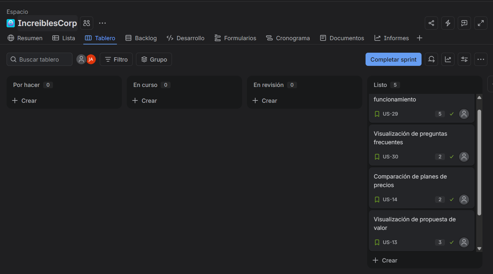
</p>

**Enlace de invitación a Jira:** [Acceder al sitio de Jira](https://joseasto24-1785015581364.atlassian.net/?continue=https%3A%2F%2Fjoseasto24-1785015581364.atlassian.net%2Fwelcome%2Fsoftware%3FprojectId%3D10033&atlOrigin=eyJpIjoiM2UwMTY0NzJlODE3NGI3MzgzZDZmMWY2NGY5ZmEwY2MiLCJwIjoiamlyYS1zb2Z0d2FyZSJ9). Se requiere iniciar sesión y contar con acceso al proyecto.

Las horas corresponden a estimaciones del desglose de trabajo. Las asignaciones propuestas siguen los aspectos y líderes definidos en la matriz LACX. Los estados de las tareas se derivan del estado de las historias registradas para el Sprint.

<table border="1" cellpadding="4" cellspacing="0">
  <thead>
    <tr><th>Sprint #</th><th colspan="7">Sprint 1</th></tr>
    <tr><th colspan="2">User Story</th><th colspan="6">Work-Item / Task</th></tr>
    <tr>
      <th>Story Id</th><th>Story Title</th><th>Task Id</th><th>Task Title</th>
      <th>Task Description</th><th>Estimation<br>(Hours)</th><th>Assigned To</th>
      <th>Status<br>(To-do / InProcess / ToReview / Done)</th>
    </tr>
  </thead>
  <tbody>
    <tr><td>US33</td><td>Consultar la propuesta de valor</td><td>S1-T01</td><td>Implementar la sección principal</td><td>Presentar el propósito y el valor de InstAlert en la página.</td><td>4</td><td>José Gustavo Asto Jácome (DhudsQ)</td><td>Done</td></tr>
    <tr><td>US33</td><td>Consultar la propuesta de valor</td><td>S1-T02</td><td>Adaptar la sección a móvil</td><td>Ajustar la presentación de la propuesta de valor a pantallas pequeñas.</td><td>2</td><td>Yngrid Nahir Ruiz Villegas (nahiryn8)</td><td>Done</td></tr>
    <tr><td>US34</td><td>Comparar planes y precios</td><td>S1-T03</td><td>Crear tarjetas de planes</td><td>Mostrar los precios y capacidades de los planes disponibles.</td><td>3</td><td>José Gustavo Asto Jácome (DhudsQ)</td><td>Done</td></tr>
    <tr><td>US34</td><td>Comparar planes y precios</td><td>S1-T04</td><td>Añadir selector de moneda</td><td>Permitir visualizar los precios en PEN y USD.</td><td>3</td><td>José Gustavo Asto Jácome (DhudsQ)</td><td>Done</td></tr>
    <tr><td>US35</td><td>Visualizar testimonios</td><td>S1-T05</td><td>Implementar sección de testimonios</td><td>Presentar las tarjetas de testimonios incluidas en la página.</td><td>3</td><td>Yngrid Nahir Ruiz Villegas (nahiryn8)</td><td>Done</td></tr>
    <tr><td>US37</td><td>Consultar cómo funciona InstAlert</td><td>S1-T06</td><td>Crear sección de funcionamiento</td><td>Explicar visualmente los pasos principales de InstAlert.</td><td>3</td><td>José Gustavo Asto Jácome (DhudsQ)</td><td>Done</td></tr>
    <tr><td>US38</td><td>Consultar preguntas frecuentes</td><td>S1-T07</td><td>Implementar preguntas desplegables</td><td>Mostrar y ocultar las respuestas al seleccionar una pregunta.</td><td>3</td><td>José Gustavo Asto Jácome (DhudsQ)</td><td>Done</td></tr>
    <tr><td>US38</td><td>Consultar preguntas frecuentes</td><td>S1-T08</td><td>Revisar interacción y presentación</td><td>Verificar la lectura y el uso de la sección en distintos tamaños de pantalla.</td><td>2</td><td>Yngrid Nahir Ruiz Villegas (nahiryn8)</td><td>Done</td></tr>
    <tr><td>US46</td><td>Cambiar el idioma de la página</td><td>S1-T09</td><td>Implementar selector y preferencia</td><td>Permitir seleccionar el idioma y conservar la preferencia del visitante.</td><td>2</td><td>José Gustavo Asto Jácome (DhudsQ)</td><td>Done</td></tr>
    <tr><td>US46</td><td>Cambiar el idioma de la página</td><td>S1-T10</td><td>Completar localización predeterminada</td><td>Ajustar el idioma inicial y verificar la traducción de los textos de la página.</td><td>3</td><td>José Gustavo Asto Jácome (DhudsQ)</td><td>InProcess</td></tr>
    <tr><td>US47</td><td>Consultar las funcionalidades principales</td><td>S1-T11</td><td>Crear sección de funcionalidades</td><td>Presentar las capacidades principales de InstAlert.</td><td>3</td><td>José Gustavo Asto Jácome (DhudsQ)</td><td>Done</td></tr>
    <tr><td>US48</td><td>Conocer al equipo detrás de InstAlert</td><td>S1-T12</td><td>Crear sección del equipo</td><td>Mostrar la información del equipo en la Landing Page.</td><td>2</td><td>Yngrid Nahir Ruiz Villegas (nahiryn8)</td><td>Done</td></tr>
    <tr><td>US49</td><td>Consultar el centro de ayuda</td><td>S1-T13</td><td>Enlazar el centro de ayuda</td><td>Añadir el acceso al documento del centro de ayuda desde la página.</td><td>2</td><td>Jean Fabio Noriega Collado (dumbaskidd)</td><td>Done</td></tr>
    <tr><td>US50</td><td>Revisar la privacidad y los términos del servicio</td><td>S1-T14</td><td>Enlazar documentos legales</td><td>Añadir los accesos a la política de privacidad y a los términos del servicio.</td><td>2</td><td>Jean Fabio Noriega Collado (dumbaskidd)</td><td>Done</td></tr>
    <tr><td>—</td><td>Tarea transversal del Sprint</td><td>S1-T15</td><td>Publicar la Landing Page</td><td>Configurar el despliegue y verificar que la página publicada cargue correctamente.</td><td>3</td><td>José Gustavo Asto Jácome (DhudsQ)</td><td>Done</td></tr>
  </tbody>
</table>

#### 5.2.1.4. Development Evidence for Sprint Review.

Esta sección presenta la evidencia técnica del progreso alcanzado durante el Sprint 1 con respecto a los productos incluidos en su alcance. La tabla resume los repositorios, las ramas y las confirmaciones relacionadas con el desarrollo estructural, la integración de contenido y la configuración de la Página de Aterrizaje de InstAlert.

| Repositorio                         | Rama             | ID de Confirmación | Mensaje de Confirmación                                              | Cuerpo del Mensaje de Confirmación                                                                                                                        | Confirmado en (Fecha) |
| :---------------------------------- | :--------------- | :----------------- | :------------------------------------------------------------------- | :-------------------------------------------------------------------------------------------------------------------------------------------------------- | :-------------------- |
| DhudsQ/InstAlert-LandingPage        | feature/inicio   | 8c9035e            | feat(inicio):add site-config file for default Language               | Configured the initial site settings and established the default language parameters for the i18n implementation across the main layout.                  | 10/09/2026            |
| dumbaskidd/InstAlert-LandingPage    | feature/planes   | 8a6b851            | feat(planes): add base and responsive css styles for pricing section | Implemented the core stylesheet for the subscription plans, ensuring mobile responsiveness and proper alignment of the pricing cards and currency toggle. | 11/09/2026            |
| Mayel-dev/InstAlert-LandingPage     | feature/equipo   | 4bbfccf            | feat(team): add team presentation section                            | Developed the 'About Us' structure, integrating team member portraits, roles, and the placeholder layout for the promotional video.                       | 11/09/2026            |
| DiazDeveloper/InstAlert-LandingPage | feature/producto | a8ca125            | feat: agrego estilos, html y js de la seccion producto               | Built the interactive 'What We Offer' section, linking the descriptive HTML with its specific CSS styles and interactive JavaScript components.           | 12/09/2026            |
| nahiryn8/InstAlert-LandingPage      | feature/cierre   | e6cc66e            | docs(cierre): add help center and legal documentation pdfs           | Uploaded the necessary legal assets (Privacy Policy, Terms of Service) and Help Center documentation, linking them directly in the site footer.           | 13/09/2026            |
| DhudsQ/InstAlert-LandingPage        | main             | b54c82e            | chore: integración iteración 1 features and trigger deployment       |

#### 5.2.1.5. Execution Evidence for Sprint Review.

Durante el Sprint 1, el esfuerzo de desarrollo se centró en la construcción y el despliegue de la Página de Aterrizaje oficial de InstAlert. Se completaron las historias US33, US34, US35, US37, US38 y US47–US50, correspondientes a la propuesta de valor, la comparación de planes y precios en PEN y USD, los testimonios, la explicación de funcionamiento, las preguntas frecuentes, las funcionalidades principales, la presentación del equipo y la consulta de documentación de ayuda y legal. La historia US46, relacionada con el cambio de idioma, quedó en progreso: el selector y la persistencia de la preferencia están implementados, pero la página inicia en español y debe ajustarse para cumplir el idioma predeterminado establecido para el proyecto.

El alcance desarrollado incluye la estructura base, navegación global, la sección principal de impacto (Hero), los beneficios de la plataforma, la presentación del producto y sus funcionalidades, los planes de suscripción, la presentación del equipo, las preguntas frecuentes, el llamado a la acción final (CTA) y el pie de página con documentación de ayuda y legal. La historia US36, que contempla la redirección a la aplicación, no forma parte de las historias completadas en este Sprint: los botones de ingreso y registro permanecen desactivados mientras no se configure una URL de destino.

**Evidencia visual:**

A continuación, se presentan capturas de las principales vistas y componentes implementados durante el Sprint 1, junto con el responsable principal de cada apartado según la distribución del repositorio.

**1. Estructura base, Navegación, Hero y Beneficios**

_Desarrollado por: Jose Gustavo Asto Jacome_

<p align="center">
  
</p>

**2. Presentación del Producto y Soluciones (Qué ofrecemos)**

_Desarrollado por: Sebastián Víctor André Díaz Mendoza_

<p align="center">
  
</p>

**3. Planes de Suscripción y Selector de Moneda (Precios)**

_Desarrollado por: Jean Fabio Noriega Collado_

<p align="center">
  
</p>

**4. Sobre Nosotros y Nuestro Equipo (About Us & Team)**

_Desarrollado por: Ismael Sebastian Simon Calderon_

<p align="center">
  
</p>

**5. Llamado a la Acción (CTA), Footer y Enlaces Legales**

_Desarrollado por: Yngrid Nahir Ruiz Villegas_

<p align="center">
  
</p>

**Video de la revisión del Sprint:** [Ver video de la revisión del Sprint 1](https://upcedupe-my.sharepoint.com/:v:/g/personal/u20241c630_upc_edu_pe/IQDDu4coMfEFS5u3PVPylCcgAWrLM56l0VTYYK_eO1OWuSk?nav=eyJyZWZlcnJhbEluZm8iOnsicmVmZXJyYWxBcHAiOiJTdHJlYW1XZWJBcHAiLCJyZWZlcnJhbFZpZXciOiJTaGFyZURpYWxvZy1MaW5rIiwicmVmZXJyYWxBcHBQbGF0Zm9ybSI6IldlYiIsInJlZmVycmFsTW9kZSI6InZpZXcifX0%3D&e=ChGf3N)

#### 5.2.1.6. Services Documentation Evidence for Sprint Review.

Durante el Sprint 1, el equipo se centró en la ideación, el diseño, el desarrollo y el despliegue de la Página de Aterrizaje de InstAlert. El alcance no incluyó la implementación de los Servicios Web ni de una API REST, por lo que todavía no hay endpoints disponibles para documentar con OpenAPI. El repositorio destinado a los Servicios Web del proyecto es [InstAlert-BackEnd](https://github.com/LosIncreiblesCorp/Instalert-BackEnd). La documentación de la API se elaborará cuando sus endpoints estén implementados.

| **End Point** | **Funciones**                                                                                                                 |
| ------------- | ----------------------------------------------------------------------------------------------------------------------------- |
| N/A           | No hay Web Services ni endpoints documentados con OpenAPI en el Sprint 1, cuyo alcance fue una Página de Aterrizaje estática. |

No hubo commits de documentación OpenAPI asociados a este Sprint.

#### 5.2.1.7. Software Deployment Evidence for Sprint Review.

Durante el Sprint 1, los esfuerzos del equipo se centraron en configurar y ejecutar el despliegue inicial de la Página de Aterrizaje de InstAlert. Este proceso permitió publicar la propuesta de valor del producto y establecer las bases para la integración continua.

Dado que el alcance de este Sprint se limitó a la presentación web estática, aún no se habían creado cuentas ni configurado entornos de despliegue para la Aplicación Web ni para los Servicios Web. Estas actividades están previstas para Sprints posteriores.

**Actividades de Despliegue Realizadas:**

**1. Configuración del Repositorio de Código Fuente**

- Se estableció un repositorio público dedicado exclusivamente a la Página de Aterrizaje dentro de la organización del equipo.
- El control de versiones se estructuró para facilitar la automatización de los despliegues.
- Enlace del repositorio: https://github.com/losincreiblescorp/InstAlert-LandingPage

**2. Habilitación y Configuración de GitHub Pages**

- Se activó el servicio de alojamiento estático desde el apartado de configuración (Configuración > Páginas) del repositorio.
- Se definió la rama main y el directorio raíz (/root) como el entorno de origen para la lectura de los archivos a publicar.
- Mediante esta configuración, el sitio web quedó expuesto de forma segura y pública en la siguiente URL de producción: https://losincreiblescorp.github.io/InstAlert-LandingPage/

<p align="center">
  
</p>

**3. Automatización del Proceso de Despliegue (CI/CD)**

- Se aprovechó la integración nativa de GitHub Actions para el despliegue automático.
- El flujo de trabajo garantiza que cada vez que se aprueba un Solicitud de extracción y se realiza un integración hacia la rama main, la plataforma detecta los cambios y actualiza el contenido en tiempo real sin requerir intervención manual del equipo de desarrollo.

<p align="center">
  
</p>

**4. Verificación y Validación en Producción**

- Se validó la correcta carga de todos los recursos (imágenes, estilos, scripts), la estabilidad del diseño responsivo en múltiples resoluciones y el correcto funcionamiento del cambio de idioma (i18n) directamente en la URL pública.

<p align="center">
  
</p>

#### 5.2.1.8. Team Collaboration Insights during Sprint.

Durante este primer Sprint, el equipo se dedicó a la concepción, el diseño y la implementación de la Página de Aterrizaje de InstAlert. Las responsabilidades se dividieron entre sus integrantes, quienes participaron en el desarrollo del código fuente, la maquetación y la lógica de la interfaz.

**Actividades de implementación desarrolladas:**

- **Planificación Visual:** Se estructuró el diseño base (esquemas visuales y maquetas) de la web para definir claramente la jerarquía de la información, las secciones clave y la paleta de colores.
- **Desarrollo Modular:** La maquetación se dividió en componentes específicos (Principal, Precios, Testimonios, Sobre Nosotros, Contacto, Estructura), permitiendo que cada desarrollador trabajara en una rama de característica (`feature/*`) independiente.
- **Integración de Funcionalidades:** Se aplicaron estilos responsivos con CSS y se integró lógica en JavaScript para dotar de interactividad a la página, incluyendo el sistema de internacionalización (i18n) para soportar múltiples idiomas.
- **Gestión de Versiones y Despliegue:** Se empleó GitHub como plataforma central, aplicando flujos de Solicitudes de extracción y revisiones de código antes de integrar los cambios a la rama `main` para su posterior publicación en GitHub Pages.

**Analíticas de colaboración en GitHub:**

Para evidenciar el compromiso y la participación equitativa de todos los integrantes, a continuación se presentan los gráficos y registros extraídos directamente de las estadísticas del repositorio del proyecto.

**1. Historial de confirmaciones por miembro**

_Desarrollado por: Jean Fabio Noriega Collado (dumbaskidd)_

<p align="center">
  
</p>

_Desarrollado por: Ismael Sebastian Simon Calderon (Mayel-dev)_

<p align="center">
  
</p>

_Desarrollado por: Yngrid Nahir Ruiz Villegas (nahiryn8)_

<p align="center">
  
</p>

_Desarrollado por: Jose Gustavo Asto Jacome (DhudsQ)_

<p align="center">
  
</p>

_Desarrollado por: Sebastián Víctor André Díaz Mendoza (DiazDeveloper)_

<p align="center">
  
</p>

**2. Colaboradores activos en el repositorio**

_Esta gráfica muestra la actividad conjunta del equipo y la distribución de los aportes (adiciones y eliminaciones de código) a lo largo del Sprint._

<p align="center">
  
</p>

**3. Histograma de contribuciones en el tiempo**

_Muestra la frecuencia de las confirmaciones realizadas en los días previos a la revisión del Sprint, como evidencia de la actividad de integración del equipo._

<p align="center">
  
</p>

### 5.2.2. Sprint 2

#### 5.2.2.1. Sprint Planning 2.

| Sprint #                        | Sprint 2                                                                                                                                                                                                                                                                                                                                                                                                                                                                                                                                                                                                                                                                                         |
| :------------------------------ | :----------------------------------------------------------------------------------------------------------------------------------------------------------------------------------------------------------------------------------------------------------------------------------------------------------------------------------------------------------------------------------------------------------------------------------------------------------------------------------------------------------------------------------------------------------------------------------------------------------------------------------------------------------------------------------------------- |
| **Sprint Planning Background**  |                                                                                                                                                                                                                                                                                                                                                                                                                                                                                                                                                                                                                                                                                                  |
| Date                            | 28/09/2026                                                                                                                                                                                                                                                                                                                                                                                                                                                                                                                                                                                                                                                                                       |
| Time                            | 09:00 PM                                                                                                                                                                                                                                                                                                                                                                                                                                                                                                                                                                                                                                                                                         |
| Location                        | Llamada por Google Meet                                                                                                                                                                                                                                                                                                                                                                                                                                                                                                                                                                                                                                                                          |
| Prepared By                     | José Gustavo Asto Jácome                                                                                                                                                                                                                                                                                                                                                                                                                                                                                                                                                                                                                                                                         |
| Attendees (to planning meeting) | José Gustavo Asto Jácome<br>Sebastián Víctor André Díaz Mendoza<br>Jean Fabio Noriega Collado<br>Yngrid Nahir Ruiz Villegas<br>Ismael Sebastián Simón Calderón                                                                                                                                                                                                                                                                                                                                                                                                                                                                                                                                   |
| Sprint 1 Review Summary         | Durante el Sprint 1 se publicó la Landing Page y se completaron historias por 11 de los 13 puntos planificados. La US46 quedó en progreso y la US36 no se abordó porque aún no estaba configurada la URL de destino de la aplicación.                                                                                                                                                                                                                                                                                                                                                                                                                                                            |
| Sprint 1 Retrospective Summary  | El equipo consideró que la implementación y el despliegue de la Landing Page funcionaron según lo esperado. Los botones destinados a dirigir a los usuarios hacia la aplicación quedaron pendientes porque la página de destino todavía no existía; su configuración se retomaría cuando estuviera disponible.                                                                                                                                                                                                                                                                                                                                                                                   |
| **Sprint Goal & User Stories**  |                                                                                                                                                                                                                                                                                                                                                                                                                                                                                                                                                                                                                                                                                                  |
| **Sprint 2 Goal**               | **Nuestro enfoque está en** entregar una primera versión funcional de la aplicación web para que administradores y personal operativo puedan gestionar información del comercio, reportar y consultar alertas, y revisar incidentes en el mapa; además, completar la redirección desde la Landing Page y el cambio de idioma.<br>**Creemos que esto aportará** una gestión más centralizada y oportuna de la seguridad de los comercios, con un acceso claro a la aplicación.<br>**Esto se confirmará cuando** los flujos priorizados cumplan sus criterios de aceptación durante la revisión del Sprint, usando la API simulada y comprobando los dos recorridos pendientes de la Landing Page. |
| Sprint 2 Velocity               | 20 puntos estimados inicialmente al planificar el Sprint                                                                                                                                                                                                                                                                                                                                                                                                                                                                                                                                                                                                                                         |
| Sum of Story Points             | 42 puntos de historias de usuario                                                                                                                                                                                                                                                                                                                                                                                                                                                                                                                                                                                                                                                                |

#### 5.2.2.2. Aspect Leaders and Collaborators.

Para el Sprint 2 se presenta la matriz **Leadership-and-Collaboration Matrix (LACX)**, que define líderes (**L**) y colaboradores (**C**) para tres aspectos técnicos y funcionales del desarrollo frontend de InstAlert. La aplicación web está construida con **Vite y Vue** y utiliza una API simulada para las operaciones descritas; la Landing Page es estática.

- **Integración Frontend–Backend:** consumo de endpoints de la API simulada, configuración de servicios HTTP y validación de la conexión desde la aplicación desarrollada con Vite y Vue.
- **Gestión de Alertas (UI):** desarrollo de vistas y componentes Vue para reportar y consultar alertas, revisar incidentes y navegar el mapa de riesgos con sus filtros. Incluye los ajustes de navegación de la Landing Page relacionados con el acceso a la aplicación y el idioma.
- **Gestión de Comercios y Personal:** desarrollo de vistas para consultar y administrar empleados, invitaciones y membresías, además de consultar cupos, suscripciones y contactos de emergencia del personal operativo.

| **Team Member (Last Name, First Name)** | **GitHub Username** | **Aspect: API Integration** | **Aspect: Alerts UI** | **Aspect: Commerce and Staff Management** |
| --------------------------------------- | ------------------- | --------------------------- | --------------------- | ----------------------------------------- |
| Asto Jácome, José Gustavo               | DhudsQ              | L                           | C                     | C                                         |
| Díaz Mendoza, Sebastián Víctor André    | DiazDeveloper       | C                           | C                     | C                                         |
| Noriega Collado, Jean Fabio             | dumbaskidd          | C                           | L                     | C                                         |
| Ruiz Villegas, Yngrid Nahir             | nahiryn8            | C                           | C                     | L                                         |
| Simón Calderón, Ismael Sebastián        | Mayel-dev           | C                           | C                     | C                                         |

- **L** = Líder del aspecto
- **C** = Colaborador en el aspecto

La distribución asigna un responsable principal para cada aspecto y mantiene la colaboración entre los cinco integrantes. Los líderes coordinan el seguimiento de sus tareas y las revisiones funcionales correspondientes, mientras que los colaboradores apoyan la implementación y validación del Sprint Backlog.

#### 5.2.2.3. Sprint Backlog 2.

**Sprint #**: Sprint 2

El Sprint 2 se enfocó en entregar una primera versión funcional de la aplicación web frontend. El trabajo incluyó la gestión de personal y contactos de emergencia, el reporte y consulta de alertas, la visualización de incidentes en el mapa y la consulta de la suscripción. También se completaron la redirección desde la Landing Page y la localización iniciada en el Sprint 1.

<p align="center">
  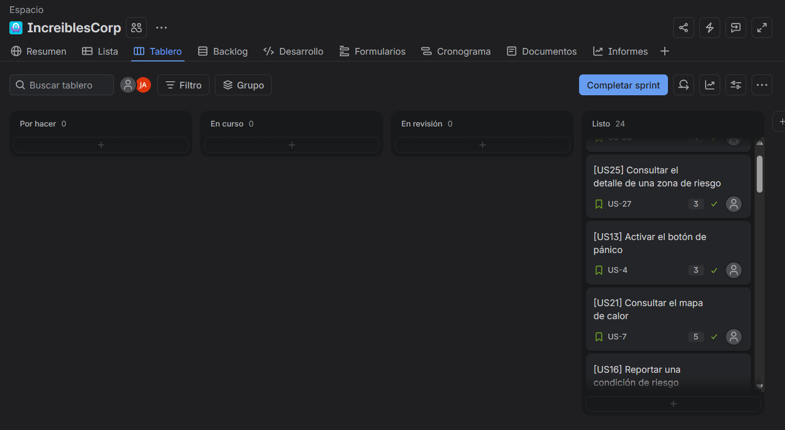
</p>

Las horas corresponden a estimaciones del desglose de trabajo. Las asignaciones propuestas siguen los aspectos y líderes definidos en la matriz LACX. Los estados de las tareas se derivan del estado de las historias registradas para el Sprint.

<table border="1" cellpadding="4" cellspacing="0">
  <thead>
    <tr><th>Sprint #</th><th colspan="7">Sprint 2</th></tr>
    <tr><th colspan="2">User Story</th><th colspan="6">Work-Item / Task</th></tr>
    <tr>
      <th>Story Id</th><th>Story Title</th><th>Task Id</th><th>Task Title</th>
      <th>Task Description</th><th>Estimation<br>(Hours)</th><th>Assigned To</th>
      <th>Status<br>(To-do / InProcess / ToReview / Done)</th>
    </tr>
  </thead>
  <tbody>
    <tr><td>US06</td><td>Cancelar una invitación</td><td>S2-T01</td><td>Añadir acción de cancelación</td><td>Permitir cancelar una invitación pendiente y reflejar el cambio en la interfaz.</td><td>3</td><td>Yngrid Nahir Ruiz Villegas (nahiryn8)</td><td>Done</td></tr>
    <tr><td>US07</td><td>Consultar empleados</td><td>S2-T02</td><td>Mostrar lista de empleados</td><td>Presentar los empleados del comercio e indicar el estado de sus membresías.</td><td>4</td><td>Yngrid Nahir Ruiz Villegas (nahiryn8)</td><td>Done</td></tr>
    <tr><td>US08</td><td>Activar o desactivar la membresía de un empleado</td><td>S2-T03</td><td>Cambiar estado de membresía</td><td>Añadir las acciones para activar o desactivar la membresía de un empleado.</td><td>4</td><td>Yngrid Nahir Ruiz Villegas (nahiryn8)</td><td>Done</td></tr>
    <tr><td>US08</td><td>Activar o desactivar la membresía de un empleado</td><td>S2-T04</td><td>Actualizar resumen de cupos</td><td>Reflejar en la interfaz el efecto de la operación sobre los cupos disponibles.</td><td>2</td><td>Yngrid Nahir Ruiz Villegas (nahiryn8)</td><td>Done</td></tr>
    <tr><td>US09</td><td>Editar los datos de un empleado</td><td>S2-T05</td><td>Implementar edición de empleado</td><td>Permitir modificar y guardar los datos editables del empleado.</td><td>3</td><td>Yngrid Nahir Ruiz Villegas (nahiryn8)</td><td>Done</td></tr>
    <tr><td>US11</td><td>Consultar invitaciones</td><td>S2-T06</td><td>Mostrar invitaciones y estados</td><td>Presentar las invitaciones del comercio junto con su estado actual.</td><td>2</td><td>Yngrid Nahir Ruiz Villegas (nahiryn8)</td><td>Done</td></tr>
    <tr><td>US41</td><td>Consultar los cupos del plan</td><td>S2-T07</td><td>Mostrar desglose de cupos</td><td>Presentar el límite del plan y los cupos ocupados, reservados y disponibles.</td><td>3</td><td>Yngrid Nahir Ruiz Villegas (nahiryn8)</td><td>Done</td></tr>
    <tr><td>US13</td><td>Activar el botón de pánico</td><td>S2-T08</td><td>Implementar activación de alerta</td><td>Permitir iniciar una alerta de pánico desde la interfaz.</td><td>5</td><td>Jean Fabio Noriega Collado (dumbaskidd)</td><td>Done</td></tr>
    <tr><td>US13</td><td>Activar el botón de pánico</td><td>S2-T09</td><td>Añadir cuenta regresiva cancelable</td><td>Permitir cancelar la activación antes del envío de la alerta, sin fijar una duración no confirmada.</td><td>3</td><td>Jean Fabio Noriega Collado (dumbaskidd)</td><td>Done</td></tr>
    <tr><td>US14</td><td>Reportar una actividad sospechosa</td><td>S2-T10</td><td>Crear formulario de actividad sospechosa</td><td>Capturar y enviar los datos requeridos para reportar una actividad sospechosa.</td><td>3</td><td>Jean Fabio Noriega Collado (dumbaskidd)</td><td>Done</td></tr>
    <tr><td>US15</td><td>Reportar un evento pasado</td><td>S2-T11</td><td>Crear formulario de evento pasado</td><td>Permitir registrar información de un incidente ocurrido anteriormente.</td><td>3</td><td>Jean Fabio Noriega Collado (dumbaskidd)</td><td>Done</td></tr>
    <tr><td>US16</td><td>Reportar una condición de riesgo</td><td>S2-T12</td><td>Crear formulario de condición de riesgo</td><td>Permitir informar una condición que representa un riesgo de seguridad.</td><td>3</td><td>Jean Fabio Noriega Collado (dumbaskidd)</td><td>Done</td></tr>
    <tr><td>US19</td><td>Consultar el historial de alertas</td><td>S2-T13</td><td>Mostrar historial de alertas</td><td>Presentar los registros disponibles para consultar alertas anteriores.</td><td>3</td><td>Jean Fabio Noriega Collado (dumbaskidd)</td><td>Done</td></tr>
    <tr><td>US44</td><td>Completar un reporte después de resolver una alerta</td><td>S2-T14</td><td>Completar reporte pendiente</td><td>Permitir ingresar los detalles pendientes y conservar la alerta como resuelta.</td><td>3</td><td>Jean Fabio Noriega Collado (dumbaskidd)</td><td>Done</td></tr>
    <tr><td>US21</td><td>Consultar el mapa de calor</td><td>S2-T15</td><td>Mostrar incidentes geolocalizados</td><td>Representar en el mapa las ubicaciones de los incidentes reportados.</td><td>5</td><td>Jean Fabio Noriega Collado (dumbaskidd)</td><td>Done</td></tr>
    <tr><td>US22</td><td>Consultar incidentes por zona</td><td>S2-T16</td><td>Consultar incidentes de una zona</td><td>Mostrar los incidentes asociados a la zona seleccionada en el mapa.</td><td>3</td><td>Jean Fabio Noriega Collado (dumbaskidd)</td><td>Done</td></tr>
    <tr><td>US23</td><td>Consultar el detalle de un incidente</td><td>S2-T17</td><td>Mostrar detalle del incidente</td><td>Presentar la información registrada al seleccionar un incidente.</td><td>2</td><td>Jean Fabio Noriega Collado (dumbaskidd)</td><td>Done</td></tr>
    <tr><td>US24</td><td>Filtrar el mapa</td><td>S2-T18</td><td>Implementar filtros del mapa</td><td>Aplicar y limpiar filtros sobre los incidentes mostrados en el mapa.</td><td>3</td><td>Jean Fabio Noriega Collado (dumbaskidd)</td><td>Done</td></tr>
    <tr><td>US25</td><td>Consultar el detalle de una zona de riesgo</td><td>S2-T19</td><td>Mostrar detalle de zona</td><td>Presentar la información de riesgo disponible para la zona seleccionada.</td><td>3</td><td>Jean Fabio Noriega Collado (dumbaskidd)</td><td>Done</td></tr>
    <tr><td>US42</td><td>Cambiar el plan de suscripción</td><td>S2-T20</td><td>Implementar selección de plan</td><td>Permitir seleccionar otro plan y reflejar el resultado de la operación simulada.</td><td>4</td><td>José Gustavo Asto Jácome (DhudsQ)</td><td>Done</td></tr>
    <tr><td>US45</td><td>Consultar el estado de la suscripción</td><td>S2-T21</td><td>Mostrar estado de suscripción</td><td>Presentar el plan y periodo vigentes, incluida una cancelación programada si corresponde.</td><td>3</td><td>José Gustavo Asto Jácome (DhudsQ)</td><td>Done</td></tr>
    <tr><td>US30</td><td>Añadir un contacto de emergencia</td><td>S2-T22</td><td>Crear formulario de contacto</td><td>Permitir registrar un contacto de emergencia propio.</td><td>3</td><td>Yngrid Nahir Ruiz Villegas (nahiryn8)</td><td>Done</td></tr>
    <tr><td>US31</td><td>Editar un contacto de emergencia</td><td>S2-T23</td><td>Editar contacto registrado</td><td>Permitir actualizar los datos de un contacto existente.</td><td>2</td><td>Yngrid Nahir Ruiz Villegas (nahiryn8)</td><td>Done</td></tr>
    <tr><td>US32</td><td>Eliminar un contacto de emergencia</td><td>S2-T24</td><td>Eliminar contacto</td><td>Solicitar confirmación y retirar el contacto de la lista.</td><td>2</td><td>Yngrid Nahir Ruiz Villegas (nahiryn8)</td><td>Done</td></tr>
    <tr><td>US36</td><td>Redirigirse a la aplicación</td><td>S2-T25</td><td>Configurar botones de acceso</td><td>Dirigir las llamadas a la acción de la Landing Page a la aplicación.</td><td>2</td><td>José Gustavo Asto Jácome (DhudsQ)</td><td>Done</td></tr>
    <tr><td>US46</td><td>Cambiar el idioma de la página</td><td>S2-T26</td><td>Completar localización</td><td>Configurar el idioma predeterminado requerido y verificar el cambio y persistencia del idioma.</td><td>4</td><td>José Gustavo Asto Jácome (DhudsQ)</td><td>Done</td></tr>
  </tbody>
</table>

#### 5.2.2.4. Development Evidence for Sprint Review.

Las siguientes confirmaciones corresponden a cambios representativos implementados en el repositorio frontend durante el Sprint 2. Se incluyen ramas integradas a `develop` y commits asociados a los bounded contexts trabajados.

| Repositorio                                                                                     | Rama                           | ID de confirmación | Mensaje de confirmación                                           | Descripción del cambio                                                                                                   | Confirmado en (fecha) |
| :---------------------------------------------------------------------------------------------- | :----------------------------- | :----------------- | :---------------------------------------------------------------- | :----------------------------------------------------------------------------------------------------------------------- | :-------------------: |
| [LosIncreiblesCorp/Instalert-FrontEnd](https://github.com/LosIncreiblesCorp/Instalert-FrontEnd) | `feature/alerts` → `develop`   | `f067530`          | `feat(alerts): implement reporting and history views`             | Se implementaron las vistas de reporte de alertas y consulta del historial para el personal operativo.                   |      03/10/2026       |
| [LosIncreiblesCorp/Instalert-FrontEnd](https://github.com/LosIncreiblesCorp/Instalert-FrontEnd) | `feature/mapping` → `develop`  | `4103cec`          | `feat(mapping): filter incidents by category and show selection`  | Se añadió el filtrado de incidentes por categoría y la visualización de los filtros seleccionados en el mapa de riesgos. |      03/10/2026       |
| [LosIncreiblesCorp/Instalert-FrontEnd](https://github.com/LosIncreiblesCorp/Instalert-FrontEnd) | `feature/business` → `develop` | `ff05cc0`          | `feat(business): manage staff and invitations with seat limits`   | Se incorporó la gestión de empleados e invitaciones considerando los límites de cupos del plan.                          |      04/10/2026       |
| [LosIncreiblesCorp/Instalert-FrontEnd](https://github.com/LosIncreiblesCorp/Instalert-FrontEnd) | `feature/payments` → `develop` | `084d292`          | `feat(payments): add subscription views and UI components`        | Se agregaron la vista de suscripción y los componentes para mostrar planes y el resumen de la suscripción.               |      02/10/2026       |
| [LosIncreiblesCorp/Instalert-FrontEnd](https://github.com/LosIncreiblesCorp/Instalert-FrontEnd) | `feature/contacts` → `develop` | `557b75b`          | `feat(contacts): add emergency contact creation and editing form` | Se implementó el formulario para crear y editar contactos de emergencia.                                                 |      04/10/2026       |

#### 5.2.2.5. Execution Evidence for Sprint Review.

Durante el Sprint 2 se desarrollaron vistas de la aplicación web para las principales tareas del personal operativo y de los administradores de comercios. La evidencia incluye la consulta del mapa de riesgo, la activación y resolución de alertas, el registro de incidentes y la gestión de contactos de emergencia. También se muestran las interfaces administrativas para gestionar al personal, enviar invitaciones y consultar la suscripción y los cupos del plan. Las capturas documentan las pantallas y los flujos de interacción implementados en el frontend.

**Evidencia visual:**

**1. Mapa de riesgo y detalle de zona**

La vista presenta incidentes y comercios sobre el mapa, junto con la simbología de los niveles de riesgo. El panel lateral muestra el detalle de la zona seleccionada y los incidentes asociados.

<p align="center">
  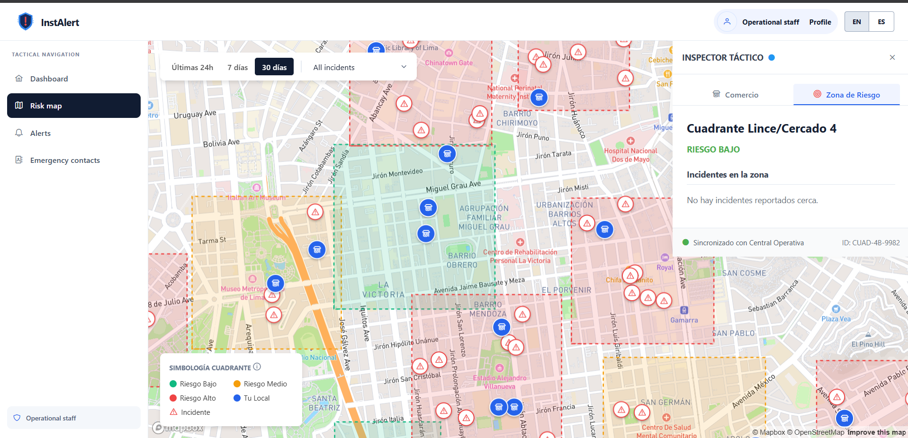
</p>

**2. Centro de alertas**

La pantalla reúne el acceso a la alerta de pánico, el historial y las opciones para reportar incidentes, actividades sospechosas u otras condiciones de riesgo. También indica cuando existe un reporte pendiente de completar.

<p align="center">
  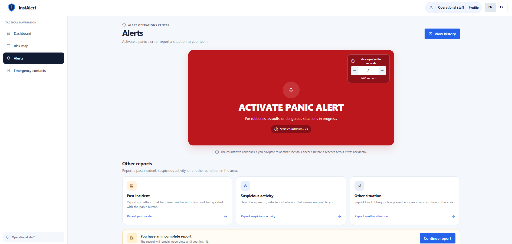
</p>

**3. Gestión de contactos de emergencia**

La lista permite consultar los contactos de emergencia registrados y acceder a las acciones para añadir, editar o eliminar un contacto.

<p align="center">
  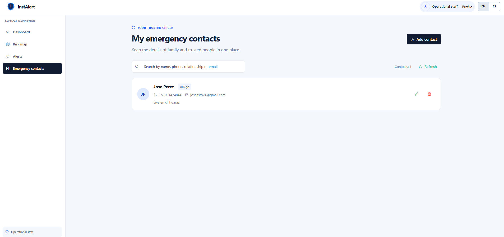
</p>

**4. Registro de actividad sospechosa**

El formulario permite seleccionar el tipo de incidente y registrar su ubicación, fecha, hora y descripción para comunicar lo observado.

<p align="center">
  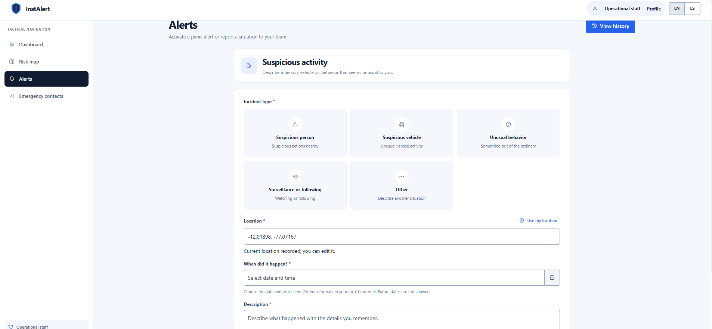
</p>

**5. Alerta de pánico activa**

La vista muestra el estado de una alerta activa, el tiempo transcurrido y la ubicación registrada, además de la acción para indicar que la situación peligrosa terminó.

<p align="center">
  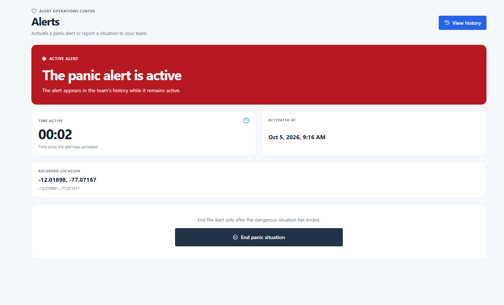
</p>

**6. Gestión del personal del comercio**

La pantalla administrativa presenta el límite del plan y el desglose de cupos ocupados, reservados y disponibles. También lista a los empleados y sus estados, con acciones de gestión e ingreso a las invitaciones.

<p align="center">
  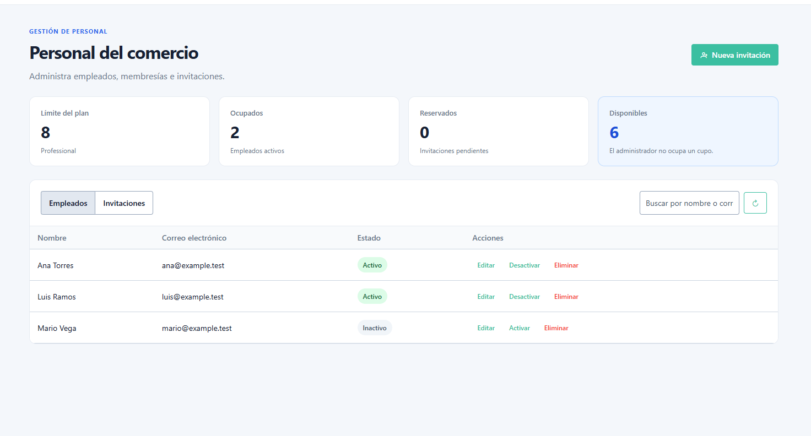
</p>

**7. Creación de invitación para un empleado**

El formulario permite ingresar el nombre y el correo electrónico del empleado, e informa los cupos disponibles antes de crear la invitación.

<p align="center">
  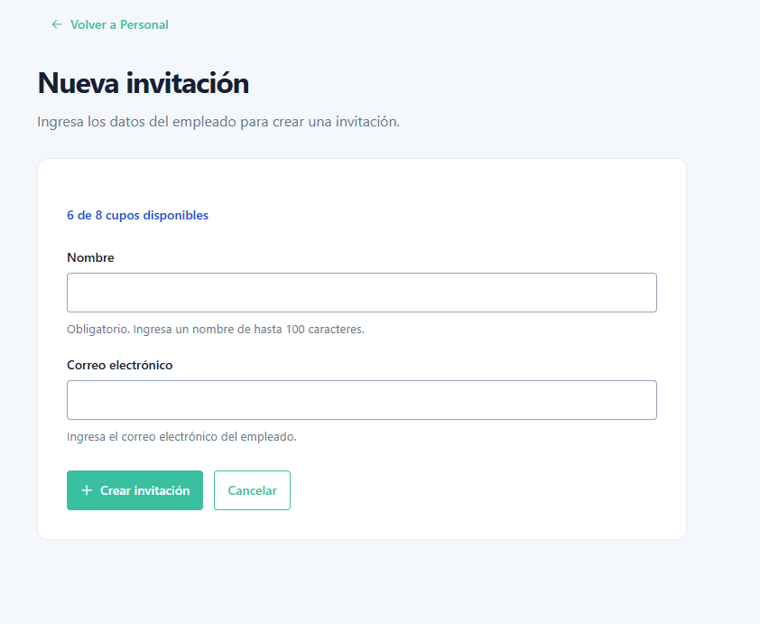
</p>

**8. Suscripción y facturación**

La vista permite consultar el plan vigente, el uso de cupos y las alternativas disponibles, incluidos los controles de moneda y periodicidad de pago.

<p align="center">
  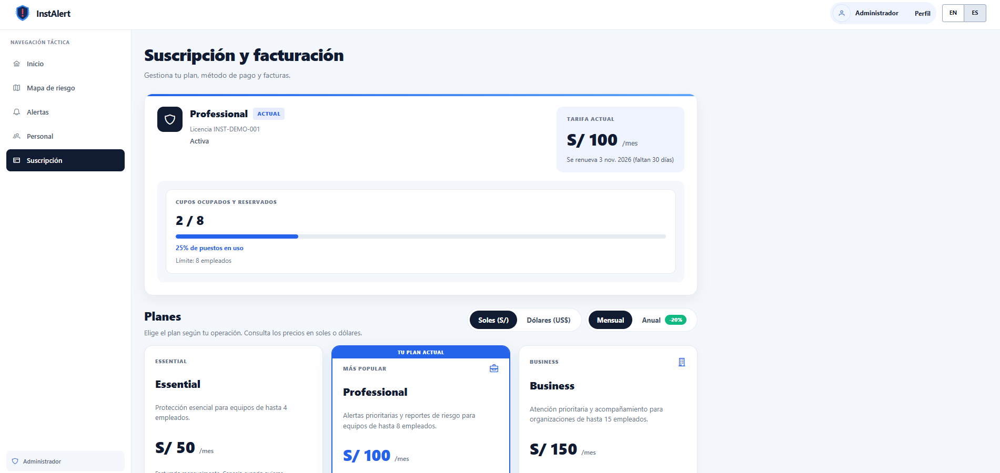
</p>

**Video de recorrido del Sprint 2:** [Ver video de la revisión del Sprint 2](https://upcedupe-my.sharepoint.com/:v:/g/personal/u20241c630_upc_edu_pe/IQD_XVhTUYmdR6-AwlPqkF1rAVeVKAK3R8NVx2AJ5A-0M30?nav=eyJyZWZlcnJhbEluZm8iOnsicmVmZXJyYWxBcHAiOiJTdHJlYW1XZWJBcHAiLCJyZWZlcnJhbFZpZXciOiJTaGFyZURpYWxvZy1MaW5rIiwicmVmZXJyYWxBcHBQbGF0Zm9ybSI6IldlYiIsInJlZmVycmFsTW9kZSI6InZpZXcifX0%3D&e=XkCFOg)

#### 5.2.2.6. Services Documentation Evidence for Sprint Review.

Durante el Sprint 2, el equipo desarrolló la aplicación web frontend de InstAlert y utilizó JSON Server como una API simulada desplegada en Render para probar las vistas con datos de muestra. No se elaboraron documentos OpenAPI ni se implementaron los Web Services definitivos con ASP.NET Core; por ello, el enlace al servidor simulado no se presenta como documentación oficial de endpoints.

| **End Point**                   | **Funciones**                                                                                                                                                                               |
| ------------------------------- | ------------------------------------------------------------------------------------------------------------------------------------------------------------------------------------------- |
| N/A (sin documentación OpenAPI) | El frontend consumió recursos REST simulados por JSON Server. URL base del mock desplegado: [https://instalert-frontend-2bmr.onrender.com/](https://instalert-frontend-2bmr.onrender.com/). |

El repositorio destinado a los Servicios Web del proyecto es [InstAlert-BackEnd](https://github.com/LosIncreiblesCorp/Instalert-BackEnd). No hubo commits de documentación OpenAPI asociados a este Sprint. Las capturas de la sección anterior corresponden a la interfaz frontend y no a una documentación OpenAPI.

#### 5.2.2.7. Software Deployment Evidence for Sprint Review.

Durante el Sprint 2 se publicó la Web Application de InstAlert en Firebase Hosting, se desplegó en Render una API simulada con JSON Server y se mantuvo disponible la Landing Page mediante GitHub Pages. Las capturas muestran el estado de publicación de la aplicación y de la Landing Page, así como la ejecución exitosa del flujo de despliegue de esta última. JSON Server se utilizó como mock para el frontend; no corresponde a los Web Services definitivos del proyecto implementados con ASP.NET Core.

**1. Despliegue de la Web Application en Firebase Hosting**

La aplicación web está disponible en [https://instalert-c3f7f.web.app/](https://instalert-c3f7f.web.app/). La consola de Firebase muestra el proyecto InstAlert y el historial de implementación, con una publicación registrada el 4 de octubre de 2026 a las 11:13 p. m. La siguiente captura evidencia el servicio de Hosting y el estado de la implementación.

<p align="center">
  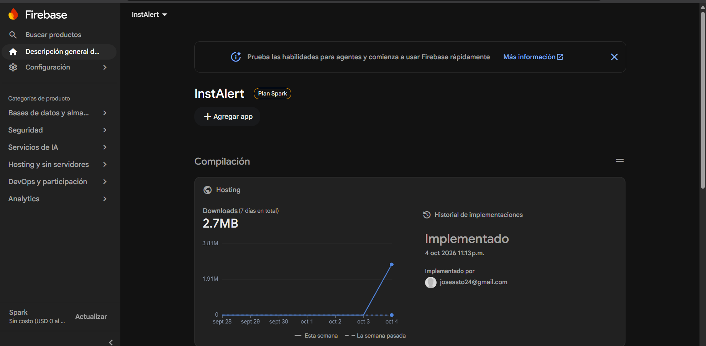
</p>

La siguiente captura muestra la pantalla de selección de perfil al ingresar a la Web Application publicada.

<p align="center">
  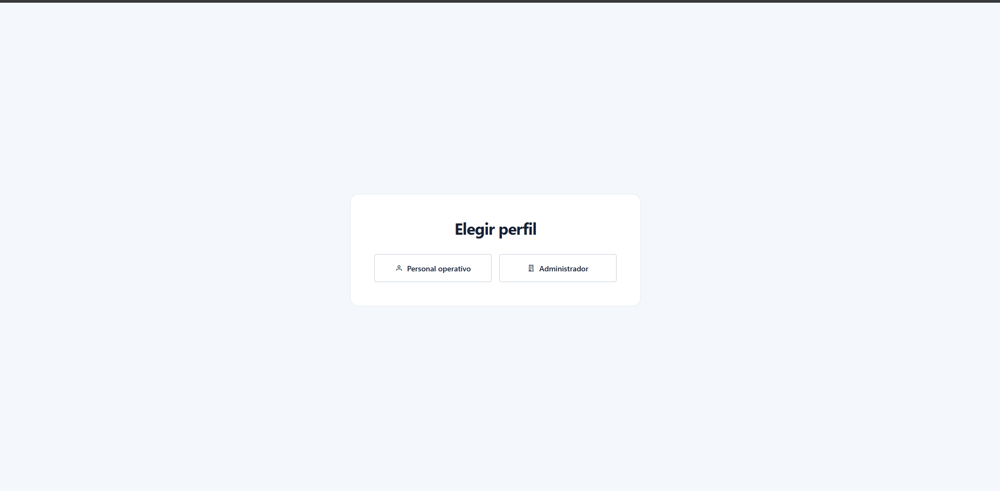
</p>

**2. Despliegue de la API simulada en Render**

Para permitir que la Web Application publicada consuma datos de prueba, se desplegó el servidor JSON Server en Render. La URL base configurada para el mock es [https://instalert-frontend-2bmr.onrender.com/](https://instalert-frontend-2bmr.onrender.com/). Este servicio simula las operaciones de la API durante el desarrollo y no sustituye a los Web Services definitivos en ASP.NET Core.

La consola de Render muestra el servicio en estado **Live** y su historial de despliegues, incluidos despliegues completados correctamente.

<p align="center">
  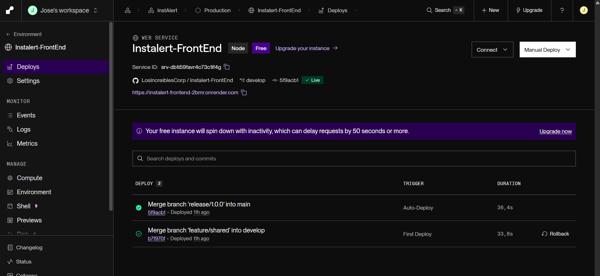
</p>

**3. Despliegue de la Landing Page en GitHub Pages**

La Landing Page está disponible en [https://losincreiblescorp.github.io/InstAlert-LandingPage/](https://losincreiblescorp.github.io/InstAlert-LandingPage/). La configuración de GitHub Pages utiliza la rama `main` y la carpeta raíz del repositorio como fuente de publicación.

<p align="center">
  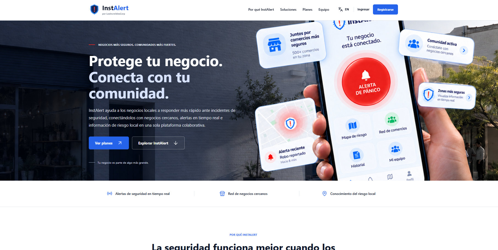
</p>

La captura de configuración confirma la URL publicada y la fuente seleccionada. Además, la ejecución mostrada en GitHub Actions presenta como exitosas las verificaciones de compilación, despliegue y reporte del estado.

<p align="center">
  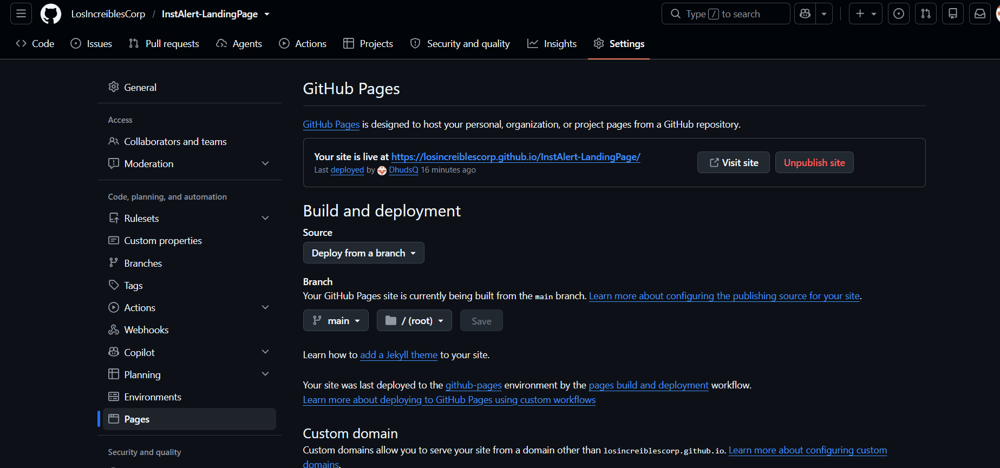
</p>

<p align="center">
  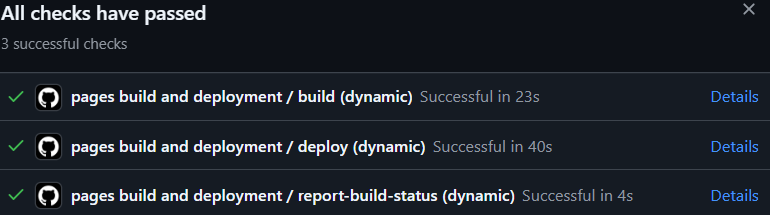
</p>

#### 5.2.2.8. Team Collaboration Insights during Sprint.

Durante el Sprint 2, el equipo colaboró en el repositorio frontend de InstAlert mediante contribuciones al código, trabajo en ramas y su integración en las ramas principales del proyecto. Las siguientes capturas corresponden a las analíticas e historial de ese repositorio. Las cifras del panel de contribuidores son acumuladas para el periodo visible en GitHub y no representan exclusivamente los commits del Sprint 2; por ello, se presentan como contexto de la actividad del equipo.

**1. Analíticas de contribución del repositorio frontend**

La vista de contribuidores registra actividad de los cinco integrantes en el repositorio. El resumen mostrado por GitHub presenta los siguientes conteos acumulados al momento de la captura:

| Integrante                          | GitHub Username | Commits acumulados |
| :---------------------------------- | :-------------- | -----------------: |
| José Gustavo Asto Jácome            | DhudsQ          |                 87 |
| Yngrid Nahir Ruiz Villegas          | nahiryn8        |                 25 |
| Ismael Sebastián Simón Calderón     | Mayel-dev       |                 17 |
| Jean Fabio Noriega Collado          | dumbaskidd      |                 14 |
| Sebastián Víctor André Díaz Mendoza | DiazDeveloper   |                  1 |

El gráfico general resume la distribución de commits entre contribuidores. El detalle individual permite observar también la actividad registrada por mes; las barras visibles en octubre muestran actividad reciente de los cinco usuarios, aunque el conteo total de cada perfil abarca más que este Sprint.

<p align="center">
  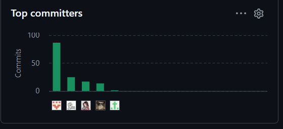
</p>

<p align="center">
  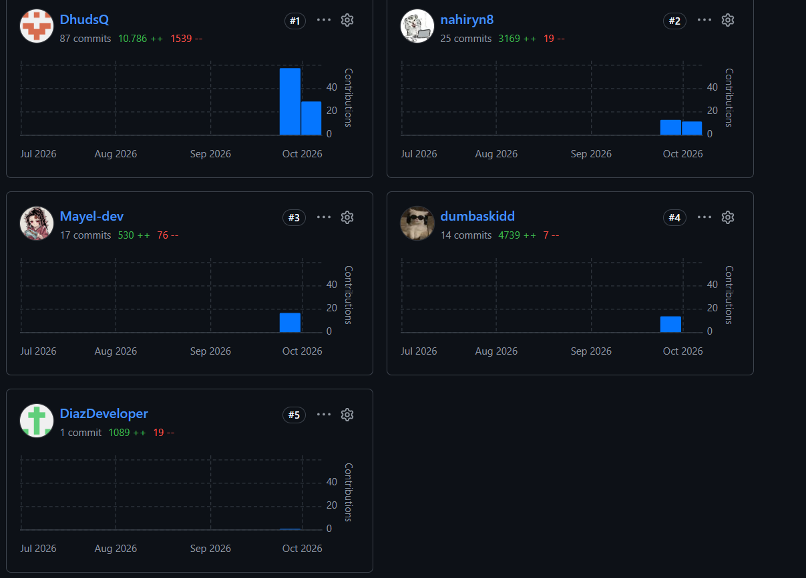
</p>

**2. Integración y evolución de ramas**

Las vistas de red del repositorio muestran la evolución de las ramas de trabajo y su relación con `develop` y `main`, incluida la integración de cambios en esas ramas.

<p align="center">
  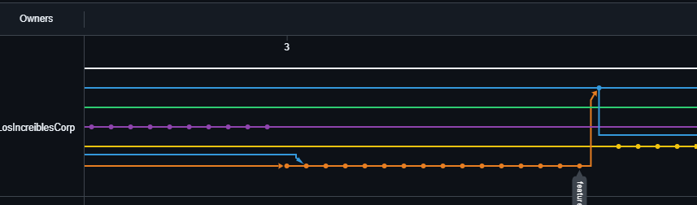
</p>

<p align="center">
  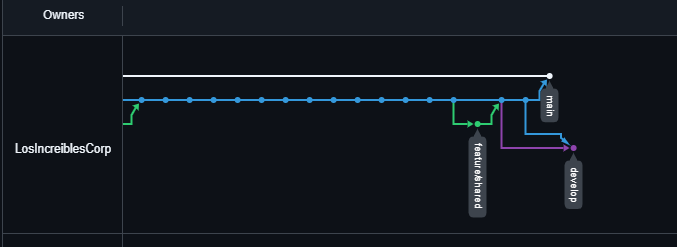
</p>

**3. Historial de commits**

El historial de la rama `main` muestra integraciones y cambios registrados el 4 de octubre de 2026. Entre los elementos visibles se encuentran la integración de `release/1.0.0` en `main`, un commit relacionado con el despliegue de Firebase y cambios documentales del frontend. Esta captura complementa las analíticas con registros concretos de autoría y actividad.

<p align="center">
  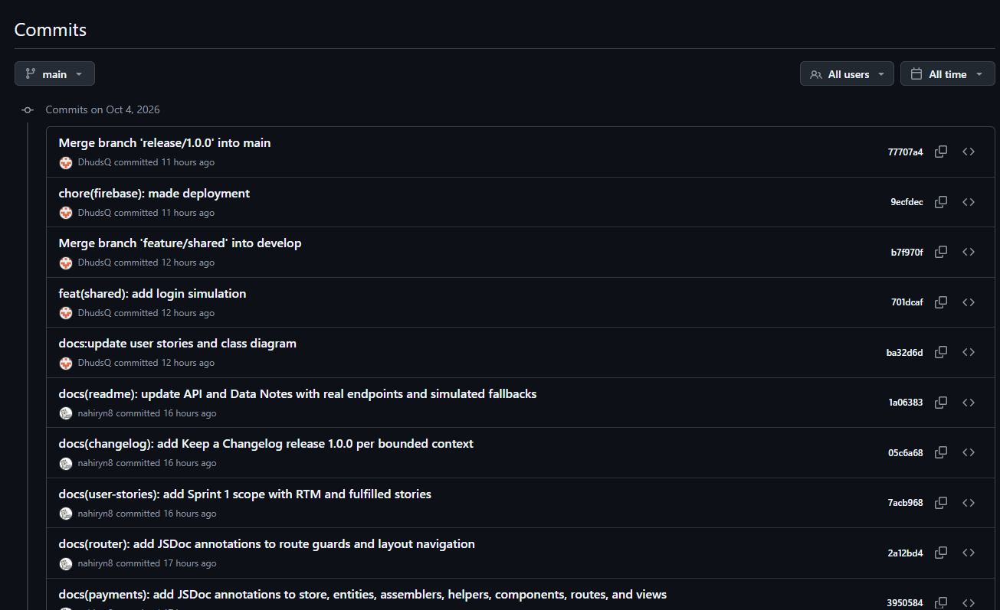
</p>

### 5.2.3. Sprint 3

Durante el Sprint 3 se implementaron los Web Services de InstAlert y se conectaron las vistas de la aplicación con la API ASP.NET Core y su persistencia relacional. La tercera entrega conserva dos usuarios de demostración para recorrer las funciones de administración y operación; la autenticación mediante IAM y el registro real de cuentas se mantienen para la siguiente entrega.

La revisión se documenta con corte al **11 de noviembre de 2026**. El backend publicado corresponde a **1.0.0** y el frontend a **2.0.0**.

#### 5.2.3.1. Sprint Planning 3.

La planificación orientó el trabajo a conectar los recorridos de seguridad y gestión comercial con servicios persistentes. La reunión se realizó por Google Meet el 26 de octubre de 2026, con la participación de los cinco integrantes.

| Sprint #                        | Sprint 3                                                                                                                                                                                                                                                                                                                                                                                                                                                                                                                                                                                                                                                                                                                                                                                                                                                                                                                                                                  |
| :------------------------------ | :------------------------------------------------------------------------------------------------------------------------------------------------------------------------------------------------------------------------------------------------------------------------------------------------------------------------------------------------------------------------------------------------------------------------------------------------------------------------------------------------------------------------------------------------------------------------------------------------------------------------------------------------------------------------------------------------------------------------------------------------------------------------------------------------------------------------------------------------------------------------------------------------------------------------------------------------------------------------ |
| **Sprint Planning Background**  |                                                                                                                                                                                                                                                                                                                                                                                                                                                                                                                                                                                                                                                                                                                                                                                                                                                                                                                                                                           |
| Date                            | 2026-10-26                                                                                                                                                                                                                                                                                                                                                                                                                                                                                                                                                                                                                                                                                                                                                                                                                                                                                                                                                                |
| Time                            | 07:00 PM, America/Lima                                                                                                                                                                                                                                                                                                                                                                                                                                                                                                                                                                                                                                                                                                                                                                                                                                                                                                                                                    |
| Location                        | Reunión virtual por Google Meet                                                                                                                                                                                                                                                                                                                                                                                                                                                                                                                                                                                                                                                                                                                                                                                                                                                                                                                                           |
| Prepared By                     | Díaz Mendoza, Sebastián Víctor André — Team Leader                                                                                                                                                                                                                                                                                                                                                                                                                                                                                                                                                                                                                                                                                                                                                                                                                                                                                                                        |
| Attendees (to planning meeting) | José Gustavo Asto Jácome<br>Sebastián Víctor André Díaz Mendoza<br>Jean Fabio Noriega Collado<br>Yngrid Nahir Ruiz Villegas<br>Ismael Sebastián Simón Calderón                                                                                                                                                                                                                                                                                                                                                                                                                                                                                                                                                                                                                                                                                                                                                                                                            |
| Sprint 2 Review Summary         | Se entregaron vistas de comercios, personal, contactos, alertas, mapa y suscripciones mediante una API simulada. Se completaron los recorridos pendientes de redirección e idioma de la Landing Page. Esta entrega necesitaba conectar esas vistas con servicios ASP.NET Core y persistencia real.                                                                                                                                                                                                                                                                                                                                                                                                                                                                                                                                                                                                                                                                        |
| Sprint 2 Retrospective Summary  | La integración requería unificar contratos HTTP, validar las reglas en el servidor y conectar las vistas con datos persistidos. Estas mejoras se priorizaron para comprobar los recorridos completos entre frontend y backend.                                                                                                                                                                                                                                                                                                                                                                                                                                                                                                                                                                                                                                                                                                                                            |
| **Sprint Goal & User Stories**  |                                                                                                                                                                                                                                                                                                                                                                                                                                                                                                                                                                                                                                                                                                                                                                                                                                                                                                                                                                           |
| **Sprint 3 Goal**               | **Nuestro enfoque está en** mejorar la gestión y el seguimiento de incidentes dentro de InstAlert, proporcionando a los administradores y al personal operativo información confiable, persistente y accesible que facilite la supervisión de emergencias y la gestión de sus actividades.<br>**Creemos que esto aportará** una mayor continuidad en la atención de situaciones de riesgo, una mejor coordinación entre los usuarios de la plataforma y una toma de decisiones más eficiente, al contar con información actualizada y consistente en las distintas funcionalidades del sistema.<br>**Esto se confirmará cuando** los administradores y el personal operativo puedan completar sus principales procesos de gestión y consulta utilizando información almacenada y recuperada mediante la API, manteniendo la consistencia de los datos entre las diferentes vistas y permitiendo supervisar incidentes e indicadores sin depender de información simulada. |
| Sprint 3 Velocity               | 71 puntos                                                                                                                                                                                                                                                                                                                                                                                                                                                                                                                                                                                                                                                                                                                                                                                                                                                                                                                                                                 |
| Sum of Story Points             | **71 puntos** para este sprint 3                                                                                                                                                                                                                                                                                                                                                                                                                                                                                                                                                                                                                                                                                                                                                                                                                                                                                                                                          |

#### 5.2.3.2. Aspect Leaders and Collaborators.

La matriz LACX organiza las responsabilidades por los módulos trabajados en la tercera entrega. Cada aspecto tiene un líder técnico y colaboradores para coordinar su implementación e integración.

| Team Member (Last Name, First Name)  | GitHub Username | Business / Profiles | Alert | Contacts / Payments | Notifications | Mapping / Dashboard |
| :----------------------------------- | :-------------- | :-----------------: | :---: | :-----------------: | :-----------: | :-----------------: |
| Asto Jácome, José Gustavo            | DhudsQ          |          C          |   C   |          L          |       C       |          C          |
| Díaz Mendoza, Sebastián Víctor André | DiazDeveloper   |          C          |   L   |          C          |       C       |          C          |
| Noriega Collado, Jean Fabio          | dumbaskidd      |          C          |   C   |          C          |       C       |          L          |
| Ruiz Villegas, Yngrid Nahir          | nahiryn8        |          C          |   C   |          C          |       L       |          C          |
| Simón Calderón, Ismael Sebastián     | Mayel-dev       |          L          |   C   |          C          |       C       |          C          |

**L** identifica al líder técnico del aspecto y **C** a sus colaboradores. Víctor coordina al equipo como Team Leader.

#### 5.2.3.3. Sprint Backlog 3.

El backlog aceptado comprende 9 historias de usuario y 24 historias técnicas. Las tareas se descompusieron según el trabajo realizado.
La captura del tablero muestra **33 historias en Listo** y ninguna en Por hacer, En curso o En revisión. El estado se contrastó con el Sprint 3 registrado en Jira; la imagen permite observar también subtareas terminadas.

<p align="center">
  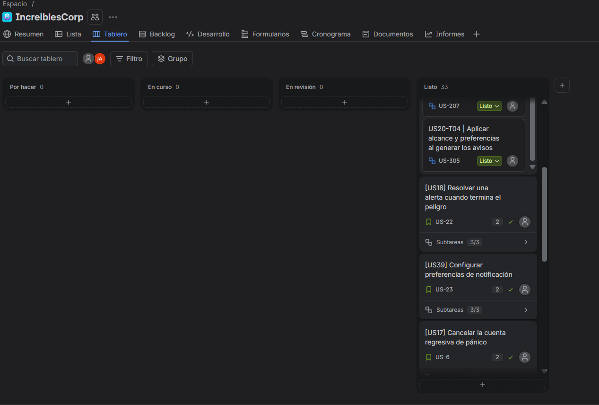
</p>

<table border="1" cellpadding="4" cellspacing="0">
  <thead>
    <tr><th>Sprint #</th><th colspan="7">Sprint 3</th></tr>
    <tr><th colspan="2">User Story / Technical Story</th><th colspan="6">Work-Item / Task</th></tr>
    <tr><th>Story Id</th><th>Story Title</th><th>Task Id</th><th>Task Title</th><th>Task Description</th><th>Estimation<br>(Hours)</th><th>Assigned To</th><th>Status<br>(To-do / InProcess / ToReview / Done)</th></tr>
  </thead>
  <tbody>
    <tr><td rowspan="2">US04</td><td rowspan="2">Editar mis datos personales</td><td>US04TASK001</td><td>Editar nombres, DNI y teléfono desde el perfil</td><td>Cargar los datos personales desde Profiles y guardar el formulario mediante la API, sin editar credenciales de acceso.</td><td>2</td><td>Ismael Sebastián Simón Calderón</td><td>Done</td></tr>
    <tr><td>US04TASK002</td><td>Conservar datos y explicar errores de validación</td><td>Validar nombres, DNI de ocho dígitos y teléfono; conservar el formulario ante un rechazo y separar estados de carga y guardado.</td><td>1</td><td>Ismael Sebastián Simón Calderón</td><td>Done</td></tr>
    <tr><td rowspan="3">US10</td><td rowspan="3">Editar los datos del comercio</td><td>US10TASK001</td><td>Cargar y editar el perfil del comercio</td><td>Conectar nombre, dirección y RUC al comercio del administrador; conservar el RUC al actualizar.</td><td>2</td><td>Ismael Sebastián Simón Calderón</td><td>Done</td></tr>
    <tr><td>US10TASK002</td><td>Seleccionar la ubicación comercial con Mapbox</td><td>Mostrar el marcador editable y guardar coordenadas válidas con la dirección del comercio.</td><td>1</td><td>Ismael Sebastián Simón Calderón</td><td>Done</td></tr>
    <tr><td>US10TASK003</td><td>Gestionar cambios pendientes y errores comerciales</td><td>Mostrar validaciones, guardado y errores del servicio; permitir descartar cambios sin sobrescribir el perfil con respuestas de otro contexto.</td><td>1</td><td>Ismael Sebastián Simón Calderón</td><td>Done</td></tr>
    <tr><td rowspan="2">US17</td><td rowspan="2">Cancelar la cuenta regresiva de pánico</td><td>US17TASK001</td><td>Cancelar la preparación antes de confirmar el pánico</td><td>Detener el temporizador, eliminar el token y el estado persistido, y volver al inicio sin llamar al endpoint de confirmación.</td><td>2</td><td>Sebastián Víctor André Díaz Mendoza</td><td>Done</td></tr>
    <tr><td>US17TASK002</td><td>Separar cancelación de cuenta regresiva y resolución</td><td>Permitir cancelar únicamente antes del vencimiento; una alerta ya confirmada se resuelve por el flujo correspondiente, sin marcarla como falsa alarma.</td><td>2</td><td>Sebastián Víctor André Díaz Mendoza</td><td>Done</td></tr>
    <tr><td rowspan="3">US18</td><td rowspan="3">Resolver una alerta cuando termina el peligro</td><td>US18TASK001</td><td>Presentar la acción para terminar el peligro</td><td>Mostrar la acción cuando existe pánico activo y solicitar su resolución al backend.</td><td>1</td><td>Sebastián Víctor André Díaz Mendoza</td><td>Done</td></tr>
    <tr><td>US18TASK002</td><td>Actualizar el estado sin exigir completar el reporte</td><td>Reflejar la alerta resuelta y mantener su reporte pendiente; la resolución no depende de rellenar detalles.</td><td>2</td><td>Sebastián Víctor André Díaz Mendoza</td><td>Done</td></tr>
    <tr><td>US18TASK003</td><td>Conservar la resolución ante solicitudes repetidas</td><td>El dominio mantiene resolved al repetir la solicitud; la UI actualiza el estado devuelto por el servidor.</td><td>1</td><td>Sebastián Víctor André Díaz Mendoza</td><td>Done</td></tr>
    <tr><td rowspan="4">US20</td><td rowspan="4">Recibir y consultar alertas activas</td><td>US20TASK001</td><td>Consultar alertas activas y sus estados</td><td>Cargar las alertas del comercio y distinguir pánico activo, pánico resuelto y reportes enviados.</td><td>1</td><td>Yngrid Nahir Ruiz Villegas</td><td>Done</td></tr>
    <tr><td>US20TASK002</td><td>Mostrar avisos cercanos en la bandeja y campana</td><td>Consultar notificaciones del destinatario, mostrar contador no leído y permitir registrar lectura.</td><td>1</td><td>Yngrid Nahir Ruiz Villegas</td><td>Done</td></tr>
    <tr><td>US20TASK003</td><td>Actualizar la bandeja mientras la aplicación está visible</td><td>Consultar periódicamente cada 15 segundos; detener el ciclo al cambiar de contexto y no presentar un fallo de carga como lista vacía.</td><td>2</td><td>Yngrid Nahir Ruiz Villegas</td><td>Done</td></tr>
    <tr><td>US20TASK004</td><td>Aplicar alcance y preferencias al generar los avisos</td><td>Seleccionar destinatarios por distancia al comercio y preferencias. La generación del aviso cercano requiere que el pánico siga activo cuando se procesa el evento.</td><td>2</td><td>Yngrid Nahir Ruiz Villegas</td><td>Done</td></tr>
    <tr><td rowspan="3">US24</td><td rowspan="3">Filtrar el mapa</td><td>US24TASK001</td><td>Aplicar filtros de categoría, periodo y radio</td><td>Aplicar categoría, periodo y radio mediante consultas al backend.</td><td>2</td><td>Jean Fabio Noriega Collado</td><td>Done</td></tr>
    <tr><td>US24TASK002</td><td>Limpiar categoría y periodo y mostrar resultados vacíos</td><td>Restablecer categoría y periodo conservando el radio, y distinguir resultados vacíos de errores.</td><td>1</td><td>Jean Fabio Noriega Collado</td><td>Done</td></tr>
    <tr><td>US24TASK003</td><td>Documentar el alcance de la limpieza de filtros</td><td>Precisar que limpiar los filtros restablece categoría y periodo, conservando el radio de búsqueda seleccionado.</td><td>1</td><td>Jean Fabio Noriega Collado</td><td>Done</td></tr>
    <tr><td rowspan="4">US28</td><td rowspan="4">Consultar el dashboard del administrador</td><td>US28TASK001</td><td>Mostrar los indicadores administrativos del mes</td><td>Consumir el resumen del comercio sin calcular datos mock: pánicos activos, reportes pendientes, incidentes y riesgo.</td><td>1</td><td>Jean Fabio Noriega Collado</td><td>Done</td></tr>
    <tr><td>US28TASK002</td><td>Presentar las gráficas calculadas por el backend</td><td>Representar evolución diaria, categorías, estados, riesgo y distribución por hora mediante Chart.js.</td><td>1</td><td>Jean Fabio Noriega Collado</td><td>Done</td></tr>
    <tr><td>US28TASK003</td><td>Mostrar personal, cupos y estado de suscripción</td><td>Representar activos, reservas y límite junto con plan y vigencia, excluyendo al administrador del consumo de cupos.</td><td>1</td><td>Jean Fabio Noriega Collado</td><td>Done</td></tr>
    <tr><td>US28TASK004</td><td>Distinguir ausencia de actividad y errores del dashboard</td><td>Mostrar ceros y series vacías válidas, advertencias parciales y reintento ante fallos; las gráficas y navegación se comprobaron en la evidencia del 10-11.</td><td>1</td><td>Jean Fabio Noriega Collado</td><td>Done</td></tr>
    <tr><td rowspan="3">US29</td><td rowspan="3">Consultar mi resumen operativo</td><td>US29TASK001</td><td>Presentar el resumen de la membresía operativa</td><td>Consumir el resumen por rol con riesgo local, incidentes cercanos, registros propios y notificaciones no leídas.</td><td>1</td><td>Jean Fabio Noriega Collado</td><td>Done</td></tr>
    <tr><td>US29TASK002</td><td>Mostrar las series y accesos del personal operativo</td><td>Representar evolución diaria y estados; enlazar a alertas, mapa y notificaciones sin exponer controles administrativos.</td><td>1</td><td>Jean Fabio Noriega Collado</td><td>Done</td></tr>
    <tr><td>US29TASK003</td><td>Separar resumen vacío, fallo y cambio de cuenta</td><td>Limpiar el contexto al cambiar de usuario, descartar respuestas tardías y mostrar errores y ausencia de actividad de manera diferenciada.</td><td>2</td><td>Jean Fabio Noriega Collado</td><td>Done</td></tr>
    <tr><td rowspan="3">US39</td><td rowspan="3">Configurar preferencias de notificación</td><td>US39TASK001</td><td>Abrir las preferencias desde la bandeja</td><td>Mostrar un diálogo accesible para activar o desactivar avisos cercanos y presentar la configuración cargada.</td><td>1</td><td>Yngrid Nahir Ruiz Villegas</td><td>Done</td></tr>
    <tr><td>US39TASK002</td><td>Guardar preferencias mediante Notifications</td><td>Persistir NearbyAlertsEnabled y el radio por usuario y comercio; diferenciar errores de consulta y guardado.</td><td>2</td><td>Yngrid Nahir Ruiz Villegas</td><td>Done</td></tr>
    <tr><td>US39TASK003</td><td>Proteger cambios pendientes y aplicar la preferencia</td><td>Ofrecer descarte, proteger la navegación con cambios sin guardar y usar la preferencia en la selección de destinatarios del backend.</td><td>2</td><td>Yngrid Nahir Ruiz Villegas</td><td>Done</td></tr>
    <tr><td rowspan="3">TS-01</td><td rowspan="3">Endpoints para consultar y actualizar el perfil personal</td><td>TS01TASK001</td><td>Exponer consulta y actualización del perfil propio</td><td>Definir recursos y transformadores GET/PUT de Profiles para nombres, apellidos, DNI y teléfono.</td><td>1</td><td>Ismael Sebastián Simón Calderón</td><td>Done</td></tr>
    <tr><td>TS01TASK002</td><td>Validar el perfil y conservar el DNI textual</td><td>UserProfile y NationalIdentityNumber validan datos antes de asignarlos; el DNI conserva ocho dígitos y ceros iniciales.</td><td>2</td><td>Ismael Sebastián Simón Calderón</td><td>Done</td></tr>
    <tr><td>TS01TASK003</td><td>Guardar el perfil del usuario reconocido</td><td>ProfileCommandService comprueba userId igual al actor y persiste mediante repositorio y UnitOfWork; no crea una cuenta IAM.</td><td>2</td><td>Ismael Sebastián Simón Calderón</td><td>Done</td></tr>
    <tr><td rowspan="2">TS-02</td><td rowspan="2">Endpoints para consultar y actualizar el idioma de la aplicación</td><td>TS02TASK001</td><td>Consultar y guardar en_US o es_419</td><td>Exponer preferencias propias; devolver inglés al no existir configuración y rechazar otros códigos.</td><td>2</td><td>Ismael Sebastián Simón Calderón</td><td>Done</td></tr>
    <tr><td>TS02TASK002</td><td>Persistir la preferencia y reflejarla en la aplicación</td><td>Guardar UserPreferences con el usuario reconocido; el frontend convierte los códigos del contrato a en/es sin perder el idioma elegido.</td><td>2</td><td>Ismael Sebastián Simón Calderón</td><td>Done</td></tr>
    <tr><td rowspan="4">TS-03</td><td rowspan="4">Endpoints para registrar, consultar y actualizar comercios</td><td>TS03TASK001</td><td>Exponer alta, consulta y edición comercial</td><td>Conectar BusinessesController a comandos y consultas; devolver identificador y datos de perfil.</td><td>1</td><td>Ismael Sebastián Simón Calderón</td><td>Done</td></tr>
    <tr><td>TS03TASK002</td><td>Validar RUC, nombre, dirección y coordenadas</td><td>El dominio conserva el RUC al editar y rechaza duplicados o ubicación inválida.</td><td>2</td><td>Ismael Sebastián Simón Calderón</td><td>Done</td></tr>
    <tr><td>TS03TASK003</td><td>Mantener un comercio por administrador</td><td>Comprobar propiedad y ausencia de otro comercio del administrador; conservar el índice único de OwnerUserId.</td><td>2</td><td>Ismael Sebastián Simón Calderón</td><td>Done</td></tr>
    <tr><td>TS03TASK004</td><td>Separar las reglas ORM del comercio</td><td>Mantener el mapeo en Business/Infrastructure y registrarlo en AppDbContext compartido, sin alterar el esquema.</td><td>2</td><td>Ismael Sebastián Simón Calderón</td><td>Done</td></tr>
    <tr><td rowspan="2">TS-04</td><td rowspan="2">Endpoints para consultar el personal y las membresías propias</td><td>TS04TASK001</td><td>Consultar el personal autorizado del comercio</td><td>Exponer integrantes y estados mediante BusinessMembersController sin inventar empleados cuando el listado está vacío.</td><td>1</td><td>Ismael Sebastián Simón Calderón</td><td>Done</td></tr>
    <tr><td>TS04TASK002</td><td>Consultar la membresía propia del actor</td><td>Consultar las relaciones por usuario reconocido; conservar la regla de asociación única incluso para una membresía inactiva.</td><td>1</td><td>Ismael Sebastián Simón Calderón</td><td>Done</td></tr>
    <tr><td rowspan="3">TS-05</td><td rowspan="3">Endpoints para actualizar y cambiar el estado de las membresías</td><td>TS05TASK001</td><td>Editar nombre y correo de la membresía</td><td>Validar los datos del miembro bajo propiedad administrativa, sin cambiar la cuenta global.</td><td>2</td><td>Ismael Sebastián Simón Calderón</td><td>Done</td></tr>
    <tr><td>TS05TASK002</td><td>Activar o desactivar sin exceder el plan</td><td>Revisar empleados activos y reservas al activar; desactivar libera cupo sin borrar la asociación comercial.</td><td>2</td><td>Ismael Sebastián Simón Calderón</td><td>Done</td></tr>
    <tr><td>TS05TASK003</td><td>Persistir cambios de personal y concurrencia de cupos</td><td>Guardar membresía y revisión comercial en la misma unidad de trabajo; mantener las restricciones únicas de usuario y correo.</td><td>2</td><td>Ismael Sebastián Simón Calderón</td><td>Done</td></tr>
    <tr><td rowspan="4">TS-06</td><td rowspan="4">Endpoints para crear y consultar invitaciones de personal</td><td>TS06TASK001</td><td>Crear invitaciones pendientes con reserva de cupo</td><td>Verificar capacidad antes de crear StaffInvitation y reservar mediante su estado pending.</td><td>1</td><td>Ismael Sebastián Simón Calderón</td><td>Done</td></tr>
    <tr><td>TS06TASK002</td><td>Impedir invitaciones duplicadas entre comercios</td><td>Validar correo normalizado frente a invitaciones pendientes y membresías existentes.</td><td>2</td><td>Ismael Sebastián Simón Calderón</td><td>Done</td></tr>
    <tr><td>TS06TASK003</td><td>Consultar invitaciones y estados por propietario</td><td>Exponer las invitaciones del comercio autorizado con pending, accepted o cancelled.</td><td>1</td><td>Ismael Sebastián Simón Calderón</td><td>Done</td></tr>
    <tr><td>TS06TASK004</td><td>Registrar la solicitud de correo en Outbox</td><td>Persistir business.invitation.requested.v1 junto con la invitación; Notifications gestiona la entrega. Esto no crea una cuenta ni contraseña temporal.</td><td>2</td><td>Ismael Sebastián Simón Calderón</td><td>Done</td></tr>
    <tr><td rowspan="3">TS-07</td><td rowspan="3">Endpoints para editar, cancelar y reenviar invitaciones</td><td>TS07TASK001</td><td>Editar los datos de una invitación pendiente</td><td>Validar nombre/correo y conservar la invitación y su reserva sin crear un segundo registro.</td><td>2</td><td>Ismael Sebastián Simón Calderón</td><td>Done</td></tr>
    <tr><td>TS07TASK002</td><td>Cancelar una invitación y liberar su reserva</td><td>Permitir la transición desde pending y reflejar la nueva capacidad sin borrar membresías.</td><td>2</td><td>Ismael Sebastián Simón Calderón</td><td>Done</td></tr>
    <tr><td>TS07TASK003</td><td>Reenviar la misma invitación mediante Outbox</td><td>Incrementar la secuencia de entrega, validar que sigue pendiente y no reservar otro cupo.</td><td>1</td><td>Ismael Sebastián Simón Calderón</td><td>Done</td></tr>
    <tr><td rowspan="2">TS-09</td><td rowspan="2">Endpoint para consultar la capacidad del comercio</td><td>TS09TASK001</td><td>Componer límite, activos, reservas y disponibles</td><td>Combinar el plan vigente con GetBusinessSeatUsageQuery, excluir al propietario y devolver cero disponible al completar el límite.</td><td>2</td><td>José Gustavo Asto Jácome</td><td>Done</td></tr>
    <tr><td>TS09TASK002</td><td>Representar correctamente la capacidad demo en Production</td><td>Reconocer la suscripción simulada solo cuando Demo y SeedOnStartup están habilitados; Docker verificó Essential con límite 4, un empleado y tres cupos disponibles.</td><td>1</td><td>José Gustavo Asto Jácome</td><td>Done</td></tr>
    <tr><td rowspan="2">TS-10</td><td rowspan="2">Endpoints para consultar y actualizar el periodo de gracia del pánico</td><td>TS10TASK001</td><td>Exponer lectura y modificación del periodo de gracia</td><td>Consultar preferencias propias y devolver el periodo configurado o predeterminado.</td><td>1</td><td>Sebastián Víctor André Díaz Mendoza</td><td>Done</td></tr>
    <tr><td>TS10TASK002</td><td>Validar y persistir los valores admitidos</td><td>Rechazar valores inválidos y mantener la configuración previa; usar el periodo del servidor al preparar el pánico.</td><td>2</td><td>Sebastián Víctor André Díaz Mendoza</td><td>Done</td></tr>
    <tr><td rowspan="4">TS-11</td><td rowspan="4">Endpoints para preparar y confirmar una alerta de pánico</td><td>TS11TASK001</td><td>Preparar un pánico sin crear la alerta</td><td>Devolver un token protegido con usuario, comercio y tiempos de confirmación; la preparación no persiste una alerta activa.</td><td>1</td><td>Sebastián Víctor André Díaz Mendoza</td><td>Done</td></tr>
    <tr><td>TS11TASK002</td><td>Validar token, acceso y tiempo antes de confirmar</td><td>Rechazar tokens alterados, de otro actor o vencidos y confirmaciones anticipadas; no confiar en el reloj del frontend.</td><td>2</td><td>Sebastián Víctor André Díaz Mendoza</td><td>Done</td></tr>
    <tr><td>TS11TASK003</td><td>Confirmar y publicar el pánico una sola vez</td><td>Persistir AlertRecord activo junto a alert.changed.v1; conservar el comportamiento de reintentos y evitar duplicar pánicos activos.</td><td>2</td><td>Sebastián Víctor André Díaz Mendoza</td><td>Done</td></tr>
    <tr><td>TS11TASK004</td><td>Proyectar el pánico a mapa y avisos por Outbox</td><td>Mapping y Notifications consumen el evento después del commit; la cancelación de preparación no genera esos efectos.</td><td>2</td><td>Sebastián Víctor André Díaz Mendoza</td><td>Done</td></tr>
    <tr><td rowspan="2">TS-12</td><td rowspan="2">Endpoint para registrar reportes de incidentes</td><td>TS12TASK001</td><td>Registrar los tres tipos de reporte no urgente</td><td>Aceptar suspicious-activity, past-incident y other-situation con categoría, descripción, ubicación y momento válidos.</td><td>2</td><td>Sebastián Víctor André Díaz Mendoza</td><td>Done</td></tr>
    <tr><td>TS12TASK002</td><td>Persistir reportes como enviados y publicar su proyección</td><td>Conservar status submitted y sus eventos, sin convertirlos en pánico activo; rechazar fechas futuras y datos incompletos.</td><td>2</td><td>Sebastián Víctor André Díaz Mendoza</td><td>Done</td></tr>
    <tr><td rowspan="3">TS-13</td><td rowspan="3">Endpoints para consultar alertas e historial de incidentes</td><td>TS13TASK001</td><td>Consultar alertas por comercio, estado y página</td><td>Aplicar permisos, filtros y paginación a listados; una ausencia de registros devuelve colección vacía.</td><td>1</td><td>Sebastián Víctor André Díaz Mendoza</td><td>Done</td></tr>
    <tr><td>TS13TASK002</td><td>Consultar el detalle y rechazar registros ajenos</td><td>Recuperar el registro por identificador dentro del acceso permitido y devolver el error correspondiente cuando no existe.</td><td>1</td><td>Sebastián Víctor André Díaz Mendoza</td><td>Done</td></tr>
    <tr><td>TS13TASK003</td><td>Separar pánicos activos, resueltos y reportes históricos</td><td>Conservar Kind, Status y ReportStatus en recursos y consultas; no usar un estado falsa alarma para cancelar una preparación.</td><td>2</td><td>Sebastián Víctor André Díaz Mendoza</td><td>Done</td></tr>
    <tr><td rowspan="2">TS-14</td><td rowspan="2">Endpoint para actualizar la ubicación de una alerta activa</td><td>TS14TASK001</td><td>Actualizar coordenadas de un pánico activo propio</td><td>Validar propiedad, estado activo y coordenadas antes de actualizar ubicación y descripción del lugar.</td><td>2</td><td>Sebastián Víctor André Díaz Mendoza</td><td>Done</td></tr>
    <tr><td>TS14TASK002</td><td>Persistir la ubicación y refrescar la proyección</td><td>Incrementar la revisión interna y publicar el cambio para Mapping; rechazar modificaciones de alertas ya resueltas.</td><td>2</td><td>Sebastián Víctor André Díaz Mendoza</td><td>Done</td></tr>
    <tr><td rowspan="3">TS-15</td><td rowspan="3">Endpoints para resolver el pánico y completar su reporte</td><td>TS15TASK001</td><td>Resolver la alerta conservando el reporte pendiente</td><td>Marcar resolved y ReportStatus pending sin exigir categoría y descripción en la resolución.</td><td>1</td><td>Sebastián Víctor André Díaz Mendoza</td><td>Done</td></tr>
    <tr><td>TS15TASK002</td><td>Guardar informes después de terminar el peligro</td><td>Permitir edición de detalles únicamente mientras el reporte del pánico resuelto está pendiente.</td><td>2</td><td>Sebastián Víctor André Díaz Mendoza</td><td>Done</td></tr>
    <tr><td>TS15TASK003</td><td>Finalizar el reporte con sus datos obligatorios</td><td>Comprobar categoría y descripción, completar ReportStatus y conservar resolved; rechazar una finalización repetida.</td><td>1</td><td>Sebastián Víctor André Díaz Mendoza</td><td>Done</td></tr>
    <tr><td rowspan="2">TS-16</td><td rowspan="2">Endpoints para consultar contactos de emergencia</td><td>TS16TASK001</td><td>Consultar listado y detalle de contactos propios</td><td>Filtrar por EmployeeId del actor y exigir membresía operativa; no devolver datos de contactos ajenos.</td><td>1</td><td>José Gustavo Asto Jácome</td><td>Done</td></tr>
    <tr><td>TS16TASK002</td><td>Representar ausencia de contactos sin inventar registros</td><td>Devolver colección vacía o error de detalle según corresponda; mantener recursos y transformadores de Contacts.</td><td>1</td><td>José Gustavo Asto Jácome</td><td>Done</td></tr>
    <tr><td rowspan="3">TS-17</td><td rowspan="3">Endpoints para mantener contactos de emergencia</td><td>TS17TASK001</td><td>Crear y actualizar contactos validados</td><td>Validar nombre, relación, teléfono y correo, mantener unicidad exigida y asociar el contacto al actor.</td><td>2</td><td>José Gustavo Asto Jácome</td><td>Done</td></tr>
    <tr><td>TS17TASK002</td><td>Eliminar contactos bajo propiedad del usuario</td><td>Cargar el contacto propio antes de eliminarlo y confirmar el resultado sin afectar otros usuarios.</td><td>1</td><td>José Gustavo Asto Jácome</td><td>Done</td></tr>
    <tr><td>TS17TASK003</td><td>Mantener persistencia y destinatarios de emergencia</td><td>Conservar mapeos en Contacts/Infrastructure y las consultas de destinatarios de correo; Notifications realiza la entrega.</td><td>2</td><td>José Gustavo Asto Jácome</td><td>Done</td></tr>
    <tr><td rowspan="3">TS-18</td><td rowspan="3">Endpoints para consultar notificaciones y registrar su lectura</td><td>TS18TASK001</td><td>Consultar la bandeja del destinatario</td><td>Filtrar ReceivedNotification por actor y comercio, con paginación y estados de lectura.</td><td>1</td><td>Yngrid Nahir Ruiz Villegas</td><td>Done</td></tr>
    <tr><td>TS18TASK002</td><td>Registrar lectura sin duplicar notificaciones</td><td>Marcar como leída solo una notificación propia y devolver el estado existente si ya fue leída.</td><td>2</td><td>Yngrid Nahir Ruiz Villegas</td><td>Done</td></tr>
    <tr><td>TS18TASK003</td><td>Consultar estados de entrega del usuario</td><td>Exponer DeliveryRequest propios sin tratar sent como garantía de recepción en la bandeja del destinatario.</td><td>1</td><td>Yngrid Nahir Ruiz Villegas</td><td>Done</td></tr>
    <tr><td rowspan="2">TS-19</td><td rowspan="2">Endpoints para consultar y guardar preferencias de notificación</td><td>TS19TASK001</td><td>Guardar preferencias por usuario y comercio</td><td>Persistir NearbyAlertsEnabled y ReceptionRadius admitiendo 100, 500 y 1000 metros; rechazar valores distintos.</td><td>2</td><td>Yngrid Nahir Ruiz Villegas</td><td>Done</td></tr>
    <tr><td>TS19TASK002</td><td>Calcular destinatarios desde la ubicación del comercio</td><td>Medir distancia al pánico activo, aplicar radio y habilitación y evitar duplicados por alerta/destinatario/comercio.</td><td>2</td><td>Yngrid Nahir Ruiz Villegas</td><td>Done</td></tr>
    <tr><td rowspan="3">TS-20</td><td rowspan="3">Endpoints para consultar planes, suscripción e historial de facturación</td><td>TS20TASK001</td><td>Consultar el catálogo mensual y sus capacidades</td><td>Devolver planes, precios, moneda USD, periodo y límites desde persistencia.</td><td>1</td><td>José Gustavo Asto Jácome</td><td>Done</td></tr>
    <tr><td>TS20TASK002</td><td>Consultar suscripción y vigencia del comercio autorizado</td><td>Representar plan activo, expiración y cancelación programada, distinguiendo la suscripción simulada.</td><td>1</td><td>José Gustavo Asto Jácome</td><td>Done</td></tr>
    <tr><td>TS20TASK003</td><td>Consultar transacciones sin inventar pagos</td><td>Filtrar el historial por comercio y conservar referencias del proveedor; una suscripción demo no acredita una transacción real.</td><td>1</td><td>José Gustavo Asto Jácome</td><td>Done</td></tr>
    <tr><td rowspan="3">TS-25</td><td rowspan="3">Endpoints para consultar alertas e incidentes geolocalizados</td><td>TS25TASK001</td><td>Proyectar cambios de alertas e incidentes</td><td>Consumir alert.changed.v1 y conservar la revisión interna para evitar que eventos antiguos sobrescriban proyecciones nuevas.</td><td>2</td><td>Jean Fabio Noriega Collado</td><td>Done</td></tr>
    <tr><td>TS25TASK002</td><td>Consultar puntos por radio, categoría y fecha</td><td>Aplicar filtros geográficos desde el comercio autorizado y devolver coordenadas; pánico activo se consulta de forma diferenciada.</td><td>1</td><td>Jean Fabio Noriega Collado</td><td>Done</td></tr>
    <tr><td>TS25TASK003</td><td>Consultar el detalle geográfico disponible</td><td>Recuperar el incidente dentro del alcance permitido y responder not_found cuando no está disponible.</td><td>1</td><td>Jean Fabio Noriega Collado</td><td>Done</td></tr>
    <tr><td rowspan="2">TS-26</td><td rowspan="2">Endpoint para consultar negocios geolocalizados</td><td>TS26TASK001</td><td>Consultar comercios con ubicación válida dentro del radio</td><td>Obtener ubicaciones desde Business, filtrar por distancia al comercio del actor y devolver nombre, dirección y coordenadas.</td><td>1</td><td>Jean Fabio Noriega Collado</td><td>Done</td></tr>
    <tr><td>TS26TASK002</td><td>Representar negocios sin exigir verificación adicional</td><td>No aplicar una certificación comercial inexistente; los puntos provienen de perfiles con coordenadas válidas.</td><td>1</td><td>Jean Fabio Noriega Collado</td><td>Done</td></tr>
    <tr><td rowspan="3">TS-27</td><td rowspan="3">Endpoints para consultar zonas y clasificación de riesgo</td><td>TS27TASK001</td><td>Agrupar incidentes en celdas geográficas</td><td>Clasificar observaciones únicas en celdas de 250 metros y descartar coordenadas fuera de límites admitidos.</td><td>1</td><td>Jean Fabio Noriega Collado</td><td>Done</td></tr>
    <tr><td>TS27TASK002</td><td>Calcular riesgo en una ventana fija de 30 días</td><td>Asignar low para 1–5, medium para 6–14 y high desde 15, sin alterar la ventana por el filtro visual.</td><td>2</td><td>Jean Fabio Noriega Collado</td><td>Done</td></tr>
    <tr><td>TS27TASK003</td><td>Consultar zonas y detalle sin generar concentraciones vacías</td><td>Devolver únicamente celdas clasificadas disponibles en el alcance y not_found para una zona inexistente.</td><td>2</td><td>Jean Fabio Noriega Collado</td><td>Done</td></tr>
    <tr><td rowspan="3">TS-28</td><td rowspan="3">Endpoint para consultar indicadores del mes actual por rol</td><td>TS28TASK001</td><td>Componer el resumen administrativo del mes de Lima</td><td>Calcular indicadores, distribución de incidentes, personal y plan usando los servicios de los contextos propietarios.</td><td>2</td><td>Jean Fabio Noriega Collado</td><td>Done</td></tr>
    <tr><td>TS28TASK002</td><td>Componer el resumen operativo por membresía</td><td>Limitar indicadores propios, riesgo cercano y notificaciones al usuario operativo autorizado.</td><td>2</td><td>Jean Fabio Noriega Collado</td><td>Done</td></tr>
    <tr><td>TS28TASK003</td><td>Devolver series vacías y advertencias sin datos mock</td><td>Diferenciar cero de fallo y preservar las distribuciones diarias, por hora, categoría, estado y riesgo.</td><td>1</td><td>Jean Fabio Noriega Collado</td><td>Done</td></tr>
    <tr><td rowspan="4">TS-29</td><td rowspan="4">Endpoints para generar y consultar reportes por rango de fechas</td><td>TS29TASK001</td><td>Validar rangos inclusivos y fecha de corte</td><td>Usar ReportingPeriod para rechazar fechas invertidas o futuras y fijar límites coherentes con America/Lima.</td><td>2</td><td>Jean Fabio Noriega Collado</td><td>Done</td></tr>
    <tr><td>TS29TASK002</td><td>Generar una instantánea independiente del reporte</td><td>Persistir SummaryJson y el periodo con comparación al intervalo anterior de igual duración efectiva.</td><td>2</td><td>Jean Fabio Noriega Collado</td><td>Done</td></tr>
    <tr><td>TS29TASK003</td><td>Consultar historial y detalle guardados</td><td>Cargar reportes propios sin recalcular el contenido con incidentes posteriores.</td><td>1</td><td>Jean Fabio Noriega Collado</td><td>Done</td></tr>
    <tr><td>TS29TASK004</td><td>Conservar fechas y esquema de la instantánea en MySQL</td><td>Aplicar DateOnly/DateTime para columnas date y deserializar el esquema vigente; la evidencia HTTP y UI del 10-11 registra generación y lectura.</td><td>1</td><td>Jean Fabio Noriega Collado</td><td>Done</td></tr>
  </tbody>
</table>

#### 5.2.3.4. Development Evidence for Sprint Review.

El backend implementa contratos REST, servicios de aplicación, entidades y value objects, repositorios y mapeos EF Core por bounded context, con un AppDbContext compartido. La integración frontend reemplaza las consultas al mock en los flujos revisados por adaptadores que consumen la API, mantiene el contexto de usuario/comercio y descarta respuestas tardías de un contexto anterior.

La tabla presenta commits del Sprint 3, registrados entre el 24/10/2026 y el corte del 11/11/2026. Se conservan los mensajes originales y se identifica al autor de cada commit mediante los datos de github.

| Repository                                                                    | Branch                                     | Commit Id                                                                                                          | Commit Message                                                                  | Commit Author                           | Committed on (Date) |
| :---------------------------------------------------------------------------- | :----------------------------------------- | :----------------------------------------------------------------------------------------------------------------- | :------------------------------------------------------------------------------ | :-------------------------------------- | :------------------ |
| [Instalert-BackEnd](https://github.com/LosIncreiblesCorp/Instalert-BackEnd)   | `feature/contacts-database-configuration`  | [3e2d275](https://github.com/LosIncreiblesCorp/Instalert-BackEnd/commit/3e2d2758421727c7c5d3d2564c09a5c0ba238022)  | `refactor(contacts): move database rules to Contacts`                           | Jose Asto (DhudsQ)                      | 10/11/2026          |
| [Instalert-BackEnd](https://github.com/LosIncreiblesCorp/Instalert-BackEnd)   | `feature/payments-database-configuration`  | [fe99e9d](https://github.com/LosIncreiblesCorp/Instalert-BackEnd/commit/fe99e9d5c5fce22107a4a37e8afd05b0672c5b2c)  | `refactor(payments): move database rules to Payments`                           | Jose Asto (DhudsQ)                      | 10/11/2026          |
| [Instalert-BackEnd](https://github.com/LosIncreiblesCorp/Instalert-BackEnd)   | `feature/alert-database-configuration`     | [8a16d84](https://github.com/LosIncreiblesCorp/Instalert-BackEnd/commit/8a16d8454c73a33e4e05500a6dc86c1a0bba3cac)  | `refactor(alert): move database rules to Alert`                                 | Sebastian Diaz (DiazDeveloper)          | 10/11/2026          |
| [Instalert-BackEnd](https://github.com/LosIncreiblesCorp/Instalert-BackEnd)   | `feature/business-database-configuration`  | [d384b3b](https://github.com/LosIncreiblesCorp/Instalert-BackEnd/commit/d384b3bbef9405c0c4bd1ccc6592434ad2c25e03)  | `refactor(business): move database rules to Business`                           | Ismael Simon (Mayel-dev)                | 10/11/2026          |
| [Instalert-BackEnd](https://github.com/LosIncreiblesCorp/Instalert-BackEnd)   | `feature/profiles-database-configuration`  | [59d6f15](https://github.com/LosIncreiblesCorp/Instalert-BackEnd/commit/59d6f15573efb59cf0d5dde09847698441d83b33)  | `refactor(profiles): move database rules to Profiles`                           | Ismael Simon (Mayel-dev)                | 10/11/2026          |
| [Instalert-BackEnd](https://github.com/LosIncreiblesCorp/Instalert-BackEnd)   | `feature/dashboard-database-configuration` | [0a5500f](https://github.com/LosIncreiblesCorp/Instalert-BackEnd/commit/0a5500f250973fce0980fc6d09446799cf95e474)  | `refactor(dashboard): move database rules to Dashboard`                         | Jean Fabio Noriega Collado (dumbaskidd) | 10/11/2026          |
| [Instalert-BackEnd](https://github.com/LosIncreiblesCorp/Instalert-BackEnd)   | `feature/notifications-delivery`           | [c6f4cc2](https://github.com/LosIncreiblesCorp/Instalert-BackEnd/commit/c6f4cc2cab53986f87627999b9e64b6990064522)  | `feat(notifications): expose inbox and preferences endpoints`                   | Nahir Ruiz (nahiryn8)                   | 07/11/2026          |
| [Instalert-BackEnd](https://github.com/LosIncreiblesCorp/Instalert-BackEnd)   | `feature/deployment-preparation`           | [26608bc](https://github.com/LosIncreiblesCorp/Instalert-BackEnd/commit/26608bc139753b475b0bc9a03ad05819b700cebb)  | `fix(alert): validate incident dates and stabilize history pagination`          | Sebastian Diaz (DiazDeveloper)          | 08/11/2026          |
| [Instalert-BackEnd](https://github.com/LosIncreiblesCorp/Instalert-BackEnd)   | `feature/deployment-preparation`           | [908da10](https://github.com/LosIncreiblesCorp/Instalert-BackEnd/commit/908da10736b23e0ec04adfce374d1faddab83ab1)  | `fix(business): validate commerce ownership and employee associations`          | Ismael Simon (Mayel-dev)                | 08/11/2026          |
| [Instalert-BackEnd](https://github.com/LosIncreiblesCorp/Instalert-BackEnd)   | `feature/date-range-reports`               | [501378a](https://github.com/LosIncreiblesCorp/Instalert-BackEnd/commit/501378a5c74ffc950d414ae55e356afb75715726)  | `feat(reports): expose business date-range reports`                             | Jean Fabio Noriega Collado (dumbaskidd) | 07/11/2026          |
| [Instalert-BackEnd](https://github.com/LosIncreiblesCorp/Instalert-BackEnd)   | `release/1.0.0`                            | [0c66de7](https://github.com/LosIncreiblesCorp/Instalert-BackEnd/commit/0c66de779e0a5a25d4cea6ab55a43b4bfe26d492)  | `fix(docs): use the current server in Scalar`                                   | Jose Asto (DhudsQ)                      | 11/11/2026          |
| [Instalert-BackEnd](https://github.com/LosIncreiblesCorp/Instalert-BackEnd)   | `release/1.0.0`                            | [d694d23](https://github.com/LosIncreiblesCorp/Instalert-BackEnd/commit/d694d238ee04de2c4b519a11e91a7fb08bebc86b)  | `chore(release): prepare version 1.0.0 for deployment`                          | Jose Asto (DhudsQ)                      | 11/11/2026          |
| [Instalert-FrontEnd](https://github.com/LosIncreiblesCorp/Instalert-FrontEnd) | `feature/business-profiles-integration`    | [fbf04dc](https://github.com/LosIncreiblesCorp/Instalert-FrontEnd/commit/fbf04dcc2cdb104e896052e6afb86114564a8c95) | `feat(profiles): integrate personal profiles and language preferences with API` | Ismael Simon (Mayel-dev)                | 08/11/2026          |
| [Instalert-FrontEnd](https://github.com/LosIncreiblesCorp/Instalert-FrontEnd) | `feature/business-profiles-integration`    | [5b428bc](https://github.com/LosIncreiblesCorp/Instalert-FrontEnd/commit/5b428bc7e6bec980195a4be09f1b4e44570fd074) | `feat(business): integrate commerce and staff management with API`              | Ismael Simon (Mayel-dev)                | 08/11/2026          |
| [Instalert-FrontEnd](https://github.com/LosIncreiblesCorp/Instalert-FrontEnd) | `feature/alert-lifecycle-integration`      | [705493f](https://github.com/LosIncreiblesCorp/Instalert-FrontEnd/commit/705493ff447d5a7d0405012de35d633072d1bc45) | `feat(alert): integrate panic and incident lifecycle with API`                  | Sebastian Diaz (DiazDeveloper)          | 08/11/2026          |
| [Instalert-FrontEnd](https://github.com/LosIncreiblesCorp/Instalert-FrontEnd) | `feature/contacts-integration`             | [05d9459](https://github.com/LosIncreiblesCorp/Instalert-FrontEnd/commit/05d9459ea98a685dc2e48b404e88ff0cbf2564ed) | `feat(contacts): integrate emergency contact management with API`               | Jose Asto (DhudsQ)                      | 09/11/2026          |
| [Instalert-FrontEnd](https://github.com/LosIncreiblesCorp/Instalert-FrontEnd) | `feature/notifications-integration`        | [8cb1be6](https://github.com/LosIncreiblesCorp/Instalert-FrontEnd/commit/8cb1be6a24b766cf9e91a9c1851daea959b92dbe) | `feat(notifications): integrate inbox and preferences with API`                 | Nahir Ruiz (nahiryn8)                   | 09/11/2026          |
| [Instalert-FrontEnd](https://github.com/LosIncreiblesCorp/Instalert-FrontEnd) | `feature/mapping-integration`              | [d6b850a](https://github.com/LosIncreiblesCorp/Instalert-FrontEnd/commit/d6b850adc8fa985829149369e64f4cc265312ab1) | `feat(mapping): integrate risk map with backend queries`                        | Jean Fabio Noriega Collado (dumbaskidd) | 10/11/2026          |
| [Instalert-FrontEnd](https://github.com/LosIncreiblesCorp/Instalert-FrontEnd) | `feature/dashboard-integration`            | [decbaa2](https://github.com/LosIncreiblesCorp/Instalert-FrontEnd/commit/decbaa2e88d123c20784462ed93c96b3d8059fca) | `feat(dashboard): integrate overview and date range reports`                    | Jean Fabio Noriega Collado (dumbaskidd) | 10/11/2026          |
| [Instalert-FrontEnd](https://github.com/LosIncreiblesCorp/Instalert-FrontEnd) | `feature/payments-integration`             | [3b3edf1](https://github.com/LosIncreiblesCorp/Instalert-FrontEnd/commit/3b3edf1768a3c9a79bc9a7048a334a1025337dba) | `feat(payments): integrate subscriptions and verified PayPal checkout`          | Jose Asto (DhudsQ)                      | 10/11/2026          |
| [Instalert-FrontEnd](https://github.com/LosIncreiblesCorp/Instalert-FrontEnd) | `release/2.0.0`                            | [2cc5b10](https://github.com/LosIncreiblesCorp/Instalert-FrontEnd/commit/2cc5b10401eb39dd90484e2b971fe6618531a700) | `chore(release): prepare frontend version 2.0.0`                                | Jose Asto (DhudsQ)                      | 11/11/2026          |
| [Instalert-FrontEnd](https://github.com/LosIncreiblesCorp/Instalert-FrontEnd) | `release/2.0.0 → main`                     | [461f913](https://github.com/LosIncreiblesCorp/Instalert-FrontEnd/commit/461f91388e5a8f6131059c9d07cd05b1469dabb1) | `Merge branch 'release/2.0.0'`                                                  | Jose Asto (DhudsQ)                      | 11/11/2026          |

Las seis correcciones ORM trasladaron los mapeos de Contacts, Payments, Business, Profiles, Alert y Dashboard a sus carpetas Infrastructure. Mapping y Notifications ya utilizaban ese patrón. Se mantuvo un único AppDbContext y se comprobó que esta reorganización no modificó el modelo ni requirió otra migración. Esta evidencia no elimina las migraciones funcionales creadas previamente para persistencia y restricciones de asociación comercial.

#### 5.2.3.5. Execution Evidence for Sprint Review.

**1. Dashboard administrativo y resumen operativo.** La captura actual del administrador muestra el comercio La Bodeguita, dos reportes registrados, tres cupos disponibles y el plan Essential con un empleado activo sobre un límite de cuatro. La suscripción corresponde a la demostración y no acredita una compra externa.

<p align="center">
  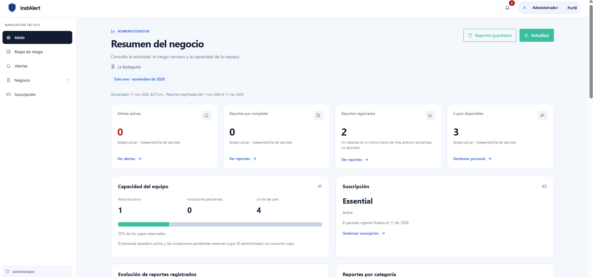
</p>

El resumen del personal operativo presenta riesgo bajo, un incidente cercano y dos notificaciones sin leer. Las gráficas muestran la evolución de los registros y su distribución por estado.

<p align="center">
  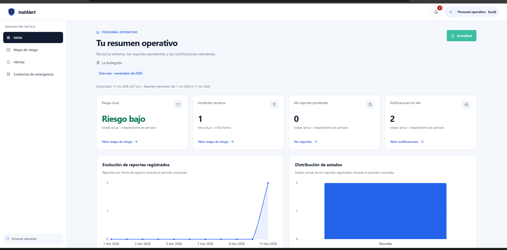
</p>

Como evidencia complementaria, la siguiente captura del entorno aislado del 10/11 muestra las series completas del dashboard administrativo. Sus valores y el plan Professional pertenecen a datos sintéticos de esa comprobación, diferentes de la captura actual.

<p align="center">
  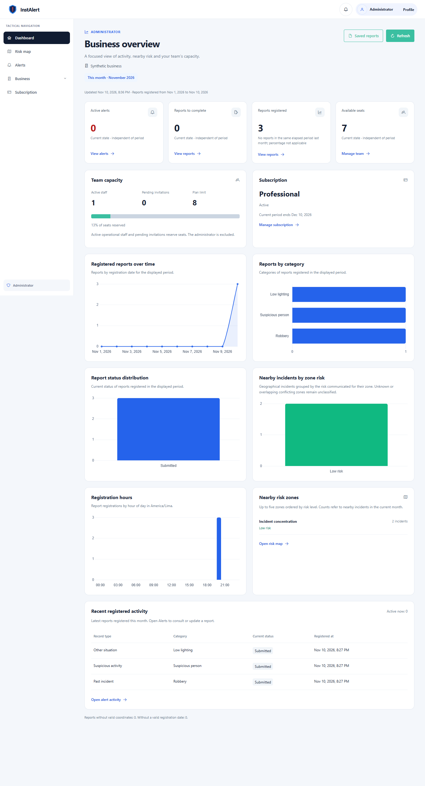
</p>

**2. Reportes guardados por rango de fechas.** La vista consulta una instantánea persistida y conserva su fecha de corte. El ejemplo sin actividad muestra ceros y estados vacíos, sin generar datos ficticios para llenar las gráficas. La funcionalidad permite rangos de fechas; no se documenta como un cierre mensual automático.

<p align="center">
  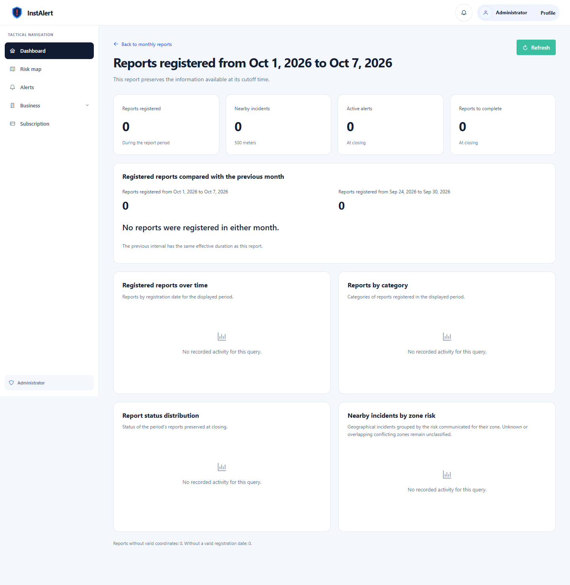
</p>

**3. Mapa de riesgo y filtros de búsqueda.** La captura actual muestra el mapa base, un marcador de incidente y una celda de concentración clasificada con riesgo bajo. Los controles permiten seleccionar periodo, categoría y radio; el ejemplo utiliza las últimas 24 horas y un radio de 1000 metros. Limpiar restablece categoría y periodo a todos y conserva el radio, según el alcance confirmado de US24. La imagen es evidencia visual de ese estado, no de todos los filtros posibles.

<p align="center">
  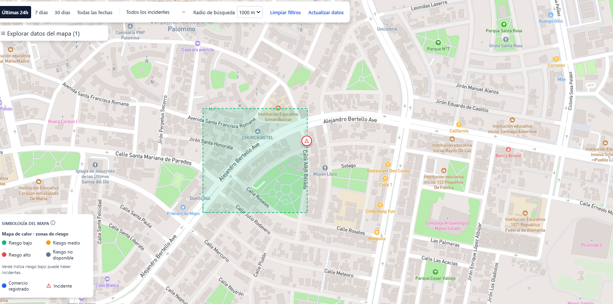
</p>

**4. Perfil personal, comercio y notificaciones.** El perfil personal muestra los datos del usuario y la selección de idioma de la aplicación. El perfil del negocio presenta nombre, RUC, dirección y ubicación en el mapa. La bandeja muestra dos avisos de alerta cercana sin leer, con su fecha de recepción y la acción para marcarlos como leídos.

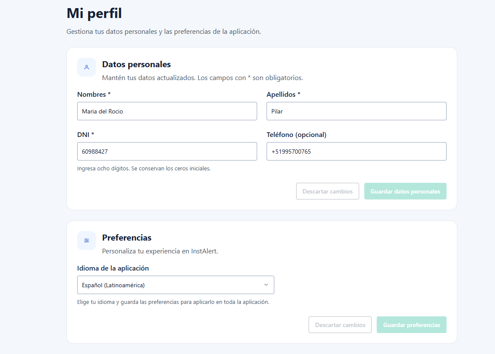

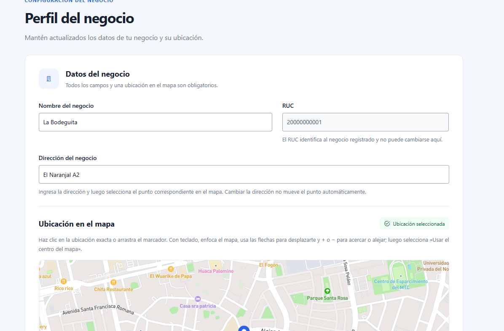

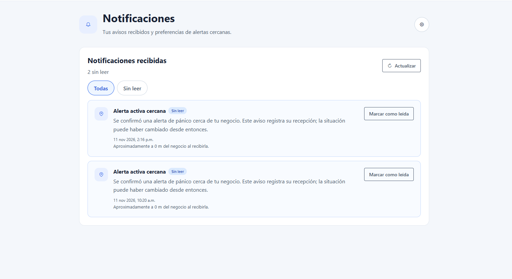

**5. Operaciones de la API por bounded context.** Las siguientes capturas muestran las rutas publicadas en Scalar, separadas por módulo. Los resultados de las consultas y los límites de validación se describen en las evidencias anteriores y en la documentación de servicios.

**Profiles.** Consulta y actualización del perfil personal y sus preferencias.

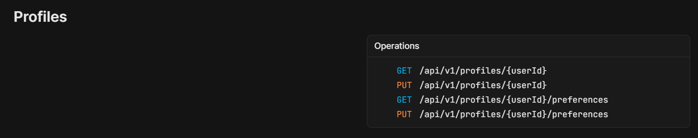

**Business.** Gestión del comercio, cupos, miembros e invitaciones del personal.

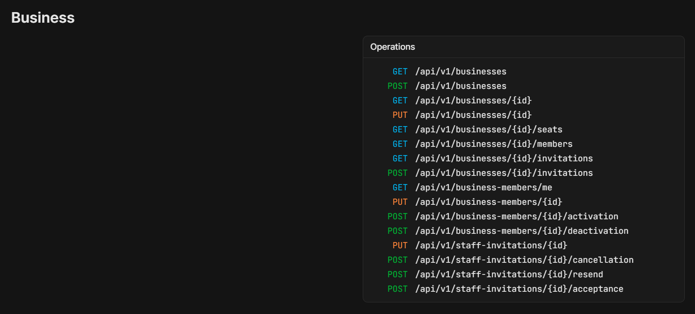

**Alert.** Consulta de alertas, preparación y confirmación del pánico, reportes, ubicación, resolución y preferencias.

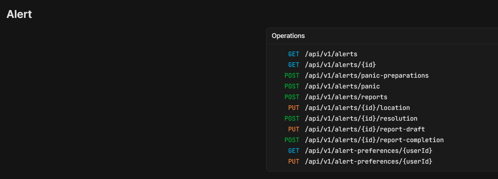

**Contacts.** Registro, consulta, edición y eliminación de contactos de emergencia.

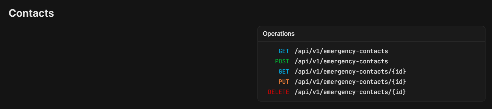

**Notifications.** Consulta de notificaciones y entregas, registro de lectura y configuración de preferencias.

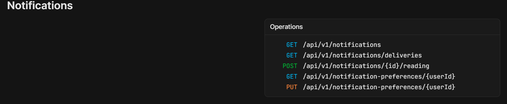

**Mapping.** Consulta de alertas activas, incidentes, comercios y zonas de riesgo.

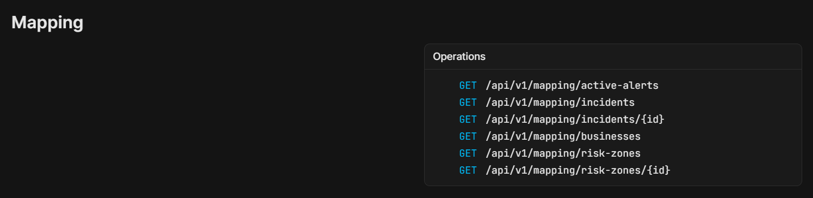

**Dashboard.** Resumen del comercio y creación y consulta de reportes guardados.

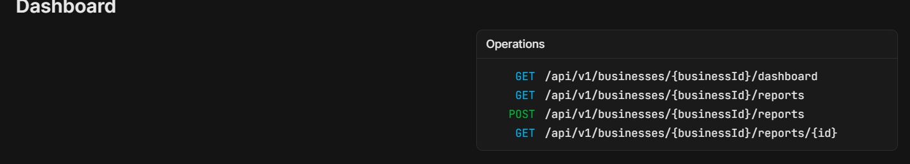

**Payments.** Rutas publicadas para planes, suscripciones y facturación. La captura original muestra parte del listado y recorta algunas rutas en el borde derecho. La validación externa de pagos y del webhook permanece pendiente, como se detalla en la documentación de servicios.

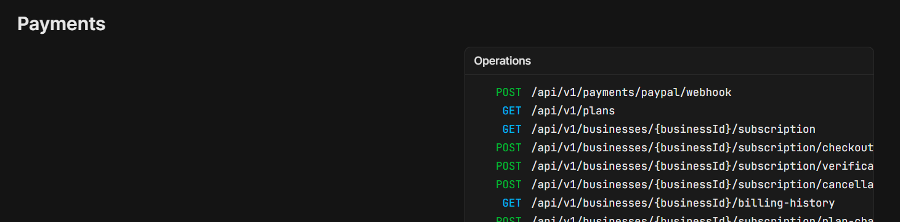

#### 5.2.3.6. Services Documentation Evidence for Sprint Review.

La API publica su contrato OpenAPI y lo presenta mediante Scalar:

- Referencia Scalar desplegada — `https://instalert-backend-yqe9.onrender.com/scalar/`.
- Documento OpenAPI JSON — `https://instalert-backend-yqe9.onrender.com/openapi/v1.json`.
- [Repositorio de Web Services](https://github.com/LosIncreiblesCorp/Instalert-BackEnd).
- Documentación e infraestructura publicadas en [d694d23](https://github.com/LosIncreiblesCorp/Instalert-BackEnd/commit/d694d238ee04de2c4b519a11e91a7fb08bebc86b) y corrección del servidor relativo de Scalar en [0c66de7](https://github.com/LosIncreiblesCorp/Instalert-BackEnd/commit/0c66de779e0a5a25d4cea6ab55a43b4bfe26d492).

El documento desplegado expone **62 operaciones HTTP**, contadas como combinación de verbo y ruta. **55 corresponden al alcance aceptado y soporte de salud**

**Cómo interpretar las llamadas.** La base es `https://instalert-backend-yqe9.onrender.com`. Los identificadores entre llaves se sustituyen por valores devueltos por la API. En esta entrega se utiliza `User-Id: synthetic-admin` o `User-Id: synthetic-employee` según el recorrido; son identidades demo habilitadas para la presentación, no autenticación IAM. `userId` debe corresponder al actor y `businessId` a su comercio. Primero se consulta `GET /api/v1/businesses` para obtener el identificador comercial.

Las solicitudes JSON utilizan `Content-Type: application/json`; `Accept-Language: en-US` o `es-419` selecciona los mensajes disponibles. En los filtros de consulta se usan fechas ISO 8601, coordenadas numéricas y radios en metros. Las respuestas de error se representan como ProblemDetails con el código aplicable: 400 para entrada inválida, 401 para identidad no reconocida, 403 para falta de acceso, 404 para recurso no disponible y 409 para conflicto o transición. Las respuestas 500 y 503 dependen del fallo o proveedor correspondiente; no todos esos escenarios se producen en cada operación.

Los ejemplos de respuesta son **fragmentos ilustrativos** con datos de prueba; el esquema completo se consulta en Scalar. Los listados se representan como arreglos. Los ejemplos de escritura describen el contrato; su ejecución se detalla en la sección de evidencias.

**Profiles — 4 operaciones del alcance aceptado.**

| TS    | Acción y sintaxis HTTP                                                                                                                                        | Parámetros / JSON de entrada                                                                                       | Respuesta de éxito y ejemplo                                                                                                                |
| :---- | :------------------------------------------------------------------------------------------------------------------------------------------------------------ | :----------------------------------------------------------------------------------------------------------------- | :------------------------------------------------------------------------------------------------------------------------------------------ |
| TS-01 | GET `/api/v1/profiles/{userId}` — `https://instalert-backend-yqe9.onrender.com/scalar/#tag/profiles/GET/api/v1/profiles/%7BuserId%7D`                         | Ruta/consulta: `userId`.                                                                                           | 200: `{"userId":"synthetic-employee","firstName":"Ana","lastName":"Pérez","dni":"01234567"}`                                                |
| TS-01 | PUT `/api/v1/profiles/{userId}` — `https://instalert-backend-yqe9.onrender.com/scalar/#tag/profiles/PUT/api/v1/profiles/%7BuserId%7D`                         | Ruta/consulta: `userId`.<br>JSON: `{"firstName":"Ana","lastName":"Pérez","dni":"01234567","phone":"+51900000000"}` | 200: `{"userId":"synthetic-employee","firstName":"Ana","lastName":"Pérez","dni":"01234567"}`                                                |
| TS-02 | GET `/api/v1/profiles/{userId}/preferences` — `https://instalert-backend-yqe9.onrender.com/scalar/#tag/profiles/GET/api/v1/profiles/%7BuserId%7D/preferences` | Ruta/consulta: `userId`.                                                                                           | 200: `{"userId":"synthetic-employee","locale":"en_US","updatedAt":"2026-11-11T15:00:00Z","version":"11111111-1111-4111-8111-111111111111"}` |
| TS-02 | PUT `/api/v1/profiles/{userId}/preferences` — `https://instalert-backend-yqe9.onrender.com/scalar/#tag/profiles/PUT/api/v1/profiles/%7BuserId%7D/preferences` | Ruta/consulta: `userId`.<br>JSON: `{"locale":"en_US"}`                                                             | 200: `{"userId":"synthetic-employee","locale":"en_US","updatedAt":"2026-11-11T15:00:00Z","version":"11111111-1111-4111-8111-111111111111"}` |

**Business — 15 operaciones del alcance aceptado.**

| TS    | Acción y sintaxis HTTP                                                                                                                                                      | Parámetros / JSON de entrada                                                                                                                                               | Respuesta de éxito y ejemplo                                                                                                            |
| :---- | :-------------------------------------------------------------------------------------------------------------------------------------------------------------------------- | :------------------------------------------------------------------------------------------------------------------------------------------------------------------------- | :-------------------------------------------------------------------------------------------------------------------------------------- |
| TS-03 | GET `/api/v1/businesses` — `https://instalert-backend-yqe9.onrender.com/scalar/#tag/business/GET/api/v1/businesses`                                                         | Sin parámetros de ruta o consulta.                                                                                                                                         | 200: `[{"id":"registro-ejemplo","ownerUserId":"synthetic-admin","taxId":"20123456789","name":"Comercio de prueba"}]`                    |
| TS-03 | POST `/api/v1/businesses` — `https://instalert-backend-yqe9.onrender.com/scalar/#tag/business/POST/api/v1/businesses`                                                       | Sin parámetros de ruta o consulta.<br>JSON: `{"taxId":"20123456789","name":"Comercio de prueba","address":"Dirección de prueba","latitude":-12.0464,"longitude":-77.0428}` | 201: `{"id":"registro-ejemplo","ownerUserId":"synthetic-admin","taxId":"20123456789","name":"Comercio de prueba"}`                      |
| TS-03 | GET `/api/v1/businesses/{id}` — `https://instalert-backend-yqe9.onrender.com/scalar/#tag/business/GET/api/v1/businesses/%7Bid%7D`                                           | Ruta/consulta: `id`.                                                                                                                                                       | 200: `{"id":"registro-ejemplo","ownerUserId":"synthetic-admin","taxId":"20123456789","name":"Comercio de prueba"}`                      |
| TS-03 | PUT `/api/v1/businesses/{id}` — `https://instalert-backend-yqe9.onrender.com/scalar/#tag/business/PUT/api/v1/businesses/%7Bid%7D`                                           | Ruta/consulta: `id`.<br>JSON: `{"name":"Comercio de prueba","address":"Dirección de prueba","latitude":-12.0464,"longitude":-77.0428,"taxId":"20123456789"}`               | 200: `{"id":"registro-ejemplo","ownerUserId":"synthetic-admin","taxId":"20123456789","name":"Comercio de prueba"}`                      |
| TS-09 | GET `/api/v1/businesses/{id}/seats` — `https://instalert-backend-yqe9.onrender.com/scalar/#tag/business/GET/api/v1/businesses/%7Bid%7D/seats`                               | Ruta/consulta: `id`.                                                                                                                                                       | 200: `{"limit":4,"activeEmployees":1,"reservedSeats":0,"availableSeats":3}`                                                             |
| TS-04 | GET `/api/v1/businesses/{id}/members` — `https://instalert-backend-yqe9.onrender.com/scalar/#tag/business/GET/api/v1/businesses/%7Bid%7D/members`                           | Ruta/consulta: `id`.                                                                                                                                                       | 200: `[{"id":"registro-ejemplo","businessId":"1","userId":"synthetic-employee","displayName":"Persona de prueba"}]`                     |
| TS-06 | GET `/api/v1/businesses/{id}/invitations` — `https://instalert-backend-yqe9.onrender.com/scalar/#tag/business/GET/api/v1/businesses/%7Bid%7D/invitations`                   | Ruta/consulta: `id`.                                                                                                                                                       | 200: `[{"id":"registro-ejemplo","businessId":"1","displayName":"Persona de prueba","email":"persona@example.test","status":"pending"}]` |
| TS-06 | POST `/api/v1/businesses/{id}/invitations` — `https://instalert-backend-yqe9.onrender.com/scalar/#tag/business/POST/api/v1/businesses/%7Bid%7D/invitations`                 | Ruta/consulta: `id`.<br>JSON: `{"displayName":"Persona de prueba","email":"persona@example.test"}`                                                                         | 201: `{"id":"registro-ejemplo","businessId":"1","displayName":"Persona de prueba","email":"persona@example.test","status":"pending"}`   |
| TS-04 | GET `/api/v1/business-members/me` — `https://instalert-backend-yqe9.onrender.com/scalar/#tag/business/GET/api/v1/business-members/me`                                       | Sin parámetros de ruta o consulta.                                                                                                                                         | 200: `[{"businessId":"1","status":"active"}]`                                                                                           |
| TS-05 | PUT `/api/v1/business-members/{id}` — `https://instalert-backend-yqe9.onrender.com/scalar/#tag/business/PUT/api/v1/business-members/%7Bid%7D`                               | Ruta/consulta: `id`.<br>JSON: `{"displayName":"Persona de prueba","email":"persona@example.test"}`                                                                         | 200: `{"id":"registro-ejemplo","businessId":"1","userId":"synthetic-employee","displayName":"Persona de prueba"}`                       |
| TS-05 | POST `/api/v1/business-members/{id}/activation` — `https://instalert-backend-yqe9.onrender.com/scalar/#tag/business/POST/api/v1/business-members/%7Bid%7D/activation`       | Ruta/consulta: `id`.                                                                                                                                                       | 200: `{"id":"registro-ejemplo","businessId":"1","userId":"synthetic-employee","displayName":"Persona de prueba","status":"active"}`     |
| TS-05 | POST `/api/v1/business-members/{id}/deactivation` — `https://instalert-backend-yqe9.onrender.com/scalar/#tag/business/POST/api/v1/business-members/%7Bid%7D/deactivation`   | Ruta/consulta: `id`.                                                                                                                                                       | 200: `{"id":"registro-ejemplo","businessId":"1","userId":"synthetic-employee","displayName":"Persona de prueba","status":"inactive"}`   |
| TS-07 | PUT `/api/v1/staff-invitations/{id}` — `https://instalert-backend-yqe9.onrender.com/scalar/#tag/business/PUT/api/v1/staff-invitations/%7Bid%7D`                             | Ruta/consulta: `id`.<br>JSON: `{"displayName":"Persona de prueba","email":"persona@example.test"}`                                                                         | 200: `{"id":"registro-ejemplo","businessId":"1","displayName":"Persona de prueba","email":"persona@example.test","status":"pending"}`   |
| TS-07 | POST `/api/v1/staff-invitations/{id}/cancellation` — `https://instalert-backend-yqe9.onrender.com/scalar/#tag/business/POST/api/v1/staff-invitations/%7Bid%7D/cancellation` | Ruta/consulta: `id`.                                                                                                                                                       | 200: `{"id":"registro-ejemplo","businessId":"1","displayName":"Persona de prueba","email":"persona@example.test","status":"pending"}`   |
| TS-07 | POST `/api/v1/staff-invitations/{id}/resend` — `https://instalert-backend-yqe9.onrender.com/scalar/#tag/business/POST/api/v1/staff-invitations/%7Bid%7D/resend`             | Ruta/consulta: `id`.                                                                                                                                                       | 200: `{"id":"registro-ejemplo","businessId":"1","displayName":"Persona de prueba","email":"persona@example.test","status":"pending"}`   |

**Alert — 11 operaciones del alcance aceptado.**

| TS    | Acción y sintaxis HTTP                                                                                                                                       | Parámetros / JSON de entrada                                                                                                                                                                                                                                                  | Respuesta de éxito y ejemplo                                                                                                                                 |
| :---- | :----------------------------------------------------------------------------------------------------------------------------------------------------------- | :---------------------------------------------------------------------------------------------------------------------------------------------------------------------------------------------------------------------------------------------------------------------------- | :----------------------------------------------------------------------------------------------------------------------------------------------------------- |
| TS-13 | GET `/api/v1/alerts` — `https://instalert-backend-yqe9.onrender.com/scalar/#tag/alert/GET/api/v1/alerts`                                                     | Ruta/consulta: `businessId`, `status`, `page`, `pageSize`.                                                                                                                                                                                                                    | 200: `[{"id":"registro-ejemplo","businessId":"1","employeeId":"synthetic-employee","kind":"suspicious-activity"}]`                                           |
| TS-13 | GET `/api/v1/alerts/{id}` — `https://instalert-backend-yqe9.onrender.com/scalar/#tag/alert/GET/api/v1/alerts/%7Bid%7D`                                       | Ruta/consulta: `id`.                                                                                                                                                                                                                                                          | 200: `{"id":"registro-ejemplo","businessId":"1","employeeId":"synthetic-employee","kind":"suspicious-activity"}`                                             |
| TS-11 | POST `/api/v1/alerts/panic-preparations` — `https://instalert-backend-yqe9.onrender.com/scalar/#tag/alert/POST/api/v1/alerts/panic-preparations`             | Sin parámetros de ruta o consulta.<br>JSON: `{"businessId":"1","location":"Ubicación de prueba","latitude":-12.0464,"longitude":-77.0428}`                                                                                                                                    | 200: `{"preparationToken":"TOKEN_DEVUELTO_POR_LA_PREPARACION","notBefore":"2026-11-11T15:00:05Z","expiresAt":"2026-11-11T15:02:05Z","gracePeriodSeconds":5}` |
| TS-11 | POST `/api/v1/alerts/panic` — `https://instalert-backend-yqe9.onrender.com/scalar/#tag/alert/POST/api/v1/alerts/panic`                                       | Sin parámetros de ruta o consulta.<br>JSON: `{"preparationToken":"TOKEN_DEVUELTO_POR_LA_PREPARACION","location":"Ubicación de prueba","latitude":-12.0464,"longitude":-77.0428}`                                                                                              | 200: `{"id":"alerta-ejemplo","kind":"panic","status":"active"}`                                                                                              |
| TS-12 | POST `/api/v1/alerts/reports` — `https://instalert-backend-yqe9.onrender.com/scalar/#tag/alert/POST/api/v1/alerts/reports`                                   | Sin parámetros de ruta o consulta.<br>JSON: `{"businessId":"1","kind":"suspicious-activity","category":"person","description":"Descripción sintética del reporte","location":"Ubicación de prueba","latitude":-12.0464,"longitude":-77.0428,"moment":"2026-11-10T15:00:00Z"}` | 201: `{"id":"reporte-ejemplo","kind":"suspicious-activity","status":"submitted"}`                                                                            |
| TS-14 | PUT `/api/v1/alerts/{id}/location` — `https://instalert-backend-yqe9.onrender.com/scalar/#tag/alert/PUT/api/v1/alerts/%7Bid%7D/location`                     | Ruta/consulta: `id`.<br>JSON: `{"location":"Ubicación de prueba","latitude":-12.0464,"longitude":-77.0428}`                                                                                                                                                                   | 200: `{"id":"registro-ejemplo","businessId":"1","employeeId":"synthetic-employee","kind":"suspicious-activity"}`                                             |
| TS-15 | POST `/api/v1/alerts/{id}/resolution` — `https://instalert-backend-yqe9.onrender.com/scalar/#tag/alert/POST/api/v1/alerts/%7Bid%7D/resolution`               | Ruta/consulta: `id`.                                                                                                                                                                                                                                                          | 200: `{"id":"alerta-ejemplo","status":"resolved","reportStatus":"pending"}`                                                                                  |
| TS-15 | PUT `/api/v1/alerts/{id}/report-draft` — `https://instalert-backend-yqe9.onrender.com/scalar/#tag/alert/PUT/api/v1/alerts/%7Bid%7D/report-draft`             | Ruta/consulta: `id`.<br>JSON: `{"category":"other","description":"Descripción sintética del reporte","location":"Ubicación de prueba","latitude":-12.0464,"longitude":-77.0428,"moment":"2026-11-10T15:00:00Z"}`                                                              | 200: `{"id":"alerta-ejemplo","status":"resolved","reportStatus":"pending"}`                                                                                  |
| TS-15 | POST `/api/v1/alerts/{id}/report-completion` — `https://instalert-backend-yqe9.onrender.com/scalar/#tag/alert/POST/api/v1/alerts/%7Bid%7D/report-completion` | Ruta/consulta: `id`.                                                                                                                                                                                                                                                          | 200: `{"id":"alerta-ejemplo","status":"resolved","reportStatus":"completed"}`                                                                                |
| TS-10 | GET `/api/v1/alert-preferences/{userId}` — `https://instalert-backend-yqe9.onrender.com/scalar/#tag/alert/GET/api/v1/alert-preferences/%7BuserId%7D`         | Ruta/consulta: `userId`.                                                                                                                                                                                                                                                      | 200: `{"userId":"synthetic-employee","employeeId":"synthetic-employee","panicGracePeriodSeconds":5}`                                                         |
| TS-10 | PUT `/api/v1/alert-preferences/{userId}` — `https://instalert-backend-yqe9.onrender.com/scalar/#tag/alert/PUT/api/v1/alert-preferences/%7BuserId%7D`         | Ruta/consulta: `userId`.<br>JSON: `{"panicGracePeriodSeconds":5}`                                                                                                                                                                                                             | 200: `{"userId":"synthetic-employee","employeeId":"synthetic-employee","panicGracePeriodSeconds":5}`                                                         |

**Contacts — 5 operaciones del alcance aceptado.**

| TS    | Acción y sintaxis HTTP                                                                                                                                  | Parámetros / JSON de entrada                                                                                                                                                                 | Respuesta de éxito y ejemplo                                                                                                   |
| :---- | :------------------------------------------------------------------------------------------------------------------------------------------------------ | :------------------------------------------------------------------------------------------------------------------------------------------------------------------------------------------- | :----------------------------------------------------------------------------------------------------------------------------- |
| TS-16 | GET `/api/v1/emergency-contacts` — `https://instalert-backend-yqe9.onrender.com/scalar/#tag/contacts/GET/api/v1/emergency-contacts`                     | Sin parámetros de ruta o consulta.                                                                                                                                                           | 200: `[{"id":"registro-ejemplo","employeeId":"synthetic-employee","fullName":"Contacto de prueba","relationship":"Familiar"}]` |
| TS-17 | POST `/api/v1/emergency-contacts` — `https://instalert-backend-yqe9.onrender.com/scalar/#tag/contacts/POST/api/v1/emergency-contacts`                   | Sin parámetros de ruta o consulta.<br>JSON: `{"fullName":"Contacto de prueba","relationship":"Familiar","phone":"+51900000000","email":"persona@example.test","notes":"Contacto sintético"}` | 201: `{"id":"registro-ejemplo","employeeId":"synthetic-employee","fullName":"Contacto de prueba","relationship":"Familiar"}`   |
| TS-16 | GET `/api/v1/emergency-contacts/{id}` — `https://instalert-backend-yqe9.onrender.com/scalar/#tag/contacts/GET/api/v1/emergency-contacts/%7Bid%7D`       | Ruta/consulta: `id`.                                                                                                                                                                         | 200: `{"id":"registro-ejemplo","employeeId":"synthetic-employee","fullName":"Contacto de prueba","relationship":"Familiar"}`   |
| TS-17 | PUT `/api/v1/emergency-contacts/{id}` — `https://instalert-backend-yqe9.onrender.com/scalar/#tag/contacts/PUT/api/v1/emergency-contacts/%7Bid%7D`       | Ruta/consulta: `id`.<br>JSON: `{"fullName":"Contacto de prueba","relationship":"Familiar","phone":"+51900000000","email":"persona@example.test","notes":"Contacto sintético"}`               | 200: `{"id":"registro-ejemplo","employeeId":"synthetic-employee","fullName":"Contacto de prueba","relationship":"Familiar"}`   |
| TS-17 | DELETE `/api/v1/emergency-contacts/{id}` — `https://instalert-backend-yqe9.onrender.com/scalar/#tag/contacts/DELETE/api/v1/emergency-contacts/%7Bid%7D` | Ruta/consulta: `id`.                                                                                                                                                                         | 204: Sin cuerpo.                                                                                                               |

**Notifications — 5 operaciones del alcance aceptado.**

| TS    | Acción y sintaxis HTTP                                                                                                                                                     | Parámetros / JSON de entrada                                                                            | Respuesta de éxito y ejemplo                                                                                              |
| :---- | :------------------------------------------------------------------------------------------------------------------------------------------------------------------------- | :------------------------------------------------------------------------------------------------------ | :------------------------------------------------------------------------------------------------------------------------ |
| TS-18 | GET `/api/v1/notifications` — `https://instalert-backend-yqe9.onrender.com/scalar/#tag/notifications/GET/api/v1/notifications`                                             | Ruta/consulta: `businessId`, `page`, `pageSize`.                                                        | 200: `[{"id":"registro-ejemplo","recipientUserId":"synthetic-employee","targetBusinessId":"1","type":"nearby-panic"}]`    |
| TS-18 | GET `/api/v1/notifications/deliveries` — `https://instalert-backend-yqe9.onrender.com/scalar/#tag/notifications/GET/api/v1/notifications/deliveries`                       | Sin parámetros de ruta o consulta.                                                                      | 200: `[{"id":"registro-ejemplo","sourceAlertId":"valor-ejemplo","sourceInvitationId":"valor-ejemplo","channel":"email"}]` |
| TS-18 | POST `/api/v1/notifications/{id}/reading` — `https://instalert-backend-yqe9.onrender.com/scalar/#tag/notifications/POST/api/v1/notifications/%7Bid%7D/reading`             | Ruta/consulta: `id`.                                                                                    | 200: `{"id":"registro-ejemplo","recipientUserId":"synthetic-employee","targetBusinessId":"1","type":"nearby-panic"}`      |
| TS-19 | GET `/api/v1/notification-preferences/{userId}` — `https://instalert-backend-yqe9.onrender.com/scalar/#tag/notifications/GET/api/v1/notification-preferences/%7BuserId%7D` | Ruta/consulta: `userId`, `businessId`.                                                                  | 200: `{"userId":"synthetic-employee","businessId":"1","nearbyAlertsEnabled":true,"nearbyRadiusMeters":500}`               |
| TS-19 | PUT `/api/v1/notification-preferences/{userId}` — `https://instalert-backend-yqe9.onrender.com/scalar/#tag/notifications/PUT/api/v1/notification-preferences/%7BuserId%7D` | Ruta/consulta: `userId`, `businessId`.<br>JSON: `{"nearbyAlertsEnabled":true,"nearbyRadiusMeters":500}` | 200: `{"userId":"synthetic-employee","businessId":"1","nearbyAlertsEnabled":true,"nearbyRadiusMeters":500}`               |

**Payments — 3 operaciones del alcance aceptado.**

| TS    | Acción y sintaxis HTTP                                                                                                                                                            | Parámetros / JSON de entrada       | Respuesta de éxito y ejemplo                                                           |
| :---- | :-------------------------------------------------------------------------------------------------------------------------------------------------------------------------------- | :--------------------------------- | :------------------------------------------------------------------------------------- |
| TS-20 | GET `/api/v1/plans` — `https://instalert-backend-yqe9.onrender.com/scalar/#tag/payments/GET/api/v1/plans`                                                                         | Sin parámetros de ruta o consulta. | 200: `[{"id":"essential","currency":"USD","maxEmployees":4}]`                          |
| TS-20 | GET `/api/v1/businesses/{businessId}/subscription` — `https://instalert-backend-yqe9.onrender.com/scalar/#tag/payments/GET/api/v1/businesses/%7BbusinessId%7D/subscription`       | Ruta/consulta: `businessId`.       | 200: `{"planId":"essential","status":"active","isSimulated":true}`<br>204: Sin cuerpo. |
| TS-20 | GET `/api/v1/businesses/{businessId}/billing-history` — `https://instalert-backend-yqe9.onrender.com/scalar/#tag/payments/GET/api/v1/businesses/%7BbusinessId%7D/billing-history` | Ruta/consulta: `businessId`.       | 200: `[]` si no hay transacciones confirmadas.                                         |

**Mapping — 6 operaciones del alcance aceptado.**

| TS    | Acción y sintaxis HTTP                                                                                                                           | Parámetros / JSON de entrada                                            | Respuesta de éxito y ejemplo                                                                                                        |
| :---- | :----------------------------------------------------------------------------------------------------------------------------------------------- | :---------------------------------------------------------------------- | :---------------------------------------------------------------------------------------------------------------------------------- |
| TS-25 | GET `/api/v1/mapping/active-alerts` — `https://instalert-backend-yqe9.onrender.com/scalar/#tag/mapping/GET/api/v1/mapping/active-alerts`         | Ruta/consulta: `businessId`, `radiusMeters`.                            | 200: `[{"id":"registro-ejemplo","businessId":"1","title":"Incidente de prueba","description":"Descripción sintética del reporte"}]` |
| TS-25 | GET `/api/v1/mapping/incidents` — `https://instalert-backend-yqe9.onrender.com/scalar/#tag/mapping/GET/api/v1/mapping/incidents`                 | Ruta/consulta: `businessId`, `radiusMeters`, `category`, `since`.       | 200: `[{"id":"registro-ejemplo","businessId":"1","title":"Incidente de prueba","description":"Descripción sintética del reporte"}]` |
| TS-25 | GET `/api/v1/mapping/incidents/{id}` — `https://instalert-backend-yqe9.onrender.com/scalar/#tag/mapping/GET/api/v1/mapping/incidents/%7Bid%7D`   | Ruta/consulta: `businessId`, `id`, `radiusMeters`.                      | 200: `{"id":"registro-ejemplo","businessId":"1","title":"Incidente de prueba","description":"Descripción sintética del reporte"}`   |
| TS-26 | GET `/api/v1/mapping/businesses` — `https://instalert-backend-yqe9.onrender.com/scalar/#tag/mapping/GET/api/v1/mapping/businesses`               | Ruta/consulta: `businessId`, `radiusMeters`.                            | 200: `[{"id":"registro-ejemplo","name":"Comercio de prueba","address":"Dirección de prueba","latitude":-12.0464}]`                  |
| TS-27 | GET `/api/v1/mapping/risk-zones` — `https://instalert-backend-yqe9.onrender.com/scalar/#tag/mapping/GET/api/v1/mapping/risk-zones`               | Ruta/consulta: `businessId`, `radiusMeters`, `category`, `since`.       | 200: `[{"id":"registro-ejemplo","name":"Comercio de prueba","riskLevel":"low","incidentCount":2}]`                                  |
| TS-27 | GET `/api/v1/mapping/risk-zones/{id}` — `https://instalert-backend-yqe9.onrender.com/scalar/#tag/mapping/GET/api/v1/mapping/risk-zones/%7Bid%7D` | Ruta/consulta: `businessId`, `id`, `radiusMeters`, `category`, `since`. | 200: `{"id":"registro-ejemplo","name":"Comercio de prueba","riskLevel":"low","incidentCount":2}`                                    |

**Dashboard — 4 operaciones del alcance aceptado.**

| TS    | Acción y sintaxis HTTP                                                                                                                                                           | Parámetros / JSON de entrada                                                              | Respuesta de éxito y ejemplo                                                                                  |
| :---- | :------------------------------------------------------------------------------------------------------------------------------------------------------------------------------- | :---------------------------------------------------------------------------------------- | :------------------------------------------------------------------------------------------------------------ |
| TS-28 | GET `/api/v1/businesses/{businessId}/dashboard` — `https://instalert-backend-yqe9.onrender.com/scalar/#tag/dashboard/GET/api/v1/businesses/%7BbusinessId%7D/dashboard`           | Ruta/consulta: `businessId`, `radiusMeters`.                                              | 200: `{"role":"administrator","businessId":"1","userId":"synthetic-employee","businessName":"valor-ejemplo"}` |
| TS-29 | GET `/api/v1/businesses/{businessId}/reports` — `https://instalert-backend-yqe9.onrender.com/scalar/#tag/dashboard/GET/api/v1/businesses/%7BbusinessId%7D/reports`               | Ruta/consulta: `businessId`.                                                              | 200: `[{"id":"registro-ejemplo","businessId":"1","startDate":"2026-11-01","endDate":"2026-11-10"}]`           |
| TS-29 | POST `/api/v1/businesses/{businessId}/reports` — `https://instalert-backend-yqe9.onrender.com/scalar/#tag/dashboard/POST/api/v1/businesses/%7BbusinessId%7D/reports`             | Ruta/consulta: `businessId`.<br>JSON: `{"startDate":"2026-11-01","endDate":"2026-11-10"}` | 201: `{"id":"registro-ejemplo","businessId":"1","startDate":"2026-11-01","endDate":"2026-11-10"}`             |
| TS-29 | GET `/api/v1/businesses/{businessId}/reports/{id}` — `https://instalert-backend-yqe9.onrender.com/scalar/#tag/dashboard/GET/api/v1/businesses/%7BbusinessId%7D/reports/%7Bid%7D` | Ruta/consulta: `businessId`, `id`.                                                        | 200: `{"id":"registro-ejemplo","businessId":"1","startDate":"2026-11-01","endDate":"2026-11-10"}`             |

**Health — 2 operaciones del alcance aceptado.**

| TS      | Acción y sintaxis HTTP                                                                                  | Parámetros / JSON de entrada       | Respuesta de éxito y ejemplo |
| :------ | :------------------------------------------------------------------------------------------------------ | :--------------------------------- | :--------------------------- |
| Soporte | GET `/health/live` — `https://instalert-backend-yqe9.onrender.com/scalar/#tag/health/GET/health/live`   | Sin parámetros de ruta o consulta. | 200: `{"status":"alive"}`    |
| Soporte | GET `/health/ready` — `https://instalert-backend-yqe9.onrender.com/scalar/#tag/health/GET/health/ready` | Sin parámetros de ruta o consulta. | 200: `{"status":"ready"}`    |

**Reglas para interpretar las respuestas.** En Profiles, DNI se representa como texto para conservar ceros iniciales. En Business, un administrador posee un comercio y una membresía inactiva conserva su asociación; el administrador no consume cupo. En Alert, preparar no crea una alerta y confirmar exige esperar el periodo del servidor; resolver y completar el reporte son acciones distintas. En Notifications, el radio admite 100, 500 o 1000 metros y se aplica desde la ubicación del comercio. En Mapping, el riesgo usa una ventana fija de 30 días y niveles bajo (1–5), medio (6–14) y alto (15 o más). En Dashboard, los rangos no incluyen fechas futuras y la consulta de un reporte devuelve la instantánea guardada.

**Capturas de interacción con la documentación.** La primera muestra la versión 1.0.0, los módulos y el servidor HTTPS. La segunda registra una consulta de lectura ejecutada desde Scalar con HTTP 200 y status ready.

<p align="center">
  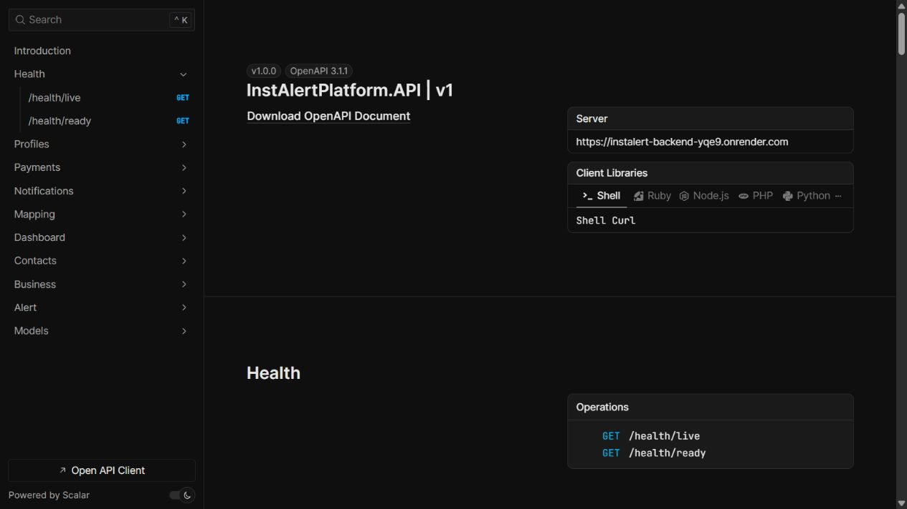
</p>
<p align="center">
  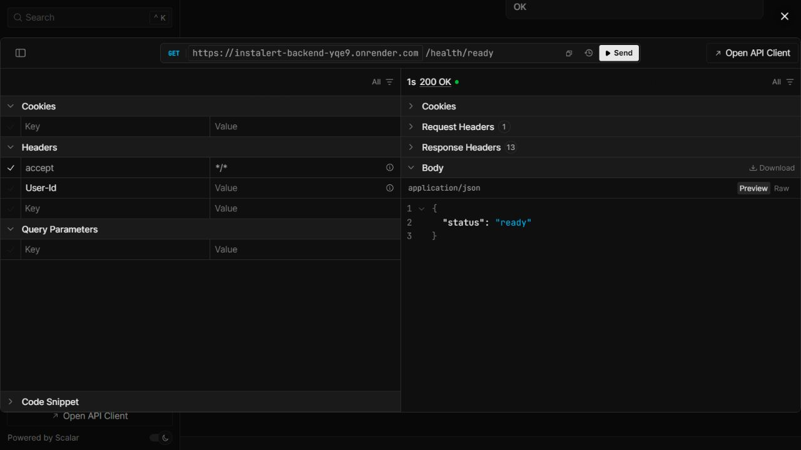
</p>

#### 5.2.3.7. Software Deployment Evidence for Sprint Review.

**Direcciones desplegadas**

- Backend: `https://instalert-backend-yqe9.onrender.com`
- Frontend: `https://instalert-c3f7f.web.app/`

El backend se publicó como Web Service Docker en Render y utiliza MySQL administrado por Aiven. El frontend conserva Firebase Hosting y se actualizó su configuración para consultar la API pública.

| Producto        | Versión de código                                                             | Publicación / configuración                                                                                     | Evidencia al corte                                                                                                                                              |
| :-------------- | :---------------------------------------------------------------------------- | :-------------------------------------------------------------------------------------------------------------- | :-------------------------------------------------------------------------------------------------------------------------------------------------------------- |
| Web Services    | [v1.0.0](https://github.com/LosIncreiblesCorp/Instalert-BackEnd/tree/v1.0.0)  | `https://instalert-backend-yqe9.onrender.com`, Dockerfile en la raíz, puerto PORT y health check /health/ready. | Captura del servicio Live, rama release/1.0.0 y commit 0c66de7, junto con consultas públicas comprobadas.                                                       |
| Base de datos   | Migraciones EF Core del backend                                               | MySQL en Aiven, conexión TLS y certificado ca.pem disponible en Render como secret file.                        | La consola muestra MySQL 8.4.11 en Running y la base defaultdb. Readiness comprueba conexión y ausencia de migraciones pendientes. No se publican credenciales. |
| Web Application | [v2.0.0](https://github.com/LosIncreiblesCorp/Instalert-FrontEnd/tree/v2.0.0) | Proyecto Firebase instalert-c3f7f; public dist y reescritura SPA a index.html; API configurada hacia Render.    | El sitio público respondió HTTP 200; su bundle contiene la URL de Render y CORS admite el origen web.app. La captura confirma el proyecto Firebase.             |
| Landing Page    | Actualización de contenido del Sprint 3                                       | GitHub Pages: `https://losincreiblescorp.github.io/InstAlert-LandingPage/`                                      | Se agregaron los videos About the Team y About the Product para presentar al equipo y explicar el producto.                                                     |

**Landing Page.** Se agregaron los videos **About the Team** y **About the Product**, que presentan a los integrantes del equipo y las funcionalidades de InstAlert.

- Repositorio: `https://github.com/LosIncreiblesCorp/InstAlert-LandingPage`
- Sitio publicado: `https://losincreiblescorp.github.io/InstAlert-LandingPage/`

**Backend en Render.** La imagen usa .NET 10 en dos etapas: restore/publish con SDK y ejecución con ASP.NET. El proceso escucha en todas las interfaces y utiliza el puerto proporcionado por Render. .dockerignore excluye salidas de compilación, configuración de desarrollo y certificados locales. La conexión y las credenciales del proveedor se suministran en el entorno del servicio, sin incorporarlas al informe.

El certificado de Aiven se publica como secret file `ca.pem`, disponible en `/etc/secrets/ca.pem`; la conexión utiliza TLS con verificación de CA. Las migraciones se aplican explícitamente: la ejecución automática en Production está deshabilitada. El seeder de demostración está habilitado y su repetición no debe duplicar comercio, perfiles ni membresías. Esta configuración conserva datos demo para la presentación y no constituye un registro de usuarios mediante IAM.

**Frontend en Firebase Hosting.** El archivo .firebaserc selecciona `instalert-c3f7f` y firebase.json publica `dist`. La compilación obtiene `VITE_INSTALERT_PLATFORM_API_URL=https://instalert-backend-yqe9.onrender.com/api/v1` .

```text
npm run build
firebase deploy --only hosting --project instalert-c3f7f
```

**Evidencias de los proveedores.** Render muestra el servicio Instalert-BackEnd con runtime Docker, estado Live, fuente release/1.0.0 y commit 0c66de7.

<p align="center">
  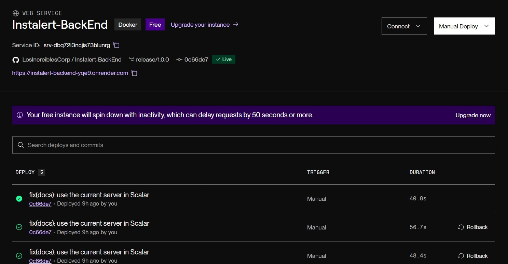
</p>

La consola de Aiven muestra el servicio mysql-65525dd ejecutándose con MySQL 8.4.11, un nodo y la base defaultdb. Esta imagen confirma la existencia y el estado del recurso.

<p align="center">
  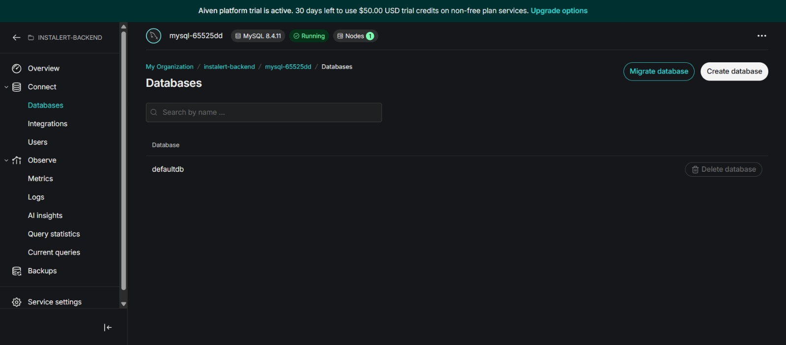
</p>

La captura de Firebase muestra el proyecto InstAlert. Corresponde a la vista general del proyecto.

<p align="center">
  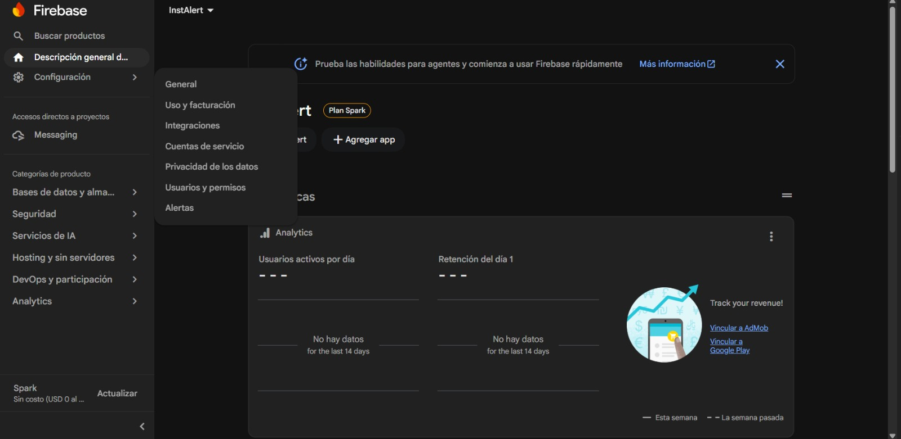
</p>

#### 5.2.3.8. Team Collaboration Insights during Sprint.

El equipo trabajó por módulos con ramas feature, revisiones e integración a develop. Los releases consolidados se integraron a main y de vuelta a develop, conservando los tags backend v1.0.0 y frontend v2.0.0. El historial de commits y los pull requests registran la autoría y las integraciones realizadas.

**Contribuciones registradas en main.** El siguiente recuento corresponde al historial Git de main entre el 24/10/2026 y el 11/11/2026 e incluye los merges. Las cifras expresan la cantidad de commits por integrante durante ese intervalo.

| Integrante                           | GitHub Username | Backend | Frontend |
| :----------------------------------- | :-------------- | ------: | -------: |
| Asto Jácome, José Gustavo            | DhudsQ          |      73 |       22 |
| Díaz Mendoza, Sebastián Víctor André | DiazDeveloper   |      52 |       10 |
| Noriega Collado, Jean Fabio          | dumbaskidd      |      49 |       10 |
| Ruiz Villegas, Yngrid Nahir          | nahiryn8        |      21 |        6 |
| Simón Calderón, Ismael Sebastián     | Mayel-dev       |     111 |        7 |
| **Total del intervalo**              |                 | **306** |   **55** |

**Analíticas e integración de ramas del backend.** El gráfico de contribuidores muestra cinco barras, de los 5 miembros del grupo. La gráfica de red identifica las ramas de preparación de despliegue.

<p align="center">
  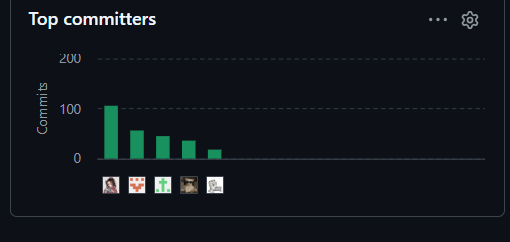
</p>

<p align="center">
  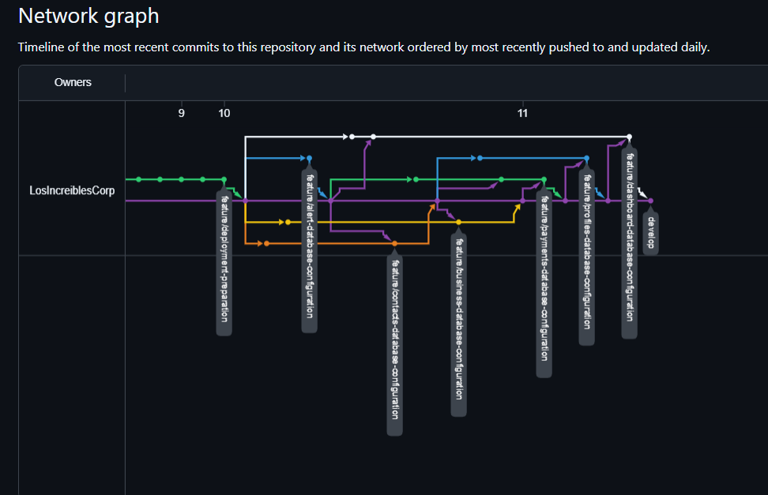
</p>

**Analíticas e integración de ramas del frontend.** El segundo gráfico presenta la actividad de cinco contribuidores. La red de ramas permite observar las integraciones de Alert, Contacts, Notifications, Mapping, Payments y Dashboard, además de release/2.0.0 y su relación con main y develop.

<p align="center">
  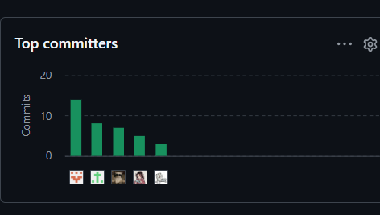
</p>

<p align="center">
  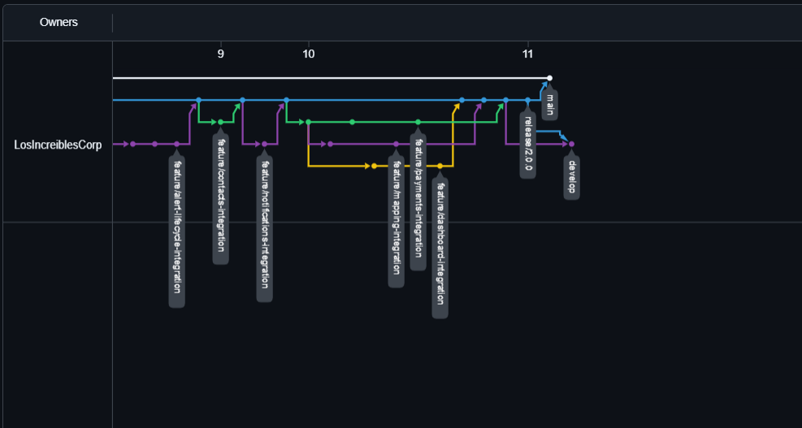
</p>

## 5.3. Validation Interviews

### 5.3.1. Diseño de Entrevistas.

Esta sección describe el diseño de las entrevistas de validación orientadas a evaluar la navegación, claridad y experiencia de uso de InstAlert. La validación se realizará considerando los dos segmentos objetivo del proyecto: administradores de establecimientos comerciales y personal operativo.

Durante las sesiones, los participantes interactuarán inicialmente con la Landing Page de InstAlert y, posteriormente, con la aplicación web correspondiente a su segmento. Para ello, se han definido tareas basadas en los User Flows documentados en el informe, con el propósito de observar cómo los participantes completan las principales acciones de la plataforma, identificar posibles dificultades y recopilar sus opiniones sobre la utilidad y facilidad de uso del producto.

Las entrevistas incluirán preguntas relacionadas con la comprensión de la información, facilidad de navegación, claridad de los mensajes, utilidad de las funcionalidades y oportunidades de mejora.

**Evaluación de la Landing Page**

Antes de utilizar las aplicaciones web, los participantes de ambos segmentos explorarán la Landing Page de InstAlert, con el objetivo de evaluar si la información presentada permite comprender el propósito de la plataforma, sus funcionalidades y los beneficios que ofrece.

**Tareas asignadas**

- Ingresar a la Landing Page de InstAlert y explorar su contenido principal.
- Identificar el propósito de InstAlert y el problema que busca resolver.
- Revisar las funcionalidades y beneficios que presenta la plataforma.
- Visualizar el video informativo y evaluar si permite comprender mejor el funcionamiento del producto.
- Explorar las secciones de información, planes y sobre nosotros.
- Comparar los planes disponibles e identificar las características y beneficios de cada uno.
- Revisar los precios y evaluar si la información presentada es clara.
- Identificar los medios de contacto y las opciones disponibles para conocer o utilizar InstAlert.

**Preguntas de validación**

1. ¿Qué fue lo primero que llamó tu atención al ingresar a la página?
2. ¿Qué crees que ofrece InstAlert y a qué tipo de usuarios está dirigido?
3. ¿Qué problema crees que busca resolver InstAlert? ¿Consideras que es relevante para un establecimiento comercial?
4. ¿Qué entiendes por las funcionalidades y beneficios que presenta InstAlert? ¿Cuál consideras más útil?
5. ¿El video te permitió comprender mejor el funcionamiento del producto? ¿Qué información adicional esperabas encontrar?
6. ¿Encontraste fácilmente las secciones de funciones, planes y sobre nosotros?
7. ¿Qué diferencias encuentras entre los planes? ¿Te resulta fácil identificar qué incluye cada uno?
8. ¿Los precios te parecen claros? ¿Prefieres visualizarlos en soles o dólares?
9. ¿Consideras que la información está organizada de manera clara?
10. ¿Hubo alguna sección que te pareciera innecesaria o confusa?
11. ¿La página te transmite confianza para utilizar InstAlert? ¿Por qué?
12. ¿Qué información adicional necesitarías para decidirte a utilizar InstAlert?

---

**Primer Segmento Objetivo (Administradores de establecimientos comerciales)**

**User Flows**

Los siguientes User Flows corresponden a los diagramas de la aplicación web del administrador documentados en el informe:

- **User Flow 1** - Registro exitoso de un comercio y registro con errores.
- **User Flow 2** - Consulta del mapa de riesgo.
- **User Flow 3** - Consulta del historial de alertas del administrador.
- **User Flow 4** - Selección y gestión de una suscripción.
- **User Flow 5** - Agregar personal operativo y validación de errores.

  **Tareas asignadas**

- Realizar el proceso de registro de un establecimiento comercial, completando los datos solicitados.
- Explorar el proceso de registro e identificar los pasos necesarios para ingresar las credenciales y seleccionar un plan.
- Evaluar el comportamiento del sistema ante información incorrecta o un correo electrónico que ya se encuentre registrado.
- Ingresar al panel administrativo y ubicar el mapa de riesgo.
- Explorar el mapa e interpretar los colores, símbolos e información que representan los establecimientos y sus incidentes.
- Seleccionar un establecimiento en el mapa y revisar los detalles de los incidentes disponibles.
- Ingresar al historial de alertas del administrador y revisar los registros presentados.
- Identificar cómo consultar las alertas y seleccionar el establecimiento cuyas incidencias desea revisar.
- Acceder a la sección de suscripciones y revisar los planes disponibles.
- Explorar las opciones para seleccionar o gestionar una suscripción.
- Ingresar a la opción para agregar personal operativo y completar los datos solicitados.
- Evaluar el mensaje de confirmación después de registrar correctamente a un empleado.
- Probar el comportamiento del sistema ante información incorrecta o un correo electrónico duplicado.

**Preguntas de validación**

1. ¿Te resultó sencillo encontrar la opción para registrar tu negocio y completar los datos solicitados?
2. ¿Comprendiste los pasos para ingresar tus credenciales, seleccionar un plan y completar el registro?
3. Si ingresaras información incorrecta o un correo ya registrado, ¿comprenderías el mensaje de error y cómo solucionarlo?
4. ¿Pudiste encontrar fácilmente el mapa de riesgo desde el dashboard?
5. ¿Cómo interpretas la información del mapa? ¿Comprendes qué representan sus colores y símbolos?
6. ¿Te resultó sencillo seleccionar un establecimiento y consultar los detalles de sus incidentes?
7. ¿Pudiste encontrar fácilmente el historial de alertas de tu establecimiento?
8. ¿Comprendiste cómo consultar las alertas y seleccionar el negocio cuyas incidencias deseas revisar?
9. ¿Te resultó sencillo encontrar la sección de gestión de suscripción?
10. ¿Comprendes las diferencias entre los planes y los beneficios que ofrece cada uno?
11. ¿Te resultó clara la información sobre los métodos de pago y la facturación?
12. ¿Pudiste encontrar fácilmente la opción para agregar personal operativo?
13. ¿Los campos solicitados para registrar a un empleado te parecieron claros y necesarios?
14. ¿Comprendiste el mensaje de confirmación cuando se agregó correctamente un empleado?
15. Si ingresaras un correo duplicado o información incorrecta, ¿sabrías cómo corregirlo?
16. ¿Qué tarea te pareció más complicada de realizar?
17. ¿Qué información o funcionalidad agregarías para facilitar la administración de tu establecimiento?

---

**Segundo Segmento Objetivo (Personal operativo)**

**User Flows**

Los siguientes User Flows corresponden a los diagramas de la aplicación web del personal operativo documentados en el informe:

- **User Flow 1** - Activación y resolución de una alerta de pánico.
- **User Flow 2** - Reportar actividad sospechosa.
- **User Flow 3** - Reportar otro tipo de alerta.
- **User Flow 4** - Consulta de notificaciones del sistema.
- **User Flow 5** - Cancelación de una falsa alarma.
- **User Flow 6** - Registro de un contacto de emergencia y validación de errores.
- **User Flow 7** - Consulta del historial de alertas.

**Tareas asignadas**

- Ingresar a la sección de alertas e identificar el botón de pánico.
- Explorar el proceso de activación de una alerta de pánico y observar cómo funciona la cuenta regresiva.
- Revisar el procedimiento para resolver o cancelar una alerta antes de que se active.
- Ingresar a la opción para reportar una actividad sospechosa y completar la información solicitada.
- Explorar las opciones disponibles para describir la situación y registrar los datos del incidente.
- Acceder a la opción para reportar otro tipo de alerta e identificar las categorías disponibles.
- Completar un reporte indicando el tipo de incidente, su ubicación y las evidencias correspondientes, según las opciones disponibles.
- Ingresar a la sección de notificaciones y revisar los avisos recibidos por el sistema.
- Explorar el procedimiento para cancelar una alerta generada por error y revisar el mensaje de confirmación.
- Ingresar a la sección de contactos de emergencia y registrar un nuevo contacto.
- Evaluar el comportamiento del sistema cuando se ingresan datos incorrectos durante el registro del contacto.
- Acceder al historial de alertas y revisar los eventos registrados.
- Utilizar los filtros disponibles para localizar una alerta específica y consultar sus detalles.

**Preguntas de validación**

1. ¿Pudiste encontrar fácilmente el botón de pánico desde la sección de alertas?
2. ¿Comprendiste cómo funciona la cuenta regresiva y qué sucede cuando termina?
3. ¿Te resultó claro cómo cancelar una alerta antes de que se active?
4. ¿Te resultó sencillo completar el reporte de emergencia y seleccionar el tipo de incidente?
5. ¿Las categorías disponibles (robo, intento de robo, asalto u otro) te parecieron claras?
6. ¿Pudiste identificar fácilmente la opción para reportar una actividad sospechosa?
7. ¿Comprendiste qué información debías proporcionar para completar el reporte?
8. ¿Te resultó sencillo encontrar la opción para registrar otro tipo de alerta?
9. ¿Las opciones para describir el incidente, indicar su ubicación y adjuntar evidencias te parecieron claras?
10. ¿Pudiste identificar fácilmente las notificaciones recibidas?
11. ¿La información presentada te permite comprender qué ocurrió y dónde sucedió?
12. ¿Pudiste identificar cómo cancelar una alerta activada por error?
13. ¿Comprendiste qué sucede después de confirmar la cancelación?
14. ¿Pudiste encontrar fácilmente la sección para agregar un contacto de emergencia?
15. ¿Los datos solicitados para registrar un contacto te parecieron claros y necesarios?
16. Si ingresaras información incorrecta, ¿comprenderías qué campo necesitas corregir?
17. ¿Pudiste encontrar fácilmente el historial de alertas y eventos?
18. ¿Te resultó sencillo utilizar los filtros para encontrar una alerta específica?
19. ¿La información presentada te permite comprender los detalles de cada incidente?
20. ¿Qué tarea te pareció más complicada de realizar?
21. ¿Qué cambiarías para que la aplicación fuera más sencilla y rápida de utilizar?

---

**Preguntas generales de cierre**

Al finalizar las actividades correspondientes a cada segmento, se realizarán preguntas generales para conocer la percepción de los participantes sobre la experiencia de uso de InstAlert.

1. ¿Qué fue lo más fácil de realizar durante la prueba?
2. ¿Qué fue lo más difícil o confuso?
3. ¿En algún momento no supiste qué acción realizar?
4. ¿La aplicación te informó claramente cuando realizaste una acción?
5. ¿Consideras que podrías utilizar InstAlert sin ayuda de otra persona?
6. ¿Qué tan fácil te resultó utilizar la plataforma del 1 al 5?
7. ¿Qué funcionalidad consideras más útil?
8. ¿Qué funcionalidad mejorarías o agregarías?
9. ¿Confías en que InstAlert protegería tu información personal y ubicación?
10. ¿Qué situación podría hacer que dejaras de utilizar InstAlert?
11. ¿Consideras que InstAlert aportaría valor a la seguridad de tu establecimiento?
12. Si tuvieras que describir InstAlert en tres palabras, ¿cuáles serían?

### 5.3.2. Registro de Entrevistas.

En esta sección se documentan las entrevistas de validación realizadas a participantes pertenecientes a los dos segmentos objetivo de InstAlert: administradores de establecimientos comerciales y personal operativo.

Las entrevistas tienen como propósito evaluar la experiencia de usuario durante la interacción con la Landing Page y las aplicaciones web, considerando las tareas y los User Flows definidos en la sección 5.3.1.

Para cada participante se registra su información general, evidencia audiovisual, enlace de la grabación en Microsoft Stream, tiempo de inicio, duración de la entrevista y un resumen descriptivo de los resultados obtenidos.

#### Primer Segmento Objetivo: Administradores de establecimientos comerciales

Las entrevistas de este segmento permiten evaluar la comprensión de la propuesta de InstAlert, la navegación por la aplicación administrativa y la facilidad de uso de las funcionalidades relacionadas con la gestión de establecimientos comerciales.

---

---

**Entrevista de Validación N.º 1 — María Rocío de los Ángeles**

| Campo               | Información                                                                                                                                                   |
| ------------------- | ------------------------------------------------------------------------------------------------------------------------------------------------------------- |
| Nombre              | María Rocío                                                                                                                                                   |
| Apellidos           | de los Ángeles                                                                                                                                                |
| Edad                | 42 años                                                                                                                                                       |
| Distrito            | Comas                                                                                                                                                         |
| Evidencia           | 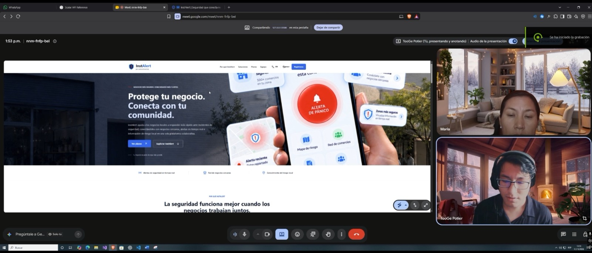                   |
| Enlace del video    | [Entrevista de María Rocío](https://upcedupe-my.sharepoint.com/:v:/g/personal/u20241c630_upc_edu_pe/IQDai321wS-vQI5NkwqzffbFAXzp9qMoHxmiW24EyAcCOvA?e=bFRsDw) |
| Timing donde inicia | 00:00                                                                                                                                                         |
| Duración            | 43:57 min                                                                                                                                                     |

**Resumen de la entrevista**

Durante la entrevista, María Rocío de los Ángeles valoró positivamente las alertas de seguridad en tiempo real y la comunicación entre negocios cercanos, especialmente para prevenir riesgos durante la apertura y cierre de su establecimiento. Tras la demostración de InstAlert, destacó la utilidad del historial de alertas, el mapa de riesgos y la gestión del personal, calificando la facilidad de uso con 4 de 5 puntos. Sin embargo, identificó dificultades para configurar el radio de notificaciones y comprender el estado de las invitaciones enviadas a empleados. Como mejoras, sugirió visualizar el alcance de las alertas directamente en el mapa, ofrecer instrucciones más claras para registrar la ubicación del negocio y brindar mayor transparencia sobre la privacidad de los datos personales.

---

---

**Entrevista de Validación N.º 2 — Umi Natalia Arampa Rojas**

| Campo               | Información                                                                                                                                                                |
| ------------------- | -------------------------------------------------------------------------------------------------------------------------------------------------------------------------- |
| Nombre              | Umi Natalia                                                                                                                                                                |
| Apellidos           | Arampa Rojas                                                                                                                                                               |
| Edad                | 21 años                                                                                                                                                                    |
| Distrito            | La Molina                                                                                                                                                                  |
| Evidencia           | 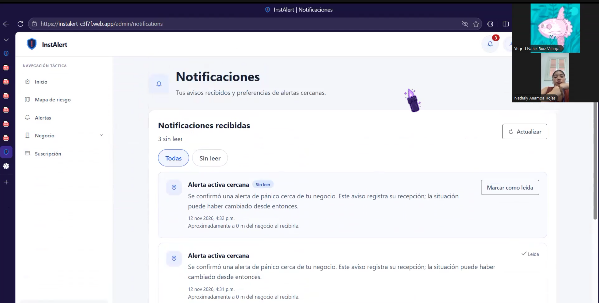                             |
| Enlace del video    | [Entrevista de Umi Natalia Arampa Rojas](https://upcedupe-my.sharepoint.com/:v:/g/personal/u20241c630_upc_edu_pe/IQDbmsfyIXK3QqaaOqt_aeWGAV4e-Il19oqA99QkHEzMAc8?e=KhGQHk) |
| Timing donde inicia | 00:03                                                                                                                                                                      |
| Duración            | 18:39 min                                                                                                                                                                  |

**Resumen de la entrevista**

Durante la entrevista de validación, Umi Natalia Arampa Rojas, encargada de un minimarket, conoció el Landing Page y las principales funcionalidades administrativas de InstAlert. Consideró que la propuesta resultaba innovadora y especialmente útil para micro y pequeños negocios que buscan mejorar su seguridad. Destacó la organización de la información, la claridad de los planes y precios, y la facilidad para identificar las diferentes secciones de la plataforma.

Respecto a la aplicación web, valoró principalmente el historial de reportes de incidentes y el mapa de riesgos, debido a que permiten identificar situaciones de inseguridad y consultar establecimientos cercanos. Calificó la facilidad de uso con 4 de 5 puntos y consideró que podría utilizar la plataforma sin asistencia. Sin embargo, manifestó dificultades iniciales para interpretar y utilizar completamente el mapa, especialmente al seleccionar el radio de alertas. Como oportunidad de mejora, sugirió incorporar notificaciones más directas y anticipadas para informar a los administradores sobre incidentes cercanos. Finalmente, expresó confianza en la plataforma y resaltó su potencial para contribuir a la seguridad de establecimientos comerciales.

---

**Entrevista de Validación N.º 3 — Stefany Trinidad**

| Campo               | Información                                                                                                                                                        |
| ------------------- | ------------------------------------------------------------------------------------------------------------------------------------------------------------------ |
| Nombre              | Stefany                                                                                                                                                            |
| Apellidos           | Trinidad                                                                                                                                                           |
| Edad                | 33 años                                                                                                                                                            |
| Distrito            | Callao                                                                                                                                                             |
| Evidencia           | 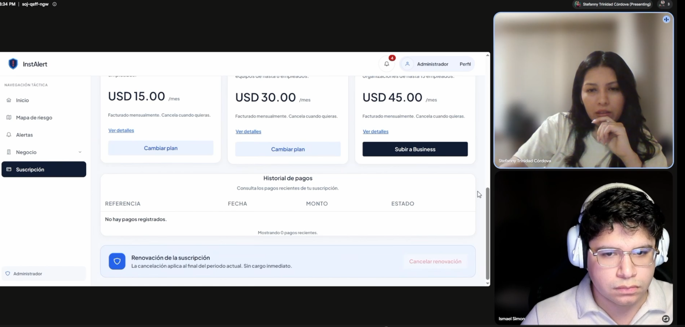                     |
| Enlace del video    | [Entrevista de Stefany Trinidad](https://upcedupe-my.sharepoint.com/:v:/g/personal/u20241c630_upc_edu_pe/IQDi-cMMD4MVQrnh6pxjUCJPATF1jBzFOBvFA2QWanMa6Bk?e=eXblQH) |
| Timing donde inicia | 00:01                                                                                                                                                              |
| Duración            | 25:34 min                                                                                                                                                          |

**Resumen de la entrevista**

Durante la entrevista de validación, Stefany Trinidad exploró el Landing Page y las funcionalidades administrativas de InstAlert, destacando positivamente la propuesta de conectar establecimientos comerciales para fortalecer la seguridad de sus comunidades. Consideró que la página estaba bien estructurada, que los planes eran accesibles y que la gestión del personal y las invitaciones resultaban intuitivas. Asimismo, valoró la información sobre incidentes presentada en el dashboard y calificó la facilidad de uso de la aplicación con 4 de 5 puntos. No obstante, expresó confusión al descubrir que el perfil de administrador no podía generar alertas de pánico, sugiriendo habilitar esta función y mostrar al responsable de cada reporte. También recomendó integrar las alertas con serenazgo o la Policía, incorporar notificaciones emergentes y asistencia dentro de la plataforma, simplificar el dashboard para evitar información redundante y reforzar la autenticación del administrador mediante una contraseña. Finalmente, consideró que InstAlert aporta valor a la seguridad de los negocios, especialmente si se fortalece la comunicación con las autoridades.

---

#### Segundo Segmento Objetivo: Personal operativo y vendedores de establecimientos comerciales

Las entrevistas de este segmento permiten evaluar la experiencia de uso de las funcionalidades relacionadas con la seguridad, generación de alertas, registro de incidentes, contactos de emergencia y consulta de notificaciones.

---

**Entrevista de Validación N.º 4 — Alberto Alejandro Ponce Perales**

| Campo               | Información                                                                                                                                                       |
| ------------------- | ----------------------------------------------------------------------------------------------------------------------------------------------------------------- |
| Nombre              | Alberto Alejandro                                                                                                                                                 |
| Apellidos           | Ponce Perales                                                                                                                                                     |
| Edad                | 26 años                                                                                                                                                           |
| Distrito            | Barranco                                                                                                                                                          |
| Evidencia           |                                  |
| Enlace del video    | [Entrevista de Alejandro Ponce](https://upcedupe-my.sharepoint.com/:v:/g/personal/u20241c630_upc_edu_pe/IQC8tnB_rovTQ6DGnwt7bVdEAZMAWnBciSuIPmpKYlqED_k?e=M53Mg7) |
| Timing donde inicia | 00:01                                                                                                                                                             |
| Duración            | 30:12 min                                                                                                                                                         |

**Resumen de la entrevista**

Durante la entrevista, Alberto Alejandro Ponce Perales valoró positivamente la claridad del Landing Page y la facilidad de navegación de InstAlert. Destacó especialmente la rapidez de las notificaciones y la gestión de contactos de emergencia, considerándolas funcionalidades fundamentales para la seguridad de su establecimiento. Calificó la facilidad de uso con 4 de 5 puntos. Sin embargo, señaló dificultades iniciales para localizar algunas configuraciones y recomendó mejorar la validación de correos electrónicos y números telefónicos, diferenciar mejor los planes comerciales y ampliar la información sobre la protección de datos personales. También sugirió mejorar ciertos elementos visuales de la interfaz.

---

**Entrevista de Validación N.º 5 — Carol Juliana Montenegro Izquierdo**

| Campo               | Información                                                                                                                                                        |
| ------------------- | ------------------------------------------------------------------------------------------------------------------------------------------------------------------ |
| Nombre              | Carol Juliana                                                                                                                                                      |
| Apellidos           | Montenegro Izquierdo                                                                                                                                               |
| Edad                | 19 años                                                                                                                                                            |
| Distrito            | San Juan de Lurigancho                                                                                                                                             |
| Evidencia           |                                       |
| Enlace del video    | [Entrevista de Carol Montenegro](https://upcedupe-my.sharepoint.com/:v:/g/personal/u20241c630_upc_edu_pe/IQDvP5TKmSk_TLsAtGPOdS5lAd9DDPyxtxPe-1W3nFx0nrY?e=DG2LHg) |
| Timing donde inicia | 00:02                                                                                                                                                              |
| Duración            | 20:19 min                                                                                                                                                          |

**Resumen de la entrevista**

Carol Juliana Montenegro Izquierdo consideró que el Landing Page presenta información clara y organizada, destacando el botón de alerta como el elemento más llamativo y útil de InstAlert. Durante la demostración de la aplicación, comprendió las principales funcionalidades relacionadas con alertas, reportes, mapas y preferencias. Calificó la facilidad de uso entre 3 y 4 de 5 puntos, señalando cierta confusión inicial con la cuenta regresiva del botón de emergencia. Como oportunidades de mejora, recomendó simplificar algunos pasos, reorganizar determinadas opciones e incorporar ejemplos prácticos sobre cómo se atienden las alertas durante una emergencia.

---

**Entrevista de Validación N.º 6 — Natalia Tarrillo**

| Campo               | Información                                                                                                                                                        |
| ------------------- | ------------------------------------------------------------------------------------------------------------------------------------------------------------------ |
| Nombre              | Natalia                                                                                                                                                            |
| Apellidos           | Tarrillo                                                                                                                                                           |
| Edad                | 20 años                                                                                                                                                            |
| Distrito            | San Juan de Lurigancho                                                                                                                                             |
| Evidencia           |                                     |
| Enlace del video    | [Entrevista de Natalia Tarrillo](https://upcedupe-my.sharepoint.com/:v:/g/personal/u20241c630_upc_edu_pe/IQD68cRq-kvTS7_eY1zC5UBlAS3K_fwehZNaR4SP538y6C4?e=FQjYcr) |
| Timing donde inicia | 00:00                                                                                                                                                              |
| Duración            | 21:54 min                                                                                                                                                          |

**Resumen de la entrevista**

Natalia Tarrillo valoró positivamente la organización y facilidad de uso de InstAlert, otorgándole una calificación de 5 de 5 puntos. Consideró especialmente útiles el mapa de riesgos, las alertas de emergencia y la gestión de contactos, aunque manifestó cierta confusión inicial al comprender el funcionamiento de la emisión de alertas. Como principal recomendación, propuso incorporar información de contacto de las estaciones de Policía y Bomberos más cercanas para facilitar la respuesta ante emergencias. Asimismo, destacó la importancia de proteger los datos personales de los usuarios y consideró que la plataforma podría contribuir a mejorar la seguridad de los establecimientos comerciales.

---

**Video consolidado de entrevistas de validación**

## **Enlace de Microsoft Stream:** [Pendiente: URL del video consolidado]

**Video consolidado de entrevistas de validación**

**Enlace de Microsoft Stream:** [Pendiente: URL del video consolidado]

Las evidencias y observaciones registradas durante las entrevistas servirán como insumo para la evaluación de usabilidad, arquitectura de información y diseño inclusivo desarrollada en la sección 5.3.3.

### 5.3.3. Evaluaciones según heurísticas.
