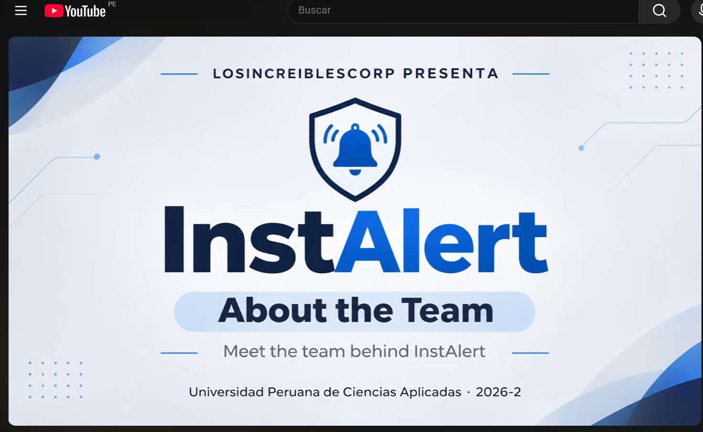

# Anexos

## Exposiciones del Proyecto

* Enlace de Exposición AV1: [Ver video de la exposición AV1](https://upcedupe-my.sharepoint.com/:v:/g/personal/u20241c630_upc_edu_pe/IQDKy1P_7vjFSKC9Q1r7TBw5AZHoo-qmaGEIEixjJACx8tI?nav=eyJyZWZlcnJhbEluZm8iOnsicmVmZXJyYWxBcHAiOiJTdHJlYW1XZWJBcHAiLCJyZWZlcnJhbFZpZXciOiJTaGFyZURpYWxvZy1MaW5rIiwicmVmZXJyYWxBcHBQbGF0Zm9ybSI6IldlYiIsInJlZmVycmFsTW9kZSI6InZpZXcifX0%3D&e=VnvfnY)

* Enlace de Exposición TB1: [Ver video de la exposición TB1](https://upcedupe-my.sharepoint.com/:v:/g/personal/u20241c630_upc_edu_pe/IQDSBUMvYZIURrQp7VUpTYUTAWImKBYAwEZHep-hC5xyS0E?e=SYjToN)

## Needfinding Interviews

* [Enlace general de las entrevistas de Needfinding](https://upcedupe-my.sharepoint.com/:v:/g/personal/u20241c630_upc_edu_pe/IQBrqsJSVffgSaS2KT2RC4_yAbMjSfUL3AXeUaYltiDsDoU?e=GPJvVF)
* [Entrevista 1 — Segmento 1](https://upcedupe-my.sharepoint.com/:v:/g/personal/u20241c630_upc_edu_pe/IQCQ3QCcLMNJTpUchqBe08G_AYlmCTa9z7RyanN0NzsO_Z4?nav=eyJyZWZlcnJhbEluZm8iOnsicmVmZXJyYWxBcHAiOiJTdHJlYW1XZWJBcHAiLCJyZWZlcnJhbFZpZXciOiJTdHJlYW1XZWJBcHAiLCJyZWZlcnJhbE1vZGUiOiJ2aWV3In19&e=1yOnV7)
* [Entrevista 2 — Segmento 1](https://upcedupe-my.sharepoint.com/:v:/g/personal/u20241c630_upc_edu_pe/IQBXA7xWaCu8Sp821kXGKg0eARcjMnTc_E4mKjf0QHs5Oi4?e=Aytt25&nav=eyJyZWZlcnJhbEluZm8iOnsicmVmZXJyYWxBcHAiOiJTdHJlYW1XZWJBcHAiLCJyZWZlcnJhbFZpZXciOiJTaGFyZURpYWxvZy1MaW5rIiwicmVmZXJyYWxBcHBQbGF0Zm9ybSI6IldlYiIsInJlZmVycmFsTW9kZSI6InZpZXcifX0%3D)
* [Entrevista 3 — Segmento 1](https://upcedupe-my.sharepoint.com/:v:/g/personal/u20241c630_upc_edu_pe/IQDHSCAadtHiTYRuyzSdT-UsAThrPOgKm9g88x3TIRDNV8I?e=VXLFKW)
* [Entrevista 4 — Segmento 2](https://upcedupe-my.sharepoint.com/:v:/g/personal/u20241c630_upc_edu_pe/IQDnrzJvuWDISZriFAfcjHYAAfXvGQiumZTBCMOoufNrfOw?nav=eyJyZWZlcnJhbEluZm8iOnsicmVmZXJyYWxBcHAiOiJTdHJlYW1XZWJBcHAiLCJyZWZlcnJhbFZpZXciOiJTaGFyZURpYWxvZy1MaW5rIiwicmVmZXJyYWxBcHBQbGF0Zm9ybSI6IldlYiIsInJlZmVycmFsTW9kZSI6InZpZXcifX0%3D&e=ScD75v)
* [Entrevista 5 — Segmento 2](https://upcedupe-my.sharepoint.com/:v:/g/personal/u20241c630_upc_edu_pe/IQCl-Zw2GZYcQ6myUop36XoIAavZ2BZlRXtX72Ux2v5yuk0?nav=eyJyZWZlcnJhbEluZm8iOnsicmVmZXJyYWxBcHAiOiJTdHJlYW1XZWJBcHAiLCJyZWZlcnJhbFZpZXciOiJTaGFyZURpYWxvZy1MaW5rIiwicmVmZXJyYWxBcHBQbGF0Zm9ybSI6IldlYiIsInJlZmVycmFsTW9kZSI6InZpZXcifX0%3D&e=NSMmm2)
* [Entrevista 6 — Segmento 2](https://upcedupe-my.sharepoint.com/:v:/g/personal/u20241c630_upc_edu_pe/IQClYQhZ0MTlSrBAfqoNr6VLAbTPo-Iti2cySls21r2J_zQ?e=D7Vyap&nav=eyJyZWZlcnJhbEluZm8iOnsicmVmZXJyYWxBcHAiOiJTdHJlYW1XZWJBcHAiLCJyZWZlcnJhbFZpZXciOiJTaGFyZURpYWxvZy1MaW5rIiwicmVmZXJyYWxBcHBQbGF0Zm9ybSI6IldlYiIsInJlZmVycmFsTW9kZSI6InZpZXcifX0%3D)

## Validation Interviews — Sprint 3

* Segmento 1 — Administradores: [María Rocío de los Ángeles](https://upcedupe-my.sharepoint.com/:v:/g/personal/u20241c630_upc_edu_pe/IQDai321wS-vQI5NkwqzffbFAXzp9qMoHxmiW24EyAcCOvA?e=bFRsDw)
* Segmento 1 — Administradores: [Umi Natalia Arampa Rojas](https://upcedupe-my.sharepoint.com/:v:/g/personal/u20241c630_upc_edu_pe/IQDbmsfyIXK3QqaaOqt_aeWGAV4e-Il19oqA99QkHEzMAc8?e=KhGQHk)
* Segmento 1 — Administradores: [Stefany Trinidad](https://upcedupe-my.sharepoint.com/:v:/g/personal/u20241c630_upc_edu_pe/IQDi-cMMD4MVQrnh6pxjUCJPATF1jBzFOBvFA2QWanMa6Bk?e=eXblQH)
* Segmento 2 — Personal operativo: [Alberto Alejandro Ponce Perales](https://upcedupe-my.sharepoint.com/:v:/g/personal/u20241c630_upc_edu_pe/IQC8tnB_rovTQ6DGnwt7bVdEAZMAWnBciSuIPmpKYlqED_k?e=M53Mg7)
* Segmento 2 — Personal operativo: [Carol Juliana Montenegro Izquierdo](https://upcedupe-my.sharepoint.com/:v:/g/personal/u20241c630_upc_edu_pe/IQDvP5TKmSk_TLsAtGPOdS5lAd9DDPyxtxPe-1W3nFx0nrY?e=DG2LHg)
* Segmento 2 — Personal operativo: [Natalia Tarrillo](https://upcedupe-my.sharepoint.com/:v:/g/personal/u20241c630_upc_edu_pe/IQD68cRq-kvTS7_eY1zC5UBlAS3K_fwehZNaR4SP538y6C4?e=FQjYcr)

## Heuristic Evaluation

* [Evaluación heurística de InstAlert realizada por Grupo Creatividad](10-product-implementation-validation-and-deployment.md#533-evaluaciones-según-heurísticas)

## Execution Evidence

* Sprint 1: [Ver video del Sprint 1](<https://upcedupe-my.sharepoint.com/:v:/g/personal/u20241c630_upc_edu_pe/IQDDu4coMfEFS5u3PVPylCcgAWrLM56l0VTYYK_eO1OWuSk?nav=eyJyZWZlcnJhbEluZm8iOnsicmVmZXJyYWxBcHAiOiJTdHJlYW1XZWJBcHAiLCJyZWZlcnJhbFZpZXciOiJTaGFyZURpYWxvZy1MaW5rIiwicmVmZXJyYWxBcHBQbGF0Zm9ybSI6IldlYiIsInJlZmVycmFsTW9kZSI6InZpZXcifX0%3D&e=ChGf3N>)

* Sprint 2: [Ver video del Sprint 2](<https://upcedupe-my.sharepoint.com/:v:/g/personal/u20241c630_upc_edu_pe/IQD_XVhTUYmdR6-AwlPqkF1rAVeVKAK3R8NVx2AJ5A-0M30?nav=eyJyZWZlcnJhbEluZm8iOnsicmVmZXJyYWxBcHAiOiJTdHJlYW1XZWJBcHAiLCJyZWZlcnJhbFZpZXciOiJTaGFyZURpYWxvZy1MaW5rIiwicmVmZXJyYWxBcHBQbGF0Zm9ybSI6IldlYiIsInJlZmVycmFsTW9kZSI6InZpZXcifX0%3D&e=XkCFOg>)

* Sprint 3: [Ver video del Sprint 3](https://upcedupe-my.sharepoint.com/:v:/g/personal/u20241c630_upc_edu_pe/IQC9XmtuxxY9TrpuGHSsSMNlAe0-iL2rmfbyfLlpkBrtuLE?nav=eyJyZWZlcnJhbEluZm8iOnsicmVmZXJyYWxBcHAiOiJTdHJlYW1XZWJBcHAiLCJyZWZlcnJhbFZpZXciOiJTaGFyZURpYWxvZy1MaW5rIiwicmVmZXJyYWxBcHBQbGF0Zm9ybSI6IldlYiIsInJlZmVycmFsTW9kZSI6InZpZXcifX0%3D&e=RaVpEc) — [evidencia documentada de ejecución en el Capítulo V](10-product-implementation-validation-and-deployment.md#5235-execution-evidence-for-sprint-review).

## Productos Desplegados

### Landing Page

<https://losincreiblescorp.github.io/InstAlert-LandingPage/>

### InstAlert Web Application

<https://instalert-c3f7f.web.app/>

### InstAlert Backend API

* API: <https://instalert-backend-yqe9.onrender.com>
* Documentación interactiva Scalar: <https://instalert-backend-yqe9.onrender.com/scalar/>
* Health live: <https://instalert-backend-yqe9.onrender.com/health/live>
* Health ready: <https://instalert-backend-yqe9.onrender.com/health/ready>

La API ASP.NET Core desplegada proporciona los servicios web conectados a la aplicación. Las rutas de salud informan sobre disponibilidad y preparación del servicio; no sustituyen la validación funcional de cada operación.

### Database

Base de datos MySQL 8.4.11 gestionada en Aiven y conectada de forma privada a la API. No cuenta con un endpoint público para navegación.

### Versiones de código desplegadas

* Backend v1.0.0: [código fuente y tag](https://github.com/LosIncreiblesCorp/Instalert-BackEnd/tree/v1.0.0)
* Frontend v2.0.0: [código fuente y tag](https://github.com/LosIncreiblesCorp/Instalert-FrontEnd/tree/v2.0.0)

### Evidencia histórica del Sprint 2

* [API simulada JSON Server](https://instalert-frontend-2bmr.onrender.com/) — servicio de prueba utilizado durante Sprint 2; no corresponde a la API ASP.NET Core actual.

### Video de presentación del producto

* [About the Product](https://youtu.be/nV40EGPt8Aw)

### Video de presentación del equipo

El video presenta a los integrantes del equipo detrás de InstAlert.

## Repositorios

* Frontend Repository

<https://github.com/LosIncreiblesCorp/Instalert-FrontEnd>

* Backend Repository

<https://github.com/LosIncreiblesCorp/Instalert-BackEnd>

* Project Report Repository

<https://github.com/LosIncreiblesCorp/losIncreibles-project-report>

* Landing Page Repository

<https://github.com/LosIncreiblesCorp/InstAlert-LandingPage>

