# Capítulo V: Product Implementation, Validation & Deployment

## 5.1. Software Configuration Management
La Gestión de Configuración de Software (SCM) es una disciplina del desarrollo de software que permite identificar, controlar y realizar un seguimiento de los diferentes componentes de un sistema durante todo su ciclo de vida. Su aplicación facilita la organización y administración de los cambios realizados en el código, documentos y demás elementos del proyecto, contribuyendo a un proceso de desarrollo más ordenado y eficiente. De esta manera, busca optimizar el trabajo del equipo y reducir la posibilidad de errores (Martin, 2023).

### 5.1.1. Software Development Environment Configuration
A continuación se listan los productos de software utilizados por el equipo, organizados por tipo de actividad del ciclo de vida. Para cada herramienta se indica su propósito y la ruta de referencia o descarga.

**1. Project Management**

*Descripción:*

La gestión de proyectos es un aspecto esencial en el desarrollo de software, ya que permite organizar y estructurar las actividades necesarias para alcanzar los objetivos de un proyecto. Las herramientas de gestión facilitan la planificación, asignación y seguimiento de tareas, además de favorecer la comunicación y colaboración entre los integrantes del equipo.

Jira (SaaS):

Jira es una plataforma de gestión de proyectos utilizada principalmente en el desarrollo de software y en equipos que trabajan con metodologías ágiles como Scrum y Kanban. La herramienta permite organizar sprints, supervisar el progreso de las tareas y generar informes sobre el rendimiento del equipo, contribuyendo a una mejor planificación y gestión del trabajo.

https://www.atlassian.com/es/software/jira

  

Discord:

Discord es una plataforma de comunicación que permite mantener reuniones y conversaciones en tiempo real mediante canales de texto y voz. En el desarrollo del proyecto, puede utilizarse como medio de comunicación sincrónica para coordinar actividades, realizar reuniones diarias y mantener una comunicación constante entre los integrantes del equipo.

https://discord.com/

 
   

Google Meet:

Google Meet es una herramienta de videoconferencias que permite realizar reuniones virtuales mediante llamadas de audio y video. En el proyecto, se utiliza para llevar a cabo reuniones formales con el equipo, como revisiones de sprint, coordinaciones y otras actividades que requieren comunicación directa.

https://meet.google.com/

 
   

**2. Requirements Management**

UXPressia:

UXPressia es una plataforma utilizada para representar y organizar información relacionada con los usuarios y sus experiencias. En el proyecto se empleará para elaborar User Personas, Empathy Maps, Journey Maps e Impact Maps, facilitando la identificación de necesidades y comportamientos de los usuarios.

https://uxpressia.com/

  

Miro:

Miro es una plataforma colaborativa utilizada para organizar y representar visualmente diferentes elementos del proyecto. En este caso, será utilizada para la elaboración de diagramas de EventStorming y para facilitar el trabajo colaborativo del equipo.

https://miro.com/

  

**3. Product UX/UI Design**

Figma:

Figma es una herramienta de diseño colaborativo en la nube que permite crear interfaces, prototipos y diseños interactivos. Su funcionamiento en línea facilita que los integrantes de un equipo puedan editar, revisar y comentar los diseños en tiempo real, incluso trabajando desde diferentes lugares. Además, resulta especialmente útil en metodologías ágiles, donde las actividades de diseño y desarrollo se realizan de manera paralela.

https://www.figma.com/es-la/

  

Lucidchart:

Lucidchart es una plataforma de diagramación utilizada para elaborar Wireflows y User Flows, además de diagramas UML y Database Design, permitiendo representar visualmente diferentes aspectos del diseño y estructura del sistema.

https://www.lucidchart.com/

  

**4. Software Development**

Visual Studio Code:

Visual Studio Code es un editor de código utilizado como herramienta principal para el desarrollo de la Landing Page y de la Web Application. Permite trabajar con tecnologías como HTML5, CSS3, JavaScript y Vue.js.

https://code.visualstudio.com/

  

Vue.js:

Vue.js es un framework de JavaScript utilizado para el desarrollo del frontend de la Web Application. Permite construir interfaces de usuario dinámicas y componentes reutilizables.

https://vuejs.org/

  

PrimeVue:

PrimeVue es una biblioteca de componentes de interfaz de usuario para Vue.js. Será utilizada para implementar componentes visuales y funcionales en la Web Application.

https://primevue.org/

  

HTML5 / CSS3 / JavaScript:

HTML5, CSS3 y JavaScript serán utilizados como tecnologías principales para el desarrollo de la Landing Page. Asimismo, HTML5 y CSS3 se emplearán en la construcción de templates de la Web Application, mientras que JavaScript será utilizado como lenguaje de programación del frontend.

  

ASP.NET Core:

ASP.NET Core es el framework utilizado para el desarrollo de los Web Services bajo el estilo arquitectónico RESTful API. Permitirá implementar la lógica del backend y los servicios necesarios para la comunicación con el frontend.

https://dotnet.microsoft.com/apps/aspnet

  

Entity Framework Core:

Entity Framework Core es un ORM para .NET utilizado para facilitar la interacción entre los Web Services desarrollados con ASP.NET Core y la base de datos relacional.

https://learn.microsoft.com/ef/core/

  

C#:

C# es el lenguaje de programación utilizado para el desarrollo de los Web Services mediante ASP.NET Core y Entity Framework Core.

https://dotnet.microsoft.com/languages/csharp

  

MySQL Server:

MySQL Server será utilizado como sistema de gestión de bases de datos relacional (RDBMS), permitiendo almacenar y administrar la información utilizada por la aplicación.

https://www.mysql.com/

  

Structurizr:

Structurizr será utilizado para la elaboración de los diagramas de Software Architecture mediante el modelo C4, permitiendo representar la estructura y arquitectura del sistema.

https://structurizr.com/

  

Lucidchart:

Lucidchart será utilizado para la elaboración de diagramas UML y para el Database Design, permitiendo representar la estructura, relaciones y componentes de la solución.

https://www.lucidchart.com/

  

Git:

Git es un sistema de control de versiones distribuido utilizado para gestionar los cambios realizados en el código fuente de manera local. Permite crear ramas, registrar modificaciones y mantener un historial de versiones del proyecto.

https://git-scm.com/

  

GitHub:

GitHub es una plataforma de desarrollo colaborativo basada en Git que permite alojar repositorios, gestionar versiones del código y facilitar el trabajo colaborativo entre los integrantes del equipo mediante ramas, commits y pull requests.

https://github.com/

  

**5. Software Deployment**

GitHub Pages:

GitHub Pages será utilizado como servicio de hosting para realizar el despliegue de la Landing Page estática y de la Web Application (frontend).

https://pages.github.com/

  

Proveedor de hosting en la nube para ASP.NET Core:

Se utilizará un proveedor de hosting en la nube para realizar el despliegue de los Web Services desarrollados con ASP.NET Core. El proveedor definitivo será determinado de acuerdo con las necesidades del proyecto.

  

**6. Software Documentation**

Swagger / OpenAPI:

Swagger será utilizado para documentar los Web Services mediante la especificación OpenAPI, permitiendo visualizar e interactuar con los endpoints disponibles en la RESTful API.

https://swagger.io/

  

Markdown + Visual Studio Code:

Markdown será utilizado para la elaboración y estructuración de la documentación del proyecto dentro del repositorio. Visual Studio Code permitirá editar los archivos Markdown y utilizar extensiones para facilitar su visualización y generación en diferentes formatos.

  

### 5.1.2. Source Code Management

La administración del código fuente es un pilar esencial para el trabajo colaborativo en el desarrollo de InstAlert. En este apartado se define el modelo de organización y control de versiones utilizado por el equipo mediante GitHub y el flujo de trabajo GitFlow. Esta configuración permite mantener el código fuente y la documentación estructurados, trazables y organizados durante el ciclo de vida del proyecto.

Asimismo, se establecen las convenciones utilizadas para la creación de ramas, la escritura de mensajes de commit y la gestión de versiones mediante Semantic Versioning.

**1. Establecimiento de repositorios en GitHub**

Para organizar los distintos componentes de la solución, el proyecto InstAlert se encuentra distribuido en cuatro repositorios públicos dentro de la organización LosIncreiblesCorp. Cada repositorio posee una responsabilidad específica dentro de la solución.

*Landing Page:*  
Repositorio destinado al sitio web promocional e informativo de InstAlert. Contiene la estructura HTML, hojas de estilo CSS, scripts JavaScript y recursos multimedia utilizados para presentar la propuesta de valor, funcionalidades, planes y equipo del producto.

*Frontend Web Application:*  
Repositorio destinado a la aplicación web del lado del cliente. Contiene la estructura, componentes, vistas y lógica de interacción de la Web Application, además del consumo de los servicios proporcionados por la RESTful API.

*Web Services:*  
Repositorio destinado al Backend de InstAlert. Contiene la lógica de negocio, acceso a datos y servicios RESTful desarrollados con ASP.NET Core y Entity Framework Core. Asimismo, incluye los recursos necesarios para las pruebas automatizadas y la documentación de los endpoints mediante OpenAPI/Swagger.

*Project Report:*  
Repositorio destinado a la documentación académica y técnica del proyecto. Contiene el informe desarrollado colaborativamente en Markdown, junto con los recursos gráficos, diagramas y evidencias correspondientes a cada capítulo.

**Enlaces a los repositorios:**

* Repositorio de Landing Page: https://github.com/LosIncreiblesCorp/InstAlert-LandingPage
* Repositorio de Frontend Web Application: https://github.com/LosIncreiblesCorp/Instalert-FrontEnd
* Repositorio de Web Services: https://github.com/LosIncreiblesCorp/Instalert-BackEnd
* Repositorio del Project Report: https://github.com/LosIncreiblesCorp/losIncreibles-project-report

**2. Workflow de control de versiones (GitFlow)**

Para gestionar la integración de nuevas características y coordinar el trabajo colaborativo, el equipo utiliza GitFlow. Este flujo de trabajo permite desarrollar funcionalidades de manera aislada mediante ramas específicas y posteriormente integrarlas de forma controlada a las ramas principales del proyecto.

*Estructura de ramas principales y de soporte:*

| Nombre de la rama | Descripción |
| --- | --- |
| **Main Branch** (`main`) | Representa el estado estable y listo para producción del proyecto. Recibe únicamente cambios previamente integrados, revisados y validados. |
| **Develop Branch** (`develop`) | Funciona como la rama principal de integración. Las nuevas funcionalidades se incorporan aquí antes de preparar una nueva versión del producto. |
| **Feature Branches** (`feature/*`) | Ramas temporales creadas a partir de `develop` para implementar funcionalidades o tareas específicas de manera independiente.   **Convención:** `feature/nombre-de-la-tarea` |
| **Release Branches** (`release/*`) | Ramas utilizadas para preparar una nueva versión del producto. Permiten realizar validaciones finales y correcciones menores antes de integrar los cambios en `main`.   **Convención:** `release/vX.Y.Z` |
| **Hotfix Branches** (`hotfix/*`) | Ramas creadas a partir de `main` para resolver errores críticos detectados en una versión publicada. Posteriormente, los cambios deben incorporarse tanto en `main` como en `develop`.   **Convención:** `hotfix/descripcion-del-parche` |

**3. Versionado Semántico (Semantic Versioning 2.0.0)**

Para identificar y rastrear las versiones publicadas de InstAlert, el equipo utiliza Semantic Versioning (SemVer). Este estándar emplea el formato `MAJOR.MINOR.PATCH`.

* **MAJOR:** Se incrementa cuando se introducen cambios incompatibles con versiones anteriores.
* **MINOR:** Se incrementa cuando se incorporan nuevas funcionalidades compatibles con la versión actual.
* **PATCH:** Se incrementa cuando se realizan correcciones de errores o mejoras menores que no modifican la compatibilidad del producto.

Ejemplos:

* `v1.0.0`: Primera versión estable del producto.
* `v1.1.0`: Incorporación de nuevas funcionalidades manteniendo compatibilidad.
* `v1.1.1`: Corrección de errores de una versión existente.

**4. Convenciones de Mensajes de Commit (Conventional Commits)**

Los mensajes de commit siguen la especificación Conventional Commits con el objetivo de mantener un historial de cambios consistente, comprensible y fácilmente auditable.

La estructura utilizada es:

`type(scope): description`

Los principales tipos utilizados por el equipo son:

* `feat`: Incorporación de una nueva funcionalidad.  
  Ejemplo: `feat(alerts): add panic alert creation`

* `fix`: Corrección de un error o comportamiento inesperado.  
  Ejemplo: `fix(auth): resolve login validation issue`

* `docs`: Cambios realizados exclusivamente en documentación.  
  Ejemplo: `docs(chapter5): update source code management`

* `style`: Cambios de formato o presentación que no modifican la lógica del sistema.  
  Ejemplo: `style(landing): improve responsive team layout`

* `refactor`: Reestructuración de código existente sin modificar su comportamiento externo.  
  Ejemplo: `refactor(alerts): simplify alert processing logic`

* `test`: Incorporación o modificación de pruebas automatizadas.  
  Ejemplo: `test(auth): add authentication unit tests`

* `chore`: Cambios de configuración, mantenimiento o tareas auxiliares que no afectan directamente una funcionalidad del producto.  
  Ejemplo: `chore(repo): update project configuration`

### 5.1.3. Source Code Style Guide & Coding Conventions

En esta sección, el equipo define las normativas y directrices de codificación que se aplicarán a lo largo del desarrollo de la solución. El objetivo principal es estandarizar la escritura del código en HTML, CSS, JavaScript y C#, asegurando que sea legible, mantenible y escalable. 

Como regla transversal, **toda la nomenclatura (variables, métodos, clases, comentarios, etc.) se redactará exclusivamente en inglés**. Para establecer estas bases, nos alinearemos con las siguientes guías de la industria:

* HTML Style Guide and Coding Conventions
* Google HTML/CSS Style Guide
* Google JavaScript Style Guide
* MDN JavaScript Guidelines
* W3C JavaScript Style Guide
* C# Coding Conventions
* Microsoft ASP.NET Core Coding Guidelines

La estructuración e implementación del sistema, desde la Landing Page hasta los Web Services y el Frontend de la aplicación, seguirán reglas estrictas para cada tecnología involucrada.

**Principios Transversales**
* **Idioma:** Todo el nombrado de elementos técnicos y documentación interna debe estar en inglés.
* **DRY (Don't Repeat Yourself):** Evitar la duplicidad de código mediante la creación de componentes y métodos reutilizables.
* **KISS (Keep It Simple, Stupid):** Priorizar la simplicidad y claridad en la lógica de programación.
* **Indentación:** Mantener una indentación estricta y coherente según el lenguaje utilizado.

---

**HTML**

Se utilizará HTML5 para definir la estructura semántica de las interfaces (Landing Page y vistas de la aplicación web).

*Convenciones de Formato y Estructura:*
* **Indentación:** 2 espacios por nivel. No utilizar tabulaciones.
* **Etiquetas y atributos:** Escribir siempre en minúsculas (ej. `<section>`, `<article>`).
* **Comillas:** Usar comillas dobles para los valores de los atributos (ej. `class="container"`).
* **Cierre de etiquetas:** Todas las etiquetas deben cerrarse adecuadamente. Las etiquetas vacías no requieren barra diagonal en HTML5 (ej. usar ` ` en lugar de ` `).
* **Semántica:** Priorizar etiquetas semánticas (`<header>`, `<nav>`, `<main>`, `<footer>`) sobre el uso excesivo de `
`.
* **Accesibilidad:** Incluir siempre el atributo `alt` en las imágenes y usar atributos ARIA cuando sea necesario para tecnologías de asistencia.
* **Documento base:** Declarar siempre `<!DOCTYPE html>` en la primera línea y especificar el idioma principal `<html lang="en">`.

  

---

**CSS**

Se utilizará para controlar la presentación visual, priorizando un diseño modular y responsivo (Mobile-First).

*Convenciones de Formato y Arquitectura:*
* **Indentación:** 2 espacios por nivel.
* **Sintaxis:** Dejar un espacio antes de la llave de apertura `{` y colocar la llave de cierre `}` en una nueva línea. Escribir cada declaración en su propia línea, terminando con punto y coma `;`.
* **Nomenclatura:** Adoptar la metodología BEM (Block, Element, Modifier) para las clases, utilizando guiones bajos dobles para elementos y guiones medios dobles para modificadores (ej. `.card`, `.card__title`, `.card--highlighted`).
* **Orden de propiedades:** Agrupar propiedades lógicamente: Posicionamiento, Modelo de caja (Box model), Tipografía, Aspecto visual (Colores, fondos) y Animaciones.
* **Especificidad y Anidamiento:** Evitar anidar selectores más de 3 niveles de profundidad. Restringir estrictamente el uso de `!important`.
* **Variables:** Utilizar Custom Properties (variables CSS) en la raíz (`:root`) para colores de la marca, tipografías y espaciados estandarizados.

  

---

**JavaScript**

Se aplicará para la interactividad del lado del cliente y el consumo de APIs, priorizando los estándares modernos de ECMAScript (ES6+).

*Convenciones de Formato y Nomenclatura:*
* **Indentación:** 2 espacios.
* **Sintaxis:** Requerir el uso de punto y coma `;` al final de cada instrucción para evitar problemas de ASI (Automatic Semicolon Insertion). Usar comillas simples para strings (`'texto'`).
* **Nomenclatura:** 
  * Variables y funciones: `camelCase` (ej. `fetchUserData`).
  * Clases y Componentes: `PascalCase` (ej. `UserProfile`).
  * Constantes globales: `UPPER_SNAKE_CASE` (ej. `API_BASE_URL`).
* **Declaración de variables:** Usar `const` por defecto. Utilizar `let` únicamente cuando la variable vaya a ser reasignada. Prohibir el uso de `var`.

*Buenas Prácticas Añadidas:*
* **Igualdad Estricta:** Utilizar siempre `===` y `!==` en lugar de `==` y `!=`.
* **Asincronismo:** Preferir `async/await` sobre cadenas extensas de `.then()` para el manejo de promesas, y siempre envolver el bloque lógico en `try/catch` para el manejo de errores.
* **Funciones:** Utilizar arrow functions `() => {}` para callbacks y métodos anónimos para preservar el contexto de `this`.
* **Documentación:** Usar JSDoc para documentar funciones complejas, describiendo parámetros y valores de retorno.

  

---

**C# (.NET Core)**

Se aplicará en el desarrollo de los Web Services y la lógica del lado del servidor, siguiendo las convenciones oficiales de Microsoft.

*Convenciones de Formato y Nomenclatura:*
* **Indentación:** 4 espacios (configuración por defecto en Visual Studio).
* **Llaves:** Utilizar el estilo Allman (cada llave `{` y `}` va en su propia línea).
* **Nomenclatura:**
  * Clases, Métodos y Propiedades Públicas: `PascalCase` (ej. `UserController`, `GetActiveUsers`, `FirstName`).
  * Interfaces: Prefijo `I` seguido de `PascalCase` (ej. `IUserRepository`).
  * Parámetros y variables locales: `camelCase` (ej. `userId`).
  * Campos privados de clase: Prefijo guion bajo seguido de `camelCase` (ej. `_dbContext`).
* **Longitud de línea:** Evitar exceder los 120 caracteres para mejorar la legibilidad en pantallas estándar.

*Buenas Prácticas Añadidas:*
* **Tipado implícito:** Usar la palabra clave `var` cuando el tipo de dato sea evidente en el lado derecho de la asignación (ej. `var users = new List<User>();`).
* **Inyección de Dependencias:** Todos los servicios y repositorios deben ser inyectados a través del constructor, evitando instanciaciones directas (uso de `new`) de clases de lógica de negocio.
* **Controladores ligeros:** Mantener los controladores (Controllers) lo más delgados posible, delegando toda la lógica de negocio a la capa de Servicios (Services).
* **Asincronismo:** Los métodos que realicen operaciones de base de datos o I/O deben ser asíncronos, llevando el sufijo `Async` (ej. `GetUserByIdAsync`) y utilizando `async` y `await`.
* **LINQ:** Aprovechar los métodos de extensión de LINQ para manipular colecciones de forma declarativa y legible.

  

### 5.1.4. Software Deployment Configuration

En esta sección se describe la estrategia de despliegue definida para los productos que conforman la solución InstAlert. Debido a que el alcance del Sprint 1 contempla principalmente el desarrollo y publicación de la Landing Page, actualmente este es el único componente desplegado en un entorno de producción. El despliegue de la Frontend Web Application y los Web Services se realizará en iteraciones posteriores, de acuerdo con el avance del proyecto.

**1. Landing Page**

* **Plataforma de Hosting:** GitHub Pages

* **Proceso de Despliegue:**
  * **Integración:** Las nuevas características se desarrollan en ramas `feature/*` creadas a partir de `develop` y posteriormente se integran mediante Pull Requests.
  * **Preparación de versión:** Una vez que las funcionalidades han sido integradas y validadas, se prepara la versión correspondiente siguiendo el flujo GitFlow.
  * **Pase a producción:** La versión estable se integra en la rama `main`.
  * **Publicación:** GitHub Pages publica automáticamente el contenido estático del repositorio desde la configuración establecida para producción.

* **Estado actual:** Desplegado.
* **URL de Producción:** https://losincreiblescorp.github.io/InstAlert-LandingPage/

**2. Frontend Web Application**

* **Plataforma de Hosting planificada:** Vercel

La Frontend Web Application será desplegada en Vercel en una iteración posterior del proyecto. El proceso previsto considera la integración de las funcionalidades mediante ramas `feature/*`, Pull Requests hacia `develop` y la preparación de una versión estable antes de su incorporación a `main`.

Una vez implementado el frontend, el proceso de construcción utilizará las herramientas correspondientes al proyecto Vue.js, incluyendo la instalación de dependencias y la generación del build de producción. Asimismo, se configurarán las variables de entorno necesarias, como la URL base de los Web Services.

* **Estado actual:** Pendiente de implementación y despliegue.
* **URL de Producción:** No disponible en el Sprint 1.

**3. Web Services**

* **Tecnología:** ASP.NET Core
* **Plataforma de Hosting planificada:** Railway

Los Web Services serán desplegados en Railway en una iteración posterior del proyecto. Previamente, el backend será desarrollado y validado mediante las pruebas correspondientes.

El proceso de despliegue previsto contempla la compilación del proyecto en modo Release mediante el SDK de .NET, la configuración segura de variables de entorno y secretos, como la cadena de conexión de la base de datos y las claves utilizadas para autenticación mediante JWT.

Una vez que los Web Services se encuentren desplegados, sus endpoints serán documentados utilizando OpenAPI/Swagger, permitiendo visualizar y probar las operaciones disponibles de la RESTful API.

* **Estado actual:** Pendiente de implementación y despliegue.
* **URL de Producción (API):** No disponible en el Sprint 1.
## 5.2. Landing Page, Services & Applications Implementation

### 5.2.1. Sprint 1

En este primer sprint se desarrolló la landing page y la documentación inicial del proyecto InstAlert.

#### 5.2.1.1. Sprint Planning 1

| Sprint # | Sprint 1 |
| :--- | :--- |
| **Sprint Planning Background** | |
| Date | 02/09/2026 |
| Time | 11:00 PM |
| Location | Google Meet |
| Prepared By | Sebastian Victor Andre Diaz Mendoza |
| Attendees (to planning meeting) | Jose Gustavo Asto Jacome Sebastian Victor Andre Diaz Mendoza Jean Fabio Noriega Collado Yngrid Nahir Ruiz Villegas Ismael Sebastian Simon Calderon |
| **Sprint 1 Review Summary** | Durante este primer ciclo, los esfuerzos del equipo se centraron en definir la base estratégica e identitaria de InstAlert. Logramos concluir satisfactoriamente los artefactos fundamentales de UX (User Personas, Customer Journey Maps y Arquitectura de la Información), los cuales sirvieron de guía directa para la concepción del producto. Con este respaldo, logramos diseñar, desarrollar y desplegar la versión inicial de nuestra Landing Page, en la cual se expone de forma clara la propuesta de valor del SaaS y los detalles de los planes de suscripción. |
| **Sprint 1 Retrospective Summary** | El equipo concluyó que la dinámica de trabajo fue altamente productiva, impulsada por una clara y equitativa distribución de responsabilidades. Se destacó positivamente la transición y alineación entre el prototipado realizado en Figma y la configuración inicial de los repositorios en GitHub. Como área de mejora para el próximo sprint, acordamos optimizar nuestras estimaciones de tiempo (puntos de historia), especialmente de cara al inicio del desarrollo e integración del lado de la presentacion del producto (frontend). |
| **Sprint Goal & User Stories** | |
| **Sprint 1 Goal** | Nuestro objetivo principal consistió en presentar una primera iteración completamente funcional y desplegada de la Landing Page, a la par de la redacción formal de los primeros capítulos del informe técnico. Consideramos que estos avances nos permiten proyectar una propuesta de valor sólida para captar a nuestro público objetivo, hito que se validará con el tráfico web inicial y la aprobación de la documentación entregada. |
| **Sprint 1 Velocity** | 14 |
| **Sum of Story Points** | 14 |

**Nota:** Cuadro resumen que detalla la planificación estratégica, las metas establecidas, los resultados obtenidos y las métricas de esfuerzo correspondientes al Sprint 1 de InstAlert.

#### 5.2.1.2. Aspect Leaders and Collaborators

| Team Member | GitHub Username | Landing Page | Diseño UI/UX | Documentación |
| :--- | :--- | :--- | :--- | :--- |
| Jose Gustavo Asto Jacome | DhudsQ | Lider | Colaborador | Colaborador |
| Sebastian Victor Andre Diaz Mendoza | DiazDeveloper | Colaborador | Colaborador | Colaborador |
| Jean Fabio Noriega Collado | dumbaskidd | Colaborador | Colaborador | Lider |
| Yngrid Nahir Ruiz Villegas | nahiryn8 | Colaborador | Líder | Colaborador |
| Ismael Sebastian Simon Calderon | Mayel-dev | Colaborador | Colaborador | Colaborador |

**Nota:** Distribución de responsabilidades de los integrantes del equipo durante el Sprint 1, indicando el liderazgo y la colaboración en las principales áreas de trabajo.

#### 5.2.1.3. Sprint Backlog 1

| User Story Id | User Story Title | Story Points | Status |
| :--- | :--- | :---: | :--- |
| US-13 | Visualización de propuesta de valor | 3 | Done |
| US-14 | Comparación de planes de precios | 2 | Done |
| US-15 | Visualización de testimonios | 2 | Done |
| US-29 | Visualización de funcionamiento | 5 | Done |
| US-30 | Visualización de preguntas frecuentes | 2 | Done |
| **Total** |  | **14** |  |

  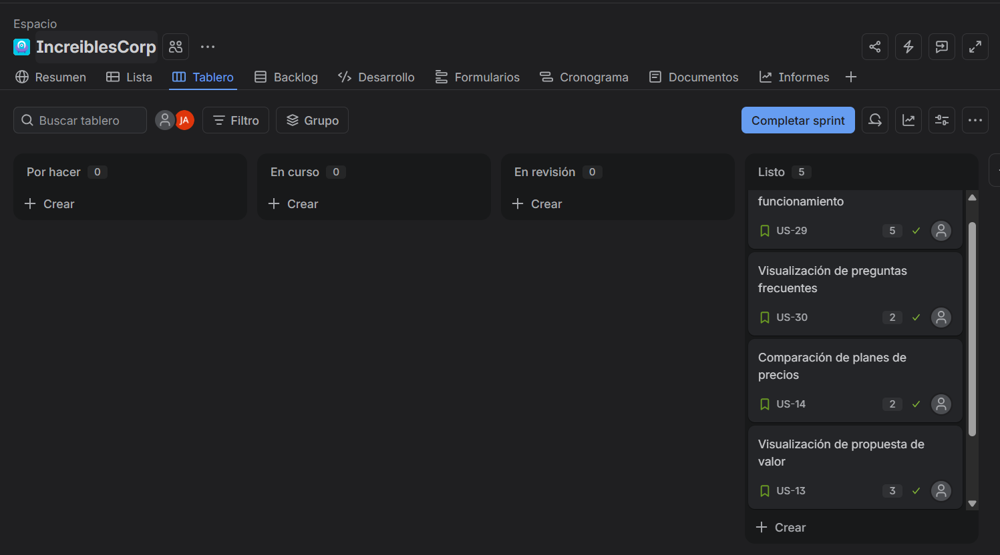

#### 5.2.1.4. Development Evidence for Sprint Review

Esta sección expone la evidencia técnica del progreso alcanzado durante el presente sprint con relación a los productos de la solución definidos en el alcance. Se resumen los principales avances en la implementación a través de un registro detallado de las modificaciones en el código fuente. A continuación, se presenta una tabla que incluye los repositorios y sus respectivos commits, documentando el desarrollo estructural, la integración de contenido y la configuración para la Landing Page de InstAlert.

| Repository | Branch | Commit Id | Commit Message | Commit Message Body | Commited on (Date) |
| :--- | :--- | :--- | :--- | :--- | :--- |
| DhudsQ/InstAlert-LandingPage | feature/inicio | 8c9035e | feat(inicio):add site-config file for default Language | Configured the initial site settings and established the default language parameters for the i18n implementation across the main layout. | 10/09/2026 |
| dumbaskidd/InstAlert-LandingPage | feature/planes | 8a6b851 | feat(planes): add base and responsive css styles for pricing section | Implemented the core stylesheet for the subscription plans, ensuring mobile responsiveness and proper alignment of the pricing cards and currency toggle. | 11/09/2026 |
| Mayel-dev/InstAlert-LandingPage | feature/equipo | 4bbfccf | feat(team): add team presentation section | Developed the 'About Us' structure, integrating team member portraits, roles, and the placeholder layout for the promotional video. | 11/09/2026 |
| DiazDeveloper/InstAlert-LandingPage | feature/producto | a8ca125 | feat: agrego estilos, html y js de la seccion producto | Built the interactive 'What We Offer' section, linking the descriptive HTML with its specific CSS styles and interactive JavaScript components. | 12/09/2026 |
| nahiryn8/InstAlert-LandingPage | feature/cierre | e6cc66e | docs(cierre): add help center and legal documentation pdfs | Uploaded the necessary legal assets (Privacy Policy, Terms of Service) and Help Center documentation, linking them directly in the site footer. | 13/09/2026 |
| DhudsQ/InstAlert-LandingPage | main | b54c82e | chore: merge sprint 1 features and trigger deployment |

#### 5.2.1.5. Execution Evidence for Sprint Review

Durante el transcurso del Sprint 1, el esfuerzo de desarrollo se centró en la construcción y despliegue de la Landing Page oficial de InstAlert. Se completaron las historias US-13, US-14, US-15, US-29 y US-30, correspondientes a la propuesta de valor, los planes de precios, los testimonios, el funcionamiento y las preguntas frecuentes.

El alcance completado incluye la estructura base, navegación global, la sección principal de impacto (Hero), los beneficios de la plataforma, la presentación del producto y soluciones, los planes de suscripción, la presentación del equipo, el llamado a la acción final (CTA) y el pie de página con documentación legal. El trabajo fue distribuido equitativamente entre todos los miembros del equipo, logrando un entregable final que comunica eficazmente la propuesta de valor del modelo SaaS B2B.

**Evidencia visual:**

A continuación, se presentan las capturas de pantalla que evidencian las principales vistas y componentes implementados durante este ciclo, indicando el responsable principal de cada apartado según la nueva distribución del repositorio.

**1. Estructura base, Navegación, Hero y Beneficios**

*Desarrollado por: Jose Gustavo Asto Jacome*

  

**2. Presentación del Producto y Soluciones (Qué ofrecemos)**

*Desarrollado por: Sebastián Víctor André Díaz Mendoza*

  

**3. Planes de Suscripción y Selector de Moneda (Pricing)**

*Desarrollado por: Jean Fabio Noriega Collado*

  

**4. Sobre Nosotros y Nuestro Equipo (About Us & Team)**

*Desarrollado por: Ismael Sebastian Simon Calderon*

  

**5. Llamado a la Acción (CTA), Footer y Enlaces Legales**

*Desarrollado por: Yngrid Nahir Ruiz Villegas*

  

**Video del Sprint Review:** [Ver video del Sprint Review del Sprint 1](https://upcedupe-my.sharepoint.com/:v:/g/personal/u20241c630_upc_edu_pe/IQDDu4coMfEFS5u3PVPylCcgAWrLM56l0VTYYK_eO1OWuSk?nav=eyJyZWZlcnJhbEluZm8iOnsicmVmZXJyYWxBcHAiOiJTdHJlYW1XZWJBcHAiLCJyZWZlcnJhbFZpZXciOiJTaGFyZURpYWxvZy1MaW5rIiwicmVmZXJyYWxBcHBQbGF0Zm9ybSI6IldlYiIsInJlZmVycmFsTW9kZSI6InZpZXcifX0%3D&e=ChGf3N)

#### 5.2.1.6. Services Documentation Evidence for Sprint Review

Durante el presente Sprint, los objetivos del equipo se centraron exclusivamente en la ideación, diseño y desarrollo de la Landing Page de InstAlert. 

Dado que el alcance de esta primera iteración no contempló el desarrollo de la lógica del lado del servidor ni la creación de una API RESTful, actualmente no existen servicios web implementados. Por consiguiente, no se han generado endpoints que requieran ser documentados mediante el estándar OpenAPI. Tienes razón en tu observación: el enlace actual de la Landing Page no corresponde a este apartado, ya que aquí solo debe ir la URL del repositorio del backend.

La construcción y documentación de los servicios web está planificada para los siguientes ciclos de desarrollo. Una vez que se inicie la implementación del backend, se empleará Swagger (OpenAPI) para generar la documentación técnica e interactiva. 

En futuras entregas, esta sección se actualizará para incluir estrictamente lo solicitado por las instrucciones del proyecto:

* Una tabla exhaustiva con la relación de los Endpoints implementados.
* Especificación de las acciones soportadas indicando el verbo HTTP correspondiente (GET, POST, PUT, PATCH, DELETE) y la sintaxis de las llamadas.
* Detalle de los parámetros requeridos y la explicación estructurada de las respuestas (Responses).
* Capturas de pantalla que evidencien la interacción funcional con la API a través de la interfaz de Swagger UI, empleando datos de muestra.
* El enlace directo al repositorio de Web Services, junto con el registro de los IDs de los commits asociados exclusivamente a la elaboración de la documentación.

#### 5.2.1.7. Software Deployment Evidence for Sprint Review

Durante el Sprint 1, los esfuerzos del equipo se centraron en configurar y ejecutar el despliegue inicial de la Landing Page de InstAlert. Este proceso garantizó que la propuesta de valor del producto esté accesible públicamente, sentando además las bases para la integración continua. 

Dado que el alcance de esta iteración se limitó a la presentación web estática, aún no se han creado cuentas ni configurado entornos de despliegue para las Web Applications ni para los Web Services. Estas actividades, que involucrarán el uso de plataformas y proveedores de nube específicos (Cloud Providers) para el backend y frontend dinámico, están planificadas para los próximos sprints.

**Actividades de Despliegue Realizadas:**

**1. Configuración del Repositorio de Código Fuente**
* Se estableció un repositorio público dedicado exclusivamente a la Landing Page dentro de la organización del equipo.
* El control de versiones se estructuró para facilitar la automatización de los despliegues.
* Enlace del repositorio: https://github.com/losincreiblescorp/InstAlert-LandingPage

**2. Habilitación y Configuración de GitHub Pages**
* Se activó el servicio de alojamiento estático desde el apartado de configuración (Settings > Pages) del repositorio.
* Se definió la rama main y el directorio raíz (/root) como el entorno de origen para la lectura de los archivos a publicar.
* Mediante esta configuración, el sitio web quedó expuesto de forma segura y pública en la siguiente URL de producción: https://losincreiblescorp.github.io/InstAlert-LandingPage/

  

**3. Automatización del Proceso de Despliegue (CI/CD)**
* Se aprovechó la integración nativa de GitHub Actions para el despliegue automático. 
* El flujo de trabajo garantiza que cada vez que se aprueba un Pull Request y se realiza un merge hacia la rama main, la plataforma detecta los cambios y actualiza el contenido en tiempo real sin requerir intervención manual del equipo de desarrollo.

  

**4. Verificación y Validación en Producción**
* Se validó la correcta carga de todos los recursos (imágenes, estilos, scripts), la estabilidad del diseño responsivo en múltiples resoluciones y el correcto funcionamiento del cambio de idioma (i18n) directamente en la URL pública.

  

#### 5.2.1.8. Team Collaboration Insights during Sprint

Durante este primer Sprint, el equipo se dedicó integralmente a la concepción, diseño e implementación de la Landing Page de InstAlert. Para cumplir con los objetivos trazados, las responsabilidades se dividieron de forma equitativa, asegurando que todos los miembros del equipo tuvieran participación activa y directa en el desarrollo del código fuente, la maquetación y la lógica de la interfaz.

**Actividades de implementación desarrolladas:**

* **Planificación Visual:** Se estructuró el diseño base (wireframes y mockups) de la web para definir claramente la jerarquía de la información, las secciones clave y la paleta de colores.
* **Desarrollo Modular:** La maquetación se dividió en componentes específicos (Hero, Pricing, Testimonials, About Us, Contact, Layout), permitiendo que cada desarrollador trabajara en una rama de característica (`feature/*`) independiente.
* **Integración de Funcionalidades:** Se aplicaron estilos responsivos con CSS y se integró lógica en JavaScript para dotar de interactividad a la página, incluyendo el sistema de internacionalización (i18n) para soportar múltiples idiomas.
* **Gestión de Versiones y Despliegue:** Se empleó GitHub como plataforma central, aplicando flujos de Pull Requests y revisiones de código antes de integrar los cambios a la rama `main` para su posterior publicación en GitHub Pages.

**Analíticas de colaboración en GitHub:**

Para evidenciar el compromiso y la participación equitativa de todos los integrantes, a continuación se presentan los gráficos y registros extraídos directamente de las estadísticas del repositorio del proyecto.

**1. Historial de commits por miembro**

*Desarrollado por: Jean Fabio Noriega Collado (dumbaskidd)*

  

*Desarrollado por: Ismael Sebastian Simon Calderon (Mayel-dev)*

  

*Desarrollado por: Yngrid Nahir Ruiz Villegas (nahiryn8)*

  

*Desarrollado por: Jose Gustavo Asto Jacome (DhudsQ)*

  

*Desarrollado por: Sebastián Víctor André Díaz Mendoza (DiazDeveloper)*

  

**2. Colaboradores activos en el repositorio**

*Esta gráfica demuestra la actividad conjunta del equipo y la distribución de los aportes (adiciones y eliminaciones de código) a lo largo del Sprint.*

  

**3. Histograma de contribuciones en el tiempo**

*Muestra la frecuencia de las confirmaciones (commits) realizadas en los días previos a la revisión del Sprint, evidenciando un esfuerzo constante y coordinado para la integración final.*

  

## 5.3. Validation Interviews

### 5.3.1. Diseño de Entrevistas.

Las entrevistas de validación de InstAlert se orientan a evaluar la comprensión de la propuesta, la facilidad de uso, la navegación y la utilidad percibida para sus dos segmentos: administradores y dueños de establecimientos comerciales, y personal operativo.

Cada sesión comprende la exploración de la Landing Page, la realización de tareas en la aplicación correspondiente al rol y las preguntas generales de cierre. Se registrarán las dificultades, las acciones que requieran ayuda y las sugerencias del participante, diferenciando sus opiniones de las observaciones del evaluador.

**User flows utilizados para la validación:**

- **Actividad común — Landing Page:** explorar la propuesta de valor, las funcionalidades, el video, los planes y los precios para explicar qué ofrece InstAlert y a quién se dirige.
- **Segmento 1: Administradores y dueños de establecimientos comerciales:**
  - Como administrador, quiero consultar el dashboard para identificar la información relevante de mi establecimiento.
  - Como administrador, quiero interpretar el mapa de riesgos y sus filtros para conocer los incidentes cercanos.
  - Como administrador, quiero completar o actualizar el perfil del negocio para mantener sus datos y ubicación.
  - Como administrador, quiero invitar personal operativo y consultar el estado de la invitación para administrar mi equipo.
  - Como administrador, quiero consultar el historial de alertas y sus filtros para revisar los incidentes registrados.
  - Como administrador, quiero comparar los planes y sus límites para evaluar una suscripción.
  - Como administrador, quiero localizar las preferencias de notificación y su radio de recepción para ajustar los avisos cercanos.
- **Segmento 2: Personal operativo:**
  - Como empleado, quiero localizar el botón de pánico y comprender su cuenta regresiva para activar o cancelar una alerta de prueba antes de confirmarla.
  - Como empleado, quiero registrar un incidente y completar sus datos para comunicar lo ocurrido.
  - Como empleado, quiero agregar o modificar mis contactos de emergencia para mantener mi red de apoyo.
  - Como empleado, quiero consultar las notificaciones y el mapa para comprender los incidentes cercanos.
  - Como empleado, quiero localizar mis datos, el idioma y las preferencias de notificación para personalizar el uso de la aplicación.

**Procedimiento de la sesión:**

1. Solicitar autorización para registrar la sesión y recoger los datos de identificación del participante.
2. Permitir la exploración de la Landing Page y realizar las preguntas de esa sección.
3. Presentar las tareas del segmento correspondiente, utilizando datos y alertas de prueba.
4. Observar el recorrido y formular las preguntas de la aplicación web sin anticipar respuestas.
5. Realizar las preguntas generales y registrar las sugerencias finales.

La configuración del radio de recepción se revisa en las preferencias de Notificaciones. Al formular la pregunta sobre el radio en el mapa, se distinguirá esa configuración del radio de búsqueda del mapa para no asumir que ambos controles cumplen la misma función.

**Preguntas de Validación de Producto:**

| Sección / Segmento | Preguntas de la Entrevista de Validación |
| :--- | :--- |
| **Landing Page — ambos segmentos** | 1. ¿Qué fue lo primero que llamó tu atención al ingresar a la página? 2. ¿Qué crees que ofrece InstAlert y a qué tipo de usuarios está dirigido? 3. ¿Qué problema crees que busca resolver InstAlert? ¿Consideras que es relevante para un establecimiento comercial? 4. ¿Qué entiendes por alertas de seguridad, red de negocios cercanos e información de riesgo local? ¿Cuál consideras más útil? 5. ¿El video te permitió comprender mejor el funcionamiento del producto? ¿Qué información adicional esperabas encontrar? 6. ¿Qué diferencias encuentras entre los planes? ¿Te resulta fácil identificar qué incluye cada uno? 7. ¿Los precios te parecen claros? ¿Prefieres visualizarlos en soles o dólares? 8. ¿Encontraste fácilmente la información que buscabas? 9. ¿Consideras que la información está organizada de manera clara? 10. ¿Hubo alguna sección que te pareciera innecesaria o confusa? 11. ¿La página te transmite confianza para contratar el servicio? ¿Por qué? 12. ¿Qué información adicional necesitarías para decidirte a utilizar InstAlert? |
| **Aplicación web — Segmento 1: Administrador** | 1. ¿Pudiste identificar fácilmente en qué sección de la aplicación te encontrabas? 2. ¿Comprendiste la información presentada en el dashboard? ¿Qué datos te parecieron más útiles para administrar tu establecimiento? 3. ¿Cómo interpretas la información del mapa? ¿Comprendes qué representan sus colores y símbolos? 4. ¿Te resultó sencillo encontrar y completar la información del establecimiento? ¿Qué campo te generó dudas? 5. ¿Qué tan sencillo fue realizar la invitación a un empleado? ¿Comprendiste qué sucedería después de enviarla? 6. ¿Pudiste identificar fácilmente el historial de alertas? ¿Qué filtros o criterios de búsqueda consideras necesarios? 7. ¿Comprendes qué beneficios y límites ofrece cada plan? ¿Qué información necesitarías antes de realizar un pago? 8. ¿Pudiste identificar cómo funciona el radio de alertas en el mapa? ¿Qué distancia elegirías y por qué? 9. ¿Encontraste fácilmente las opciones para actualizar tus datos y preferencias? 10. ¿Qué tarea te pareció más complicada de realizar? 11. Si cometieras un error durante alguna tarea, ¿sabrías cómo corregirlo? 12. ¿Qué información o funcionalidad agregarías para facilitar la administración y la toma de decisiones sobre la seguridad de tu establecimiento? |
| **Aplicación web — Segmento 2: Empleado** | 1. ¿Pudiste identificar fácilmente las opciones principales de la aplicación? 2. ¿Comprendiste cómo funciona el botón de alerta y qué sucedería después de activarlo? 3. ¿Comprendiste cómo funciona la cuenta regresiva? ¿Te resultó fácil identificar los pasos para activar o cancelar una alerta de prueba? 4. ¿Te resultó sencillo encontrar la opción para registrar un incidente? 5. ¿Qué tan sencillo fue completar el reporte? ¿Qué información consideras indispensable? 6. ¿Pudiste identificar cómo agregar o modificar un contacto de emergencia? ¿Qué información consideras necesaria solicitar? 7. ¿Pudiste identificar las notificaciones nuevas? ¿La información presentada te permite comprender qué ocurrió? 8. ¿Comprendes la información que muestra el mapa? ¿Te resulta útil para conocer los incidentes cercanos? 9. ¿Pudiste encontrar las opciones para modificar tus datos, idioma o preferencias de notificación? 10. ¿Las opciones y mensajes de la aplicación utilizaron palabras que te resultaron familiares? 11. ¿Encontraste instrucciones suficientes para realizar las tareas sin ayuda? 12. Si cometieras un error durante alguna tarea, ¿sabrías cómo corregirlo? 13. ¿Qué cambiarías para que la aplicación fuera más sencilla y rápida de utilizar? |
| **Preguntas generales — ambos segmentos** | 1. ¿Qué fue lo más fácil de realizar durante la prueba? 2. ¿Qué fue lo más difícil o confuso? 3. ¿En algún momento no supiste qué acción realizar? 4. ¿La aplicación te informó claramente cuando realizaste una acción? 5. ¿Consideras que podrías utilizar InstAlert sin ayuda de otra persona? 6. ¿Qué tan fácil te resultó utilizar la aplicación del 1 al 5? 7. ¿Qué funcionalidad consideras más útil? 8. ¿Qué funcionalidad mejorarías o agregarías? 9. ¿Confías en que InstAlert protegería tu información personal y ubicación? 10. ¿Qué situación podría hacer que dejaras de utilizar InstAlert? 11. ¿Consideras que InstAlert aportaría valor a la seguridad de tu establecimiento? 12. Si tuvieras que describir InstAlert en tres palabras, ¿cuáles serían? |

**Nota:** La guía comprende 12 preguntas de Landing Page, 12 para administradores, 13 para empleados y 12 preguntas generales. Cada participante responde las preguntas comunes y las correspondientes a su rol.

### 5.3.2. Registro de Entrevistas.

#### Entrevistas realizadas al Segmento 1: Administradores y dueños de establecimientos comerciales

<table>
<thead>
  <tr>
    <th colspan="2">Entrevista de Validación de Producto #1</th>
  </tr>
</thead>
<tbody>
  <tr>
    <td><strong>Nombre</strong></td>
    <td>María Rocío</td>
  </tr>
  <tr>
    <td><strong>Apellidos</strong></td>
    <td>de los Ángeles</td>
  </tr>
  <tr>
    <td><strong>Edad</strong></td>
    <td>42 años</td>
  </tr>
  <tr>
    <td><strong>Distrito</strong></td>
    <td>Comas</td>
  </tr>
  <tr>
    <td><strong>Evidencia</strong></td>
    <td></td>
  </tr>
  <tr>
    <td><strong>Link de Video</strong></td>
    <td></td>
  </tr>
  <tr>
    <td><strong>Timing de Inicio</strong></td>
    <td></td>
  </tr>
  <tr>
    <td><strong>Duración</strong></td>
    <td></td>
  </tr>
  <tr>
    <td><strong>Resumen de Validación</strong></td>
    <td></td>
  </tr>
</tbody>
</table>

<table>
<thead>
  <tr>
    <th colspan="2">Entrevista de Validación de Producto #2</th>
  </tr>
</thead>
<tbody>
  <tr>
    <td><strong>Nombre</strong></td>
    <td></td>
  </tr>
  <tr>
    <td><strong>Apellidos</strong></td>
    <td></td>
  </tr>
  <tr>
    <td><strong>Edad</strong></td>
    <td></td>
  </tr>
  <tr>
    <td><strong>Distrito</strong></td>
    <td></td>
  </tr>
  <tr>
    <td><strong>Evidencia</strong></td>
    <td></td>
  </tr>
  <tr>
    <td><strong>Link de Video</strong></td>
    <td></td>
  </tr>
  <tr>
    <td><strong>Timing de Inicio</strong></td>
    <td></td>
  </tr>
  <tr>
    <td><strong>Duración</strong></td>
    <td></td>
  </tr>
  <tr>
    <td><strong>Resumen de Validación</strong></td>
    <td></td>
  </tr>
</tbody>
</table>

<table>
<thead>
  <tr>
    <th colspan="2">Entrevista de Validación de Producto #3</th>
  </tr>
</thead>
<tbody>
  <tr>
    <td><strong>Nombre</strong></td>
    <td></td>
  </tr>
  <tr>
    <td><strong>Apellidos</strong></td>
    <td></td>
  </tr>
  <tr>
    <td><strong>Edad</strong></td>
    <td></td>
  </tr>
  <tr>
    <td><strong>Distrito</strong></td>
    <td></td>
  </tr>
  <tr>
    <td><strong>Evidencia</strong></td>
    <td></td>
  </tr>
  <tr>
    <td><strong>Link de Video</strong></td>
    <td></td>
  </tr>
  <tr>
    <td><strong>Timing de Inicio</strong></td>
    <td></td>
  </tr>
  <tr>
    <td><strong>Duración</strong></td>
    <td></td>
  </tr>
  <tr>
    <td><strong>Resumen de Validación</strong></td>
    <td></td>
  </tr>
</tbody>
</table>

#### Entrevistas realizadas al Segmento 2: Personal operativo

<table>
<thead>
  <tr>
    <th colspan="2">Entrevista de Validación de Producto #4</th>
  </tr>
</thead>
<tbody>
  <tr>
    <td><strong>Nombre</strong></td>
    <td></td>
  </tr>
  <tr>
    <td><strong>Apellidos</strong></td>
    <td></td>
  </tr>
  <tr>
    <td><strong>Edad</strong></td>
    <td></td>
  </tr>
  <tr>
    <td><strong>Distrito</strong></td>
    <td></td>
  </tr>
  <tr>
    <td><strong>Evidencia</strong></td>
    <td></td>
  </tr>
  <tr>
    <td><strong>Link de Video</strong></td>
    <td></td>
  </tr>
  <tr>
    <td><strong>Timing de Inicio</strong></td>
    <td></td>
  </tr>
  <tr>
    <td><strong>Duración</strong></td>
    <td></td>
  </tr>
  <tr>
    <td><strong>Resumen de Validación</strong></td>
    <td></td>
  </tr>
</tbody>
</table>

<table>
<thead>
  <tr>
    <th colspan="2">Entrevista de Validación de Producto #5</th>
  </tr>
</thead>
<tbody>
  <tr>
    <td><strong>Nombre</strong></td>
    <td></td>
  </tr>
  <tr>
    <td><strong>Apellidos</strong></td>
    <td></td>
  </tr>
  <tr>
    <td><strong>Edad</strong></td>
    <td></td>
  </tr>
  <tr>
    <td><strong>Distrito</strong></td>
    <td></td>
  </tr>
  <tr>
    <td><strong>Evidencia</strong></td>
    <td></td>
  </tr>
  <tr>
    <td><strong>Link de Video</strong></td>
    <td></td>
  </tr>
  <tr>
    <td><strong>Timing de Inicio</strong></td>
    <td></td>
  </tr>
  <tr>
    <td><strong>Duración</strong></td>
    <td></td>
  </tr>
  <tr>
    <td><strong>Resumen de Validación</strong></td>
    <td></td>
  </tr>
</tbody>
</table>

<table>
<thead>
  <tr>
    <th colspan="2">Entrevista de Validación de Producto #6</th>
  </tr>
</thead>
<tbody>
  <tr>
    <td><strong>Nombre</strong></td>
    <td></td>
  </tr>
  <tr>
    <td><strong>Apellidos</strong></td>
    <td></td>
  </tr>
  <tr>
    <td><strong>Edad</strong></td>
    <td></td>
  </tr>
  <tr>
    <td><strong>Distrito</strong></td>
    <td></td>
  </tr>
  <tr>
    <td><strong>Evidencia</strong></td>
    <td></td>
  </tr>
  <tr>
    <td><strong>Link de Video</strong></td>
    <td></td>
  </tr>
  <tr>
    <td><strong>Timing de Inicio</strong></td>
    <td></td>
  </tr>
  <tr>
    <td><strong>Duración</strong></td>
    <td></td>
  </tr>
  <tr>
    <td><strong>Resumen de Validación</strong></td>
    <td></td>
  </tr>
</tbody>
</table>

### 5.3.3. Evaluaciones según heurísticas.

#### UX Heuristics & Principles Evaluation

**Usability – Inclusive Design – Information Architecture**

**CARRERA:** Ingeniería de Software 
**CURSO:** Aplicaciones Web 
**SECCIÓN:** 8084 
**PROFESOR:** Angel Augusto Velasquez Nuñez 
**AUDITOR:** 
**CLIENTE(S):** Segmento 1: administradores y dueños de establecimientos comerciales. Segmento 2: personal operativo. 
**SITE O APP A EVALUAR:** InstAlert — Aplicación web.

#### Alcance y procedimiento

Se inspeccionaron seis situaciones de la interfaz del administrador utilizando capturas de pantalla. Se consideraron principios de usabilidad, arquitectura de información y diseño inclusivo. Aunque el producto se dirige a ambos segmentos, las evidencias de esta evaluación corresponden a la vista del administrador y no permiten generalizar los resultados a la interfaz del personal operativo.

Los hallazgos describen dificultades potenciales identificadas por inspección; no se atribuyen a participantes ni constituyen resultados de entrevistas. La severidad representa el impacto estimado y puede revisarse mediante pruebas de usuario.

**TAREAS A EVALUAR:**

1. Localizar las preferencias y configurar el radio de recepción de notificaciones.
2. Consultar el estado de una invitación enviada al personal.
3. Buscar alertas y reportes dentro de un periodo determinado.
4. Editar los datos del negocio y navegar hacia otra sección.
5. Interpretar símbolos y colores del mapa en ventanas de diferente tamaño.
6. Comparar los beneficios de los planes de suscripción.

**No están incluidas en esta versión de la evaluación:**

1. La entrega efectiva de correos electrónicos.
2. El procesamiento de pagos mediante PayPal.
3. La exactitud de los datos geográficos y de los niveles de riesgo.
4. La activación de alertas mediante dispositivos físicos.
5. Una auditoría completa de accesibilidad con tecnologías de asistencia.

#### Escala de severidad

| Nivel | Descripción |
|---|---|
| 1 | Problema superficial. Produce una dificultad mínima y puede corregirse cuando exista disponibilidad de tiempo. |
| 2 | Problema menor. Aumenta el esfuerzo o genera confusión, pero permite continuar la tarea. Debe programarse su mejora. |
| 3 | Problema mayor. Dificulta considerablemente una tarea o requiere ayuda para completarla. Debe corregirse con prioridad alta. |
| 4 | Problema muy grave. Impide completar una tarea esencial o continuar utilizando la herramienta. Debe corregirse antes del lanzamiento. |

#### Tabla resumen

| # | Problema | Severidad | Heurística o principio afectado |
|---|---|---|---|
| 1 | El acceso a la configuración del radio depende de un icono sin etiqueta visible. | 2 | Usability: reconocimiento antes que recuerdo. Information Architecture: facilidad para encontrar opciones. |
| 2 | El estado «Pendiente» no distingue la aceptación de la invitación del estado del envío del correo. | 2 | Usability: visibilidad del estado del sistema. |
| 3 | El historial no ofrece un filtro específico por intervalo de fechas. | 2 | Usability: flexibilidad y eficiencia de uso. Information Architecture: facilidad para localizar información. |
| 4 | Posible pérdida de cambios del perfil al abandonar el formulario sin guardar. | 2, provisional | Usability: prevención de errores. Pendiente de corroborar el recorrido. |
| 5 | La leyenda del mapa no permanece disponible en la vista de menor altura documentada. | 2 | Inclusive Design: proporcionar experiencias comparables. Usability: reconocimiento antes que recuerdo. |
| 6 | Los beneficios diferenciadores de los planes no se explican suficientemente, incluso al desplegar los detalles. | 2 | Usability: ayuda y documentación. Information Architecture: claridad del contenido para tomar decisiones. |

#### Descripción de problemas

##### PROBLEMA #1: Acceso poco explícito a las preferencias de notificación

**Severidad:** 2 — Problema menor.

**Heurística o principio afectado:** Usability — Reconocimiento antes que recuerdo. Information Architecture — Facilidad para encontrar opciones.

**Problema:**

La pantalla de Notificaciones presenta el acceso a las preferencias mediante un engranaje en la esquina superior derecha, sin una etiqueta de texto permanentemente visible que indique que allí se configura el radio de recepción. La segunda captura muestra que el selector del radio está dentro de ese cuadro de preferencias.

El administrador debe interpretar el icono y abrirlo para descubrir la opción. Aunque el engranaje es un símbolo habitual de configuración y no impide completar la tarea, puede aumentar el esfuerzo de descubrimiento para personas poco familiarizadas con estas interfaces.

**Evidencia:**

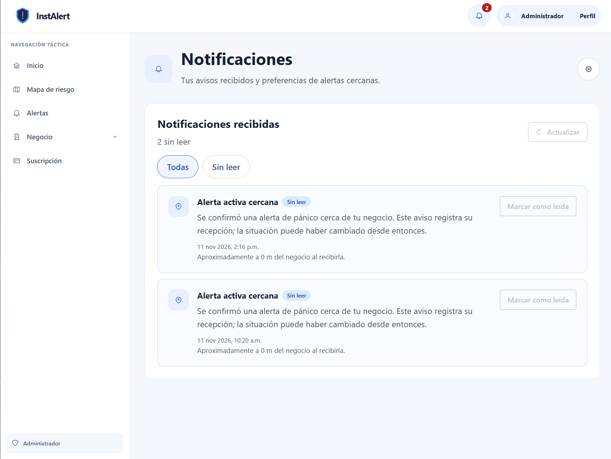

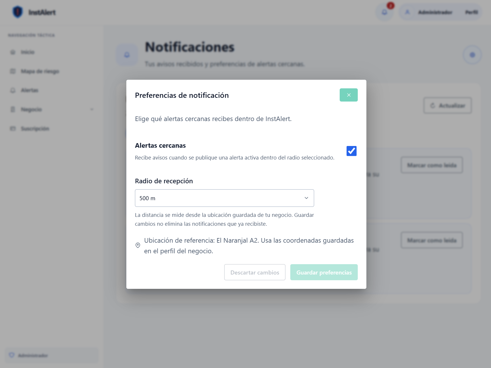

**Recomendación:**

Acompañar el icono con una etiqueta visible, como «Configurar notificaciones» o «Configurar radio». Mostrar también un resumen del valor vigente en la pantalla principal; por ejemplo: «Recibes alertas cercanas hasta 500 m de tu negocio».

##### PROBLEMA #2: Ambigüedad del estado «Pendiente» en las invitaciones

**Severidad:** 2 — Problema menor.

**Heurística o principio afectado:** Usability — Visibilidad del estado del sistema.

**Problema:**

La pestaña Invitaciones muestra un registro «Pendiente» y las acciones «Editar», «Reenviar» y «Cancelar invitación». La interfaz confirma que la invitación fue creada, pero no diferencia el estado de aceptación del estado del envío del correo.

Esto puede generar incertidumbre sobre si debe esperarse una respuesta o reenviarse el mensaje. La captura no demuestra un fallo de entrega: el hallazgo se refiere a la claridad de la información presentada.

**Evidencia:**

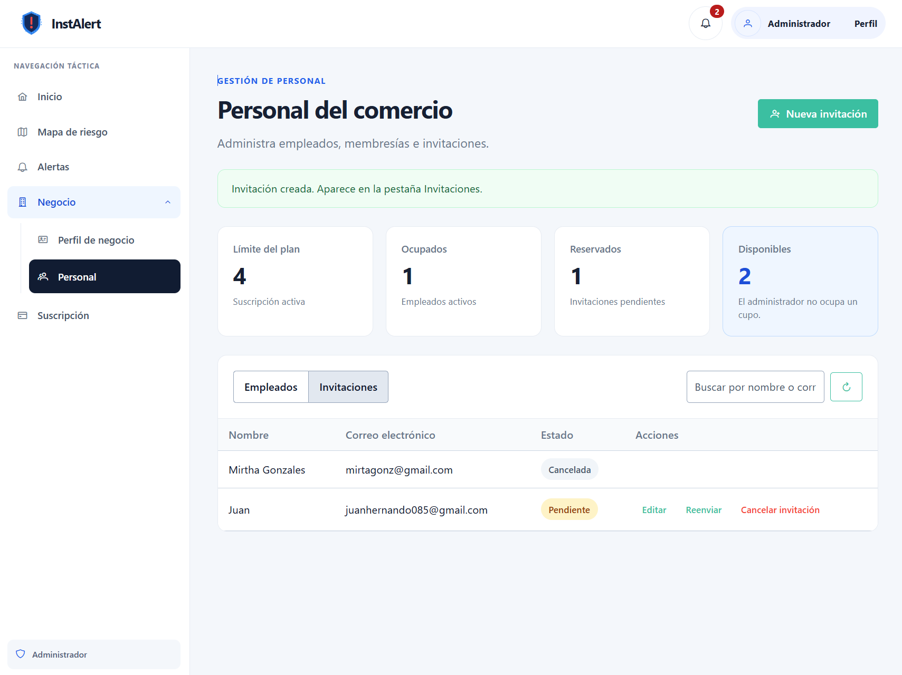

**Recomendación:**

Utilizar «Esperando aceptación» cuando ese sea el significado del estado. Mostrar por separado el estado real del correo: «En cola», «Envío aceptado por el proveedor» o «Error de envío». Explicar qué debe hacer el invitado y cómo proceder si no recibe el mensaje. No mostrar «Entregado» sin confirmación del proveedor.

##### PROBLEMA #3: Búsqueda limitada de alertas por periodo

**Severidad:** 2 — Problema menor.

**Heurística o principio afectado:** Usability — Flexibilidad y eficiencia de uso. Information Architecture — Facilidad para localizar información.

**Problema:**

El historial incluye búsqueda por tipo, descripción o ubicación y filtros por tipo y estado, pero no presenta un selector específico de intervalo de fechas. Para revisar los incidentes de una semana o un mes, el administrador debe leer las fechas de los registros o recurrir a criterios que no representan directamente el periodo solicitado.

La captura contiene solo dos registros: el esfuerzo inmediato es reducido. El impacto estimado aumenta con el volumen del historial y debe comprobarse con una tarea de búsqueda representativa.

**Evidencia:**

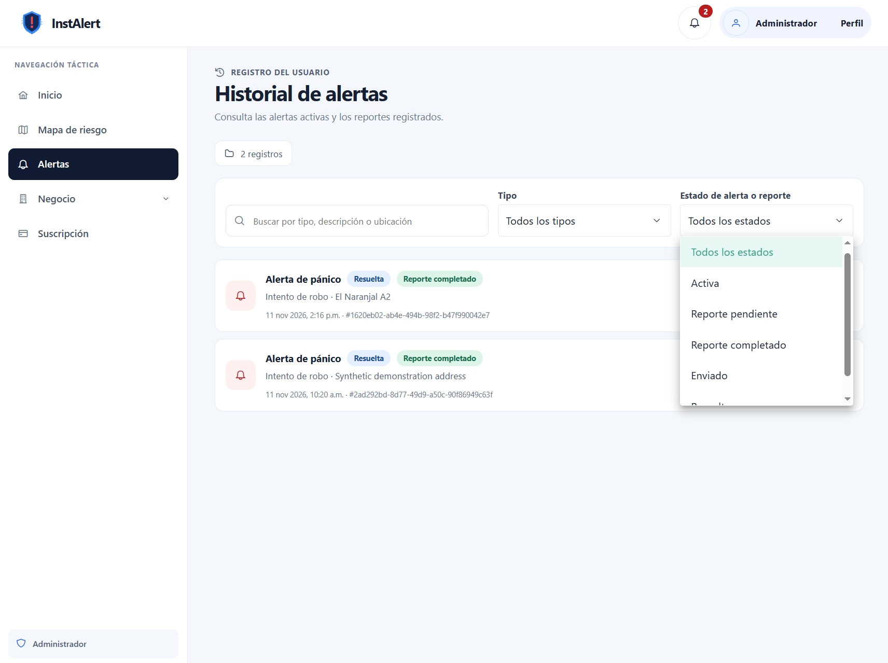

**Recomendación:**

Incorporar los campos «Desde» y «Hasta» y accesos rápidos como «Hoy», «Últimos 7 días», «Últimos 30 días» y «Todas las fechas». Mostrar el periodo aplicado y permitir restablecer los filtros fácilmente.

##### PROBLEMA #4: Posible pérdida de cambios sin guardar en el perfil del negocio

**Severidad:** 2 — Provisional, pendiente de corroborar el recorrido.

**Heurística o principio afectado:** Usability — Prevención de errores.

**Problema:**

Las capturas muestran dos valores para el nombre del negocio: «Comercial Las Torres» y «La Bodeguita». Documentan un cambio de contenido, pero no demuestran por sí solas que se abandonó el formulario sin guardar, que faltó una advertencia o que el valor se perdió al regresar.

El riesgo evaluado es la pérdida accidental del trabajo si una persona modifica datos y navega hacia otra sección sin una protección de salida o conservación del borrador.

**Estado de verificación:** pendiente. Para confirmar el hallazgo debe modificarse un campo sin guardar, navegar hacia otra sección, comprobar si aparece una advertencia y regresar para verificar si se conserva el cambio. Si existe una protección efectiva, este hallazgo debe revisarse o descartarse.

**Evidencia:**

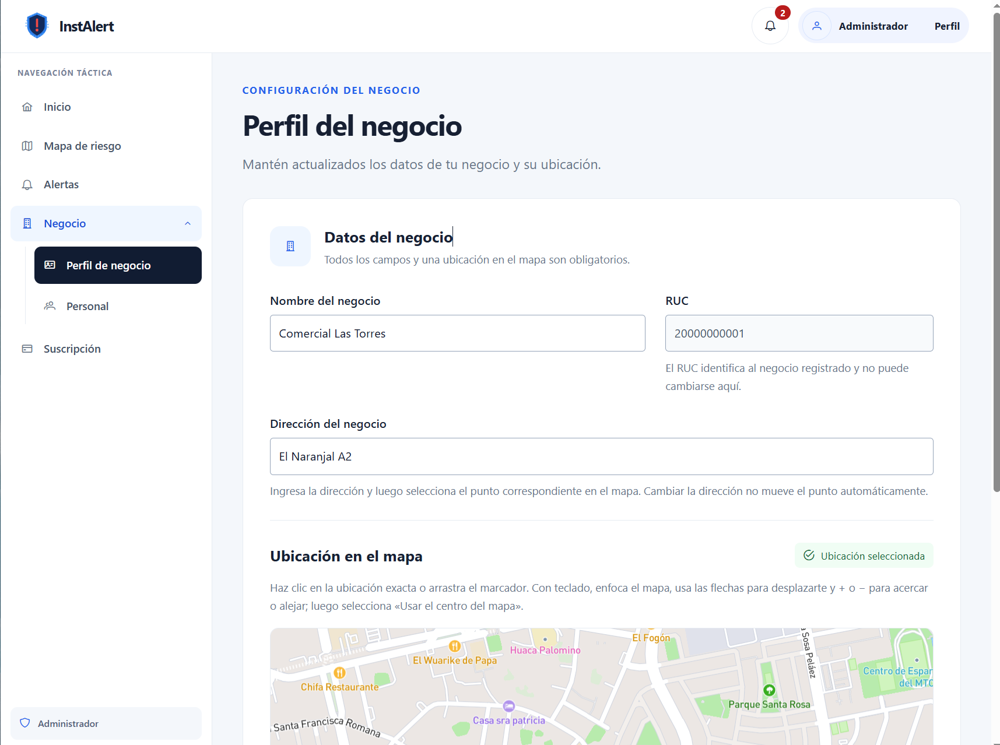

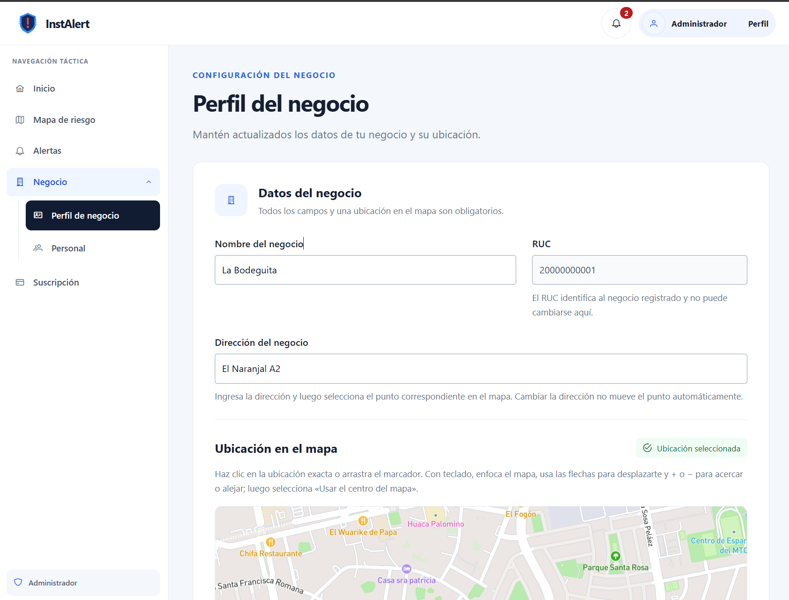

**Recomendación:**

Si se confirma la ausencia de protección, detectar los cambios pendientes y mostrar «Tienes cambios sin guardar. ¿Qué deseas hacer?», con las opciones «Seguir editando» y «Salir sin guardar». También puede conservarse un borrador para recuperar la información.

##### PROBLEMA #5: Leyenda del mapa no disponible en una vista de menor altura

**Severidad:** 2 — Problema menor.

**Heurística o principio afectado:** Inclusive Design — Proporcionar experiencias comparables en diferentes condiciones de visualización. Usability — Reconocimiento antes que recuerdo.

**Problema:**

Una captura muestra incidentes y zonas coloreadas sin leyenda; la otra presenta el panel «Simbología del mapa», con los niveles de riesgo y los símbolos de comercio e incidente. Sin esa referencia, el administrador debe recordar o deducir su significado, lo que puede dificultar la interpretación durante los primeros usos.

Las imágenes documentan la diferencia entre vistas, pero no registran las dimensiones de la ventana ni el zoom. Esos datos deben anotarse para reproducir exactamente la condición y confirmar que no existe otro acceso equivalente a la leyenda.

**Evidencia:**

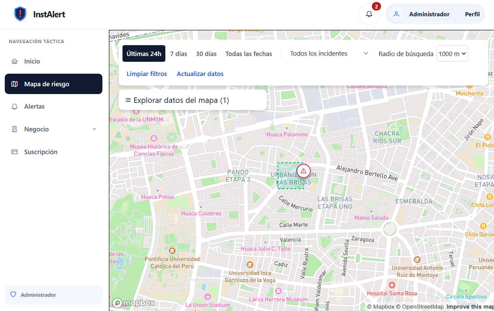

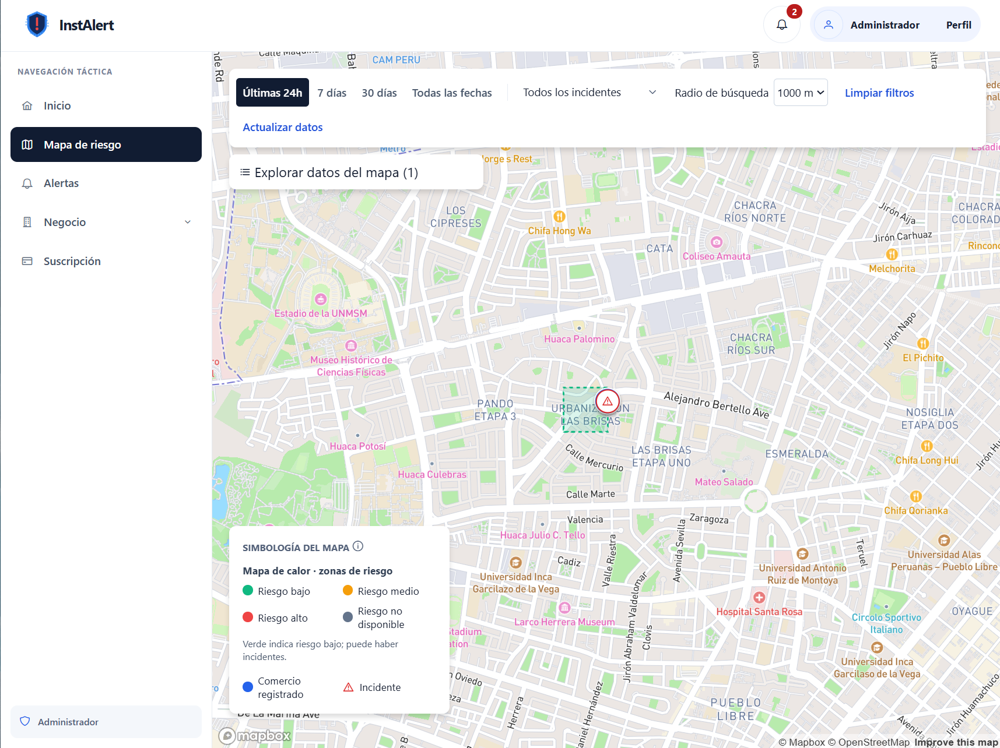

**Recomendación:**

Mantener el acceso a la leyenda en todos los tamaños de ventana. Cuando no haya espacio para el panel completo, sustituirlo por un botón visible «Ver leyenda». Conservar etiquetas de texto asociadas a colores y símbolos.

##### PROBLEMA #6: Beneficios de los planes insuficientemente detallados

**Severidad:** 2 — Problema menor.

**Heurística o principio afectado:** Usability — Ayuda y documentación. Information Architecture — Claridad del contenido para tomar decisiones.

**Problema:**

La pantalla presenta los planes Essential, Professional y Business, sus precios mensuales y los límites de empleados. Los cupos de 4, 8 y 15 empleados ya son visibles en las descripciones antes de desplegar los detalles: el problema no consiste en que estén ocultos.

La dificultad se encuentra en términos como «alertas prioritarias», «reportes de riesgo» y «atención prioritaria y acompañamiento», que no explican su alcance concreto. Al desplegar los detalles, las capturas solo añaden una fila con el cupo de empleados, repitiendo información existente sin resolver las dudas sobre los beneficios diferenciadores.

Esto limita la información para decidir si el incremento de precio corresponde a beneficios necesarios para el establecimiento.

**Evidencia:**

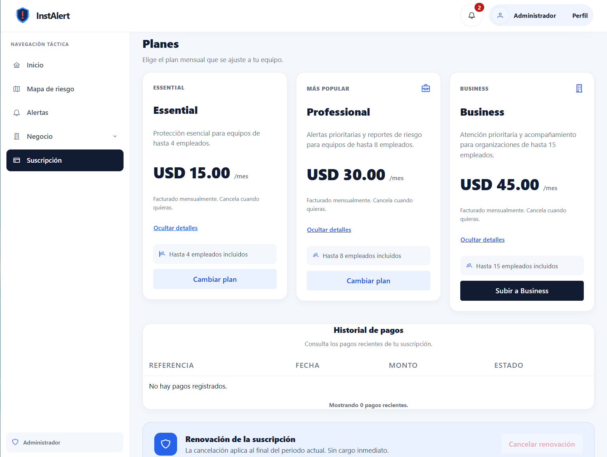

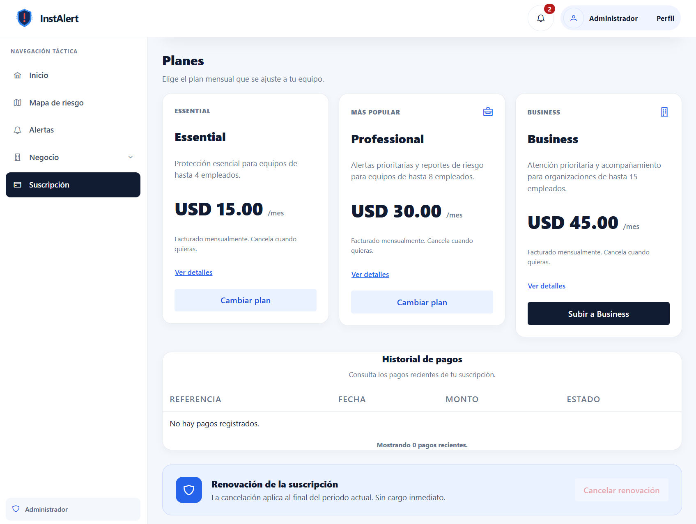

**Recomendación:**

Incluir una tabla comparativa con criterios equivalentes: cupo de empleados, funciones de alertas, alcance de reportes, tipo y horario de soporte y condiciones de renovación y cancelación. Explicar «prioritario» y «acompañamiento» con condiciones concretas y verificables. Los detalles deben ampliar beneficios y condiciones reales, no repetir únicamente el cupo.

#### Referencia conceptual

Nielsen Norman Group. [10 Usability Heuristics for User Interface Design](https://www.nngroup.com/articles/ten-usability-heuristics/).

### 5.4. Video About-the-Product.

# Conclusiones

## AV1

A partir del análisis del perfil de la startup InstAlert y su nueva propuesta comercial, se concluye que existe una necesidad crítica y un mercado altamente receptivo para una plataforma integral de seguridad, justificada por el incremento sostenido de delitos y una percepción de inseguridad superior al 80% en el país. El enfoque Lean UX implementado por el equipo demuestra una base sólida al alinear las capacidades técnicas con las exigencias del nuevo segmento objetivo B2B bajo un modelo SaaS (Software as a Service), orientado a organizaciones, administraciones residenciales y entidades que requieran planes de suscripción para gestionar su seguridad. La estrategia del producto es acertada al centralizar la prevención y la reacción inmediata mediante herramientas tecnológicas, mitigando la fragmentación de las soluciones actuales y promoviendo redes colaborativas eficientes.

Se concluye que InstAlert posee una ventaja competitiva clara frente a alternativas institucionales y comerciales tradicionales, al ofrecer una plataforma escalable y adaptable mediante niveles de suscripción. El proceso de investigación y validación permitió redefinir las problemáticas recurrentes, enfocándose no solo en la inseguridad ciudadana, sino en la necesidad de las organizaciones de contar con mecanismos de monitoreo y prevención. Como resultado, se definieron funcionalidades alineadas con los requerimientos operativos de estos nuevos clientes, estableciendo las bases funcionales y comerciales para el desarrollo del sistema.

Con respecto al diseño y la experiencia de usuario, la identidad visual, la arquitectura de información y los flujos de interacción diseñados para InstAlert mantienen una estricta coherencia con los valores de confianza, rapidez y facilidad de uso. La organización jerárquica de los contenidos y la definición de mecanismos de navegación intuitivos contribuyen a reducir la carga cognitiva, facilitando el proceso de adopción de la plataforma por parte de los clientes y sus usuarios finales.

Finalmente, tras la ejecución del primer sprint de desarrollo, se concluye que el diseño y despliegue de la Landing Page constituye un hito fundamental para la validación comercial del proyecto. La implementación de una página web estática y multilingüe (i18n), que expone claramente la propuesta de valor, los planes de suscripción (Pricing), el equipo detrás del desarrollo y casos de éxito (Testimonios), provee a InstAlert de un canal oficial y profesional. Esto no solo fortalece la presencia digital de la marca, sino que establece el principal motor para la captación de leads y futuros clientes interesados en el servicio SaaS.

# Bibliografía

# Anexos

* About the Team: Disponible en futuras entregas

* About the Product Video: Disponible en futuras entregas

## Exposiciones del Proyecto

* Enlace de Exposición AV1: (anexar link)

* Enlace de Exposición TB1: Disponible en futuras entregas

* Enlace de Exposición AV2: Disponible en futuras entregas

* Enlace de Exposición TB2: Disponible en futuras entregas

## Needfinding Interviews

* Interview 1: (Anexar Link)

* Interview 2: (Anexar Link)

* Interview 3: (Anexar Link)

* Interview 4: (Anexar Link)

* Interview 5: (Anexar Link)

* Interview 6: (Anexar Link)

## Validation Interviews

* Interview 1: Disponible en futuras entregas

* Interview 2: Disponible en futuras entregas

* Interview 3: Disponible en futuras entregas

* Interview 4: Disponible en futuras entregas

* Interview 5: Disponible en futuras entregas

* Interview 6: Disponible en futuras entregas

## Execution Evidence

* Sprint 1: <https://upcedupe-my.sharepoint.com/:v:/g/personal/u20241c630_upc_edu_pe/IQDDu4coMfEFS5u3PVPylCcgAWrLM56l0VTYYK_eO1OWuSk?nav=eyJyZWZlcnJhbEluZm8iOnsicmVmZXJyYWxBcHAiOiJTdHJlYW1XZWJBcHAiLCJyZWZlcnJhbFZpZXciOiJTaGFyZURpYWxvZy1MaW5rIiwicmVmZXJyYWxBcHBQbGF0Zm9ybSI6IldlYiIsInJlZmVycmFsTW9kZSI6InZpZXcifX0%3D&e=ChGf3N>
  
* Sprint 2: Disponible en futuras entregas

* Sprint 3: Disponible en futuras entregas

* Sprint 4: Disponible en futuras entregas

### Landing page Desplegada

<https://losincreiblescorp.github.io/InstAlert-LandingPage/>

## Plataforma Desplegada

### InstAlert Web Application

Disponible en futuras entregas

## Repositorios

* Frontend Repository

<https://github.com/instalert-startup/Instalert-FrontEnd>

* Backend Repository

<https://github.com/LosIncreiblesCorp/Instalert-BackEnd>

* Repositorio del Report:

<https://github.com/LosIncreiblesCorp/losIncreibles-project-report>

* Landingpage Repository:

<https://github.com/LosIncreiblesCorp/InstAlert-LandingPage>

## API Documentation

* Swagger / OpenAPI Documentation: Disponible en futuras entregas
